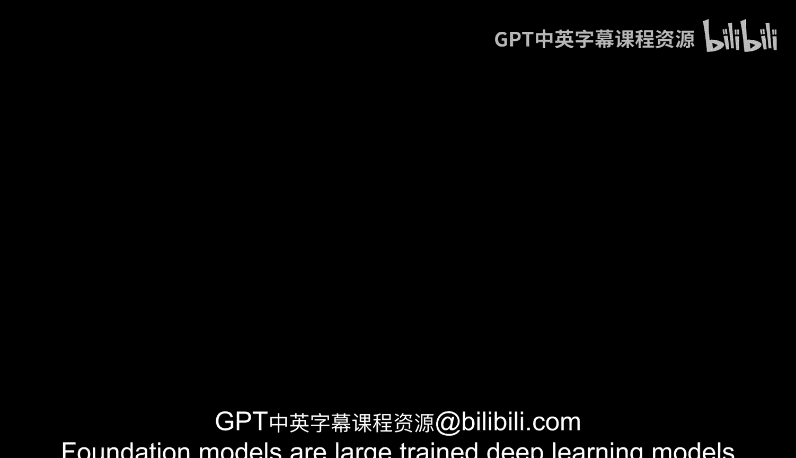
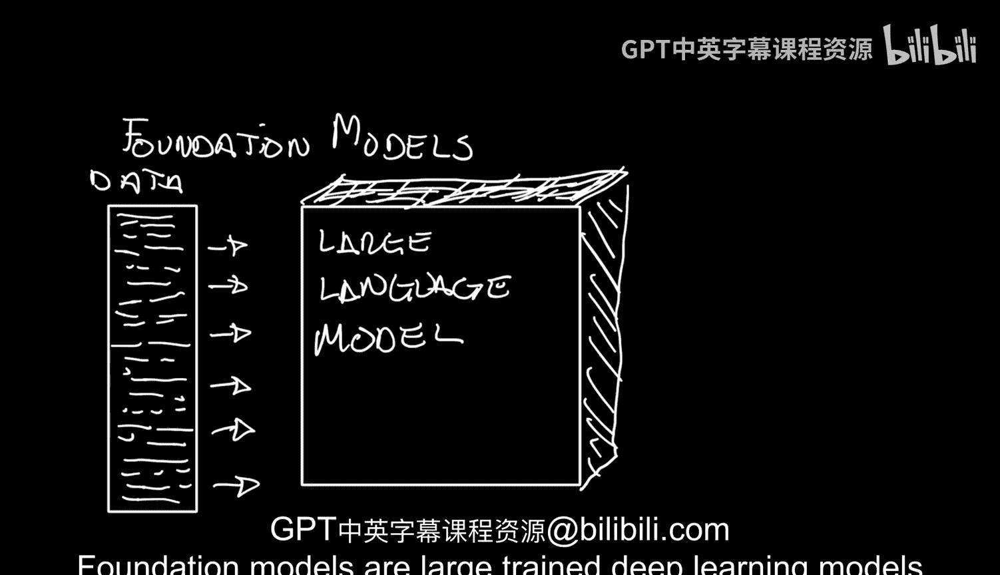
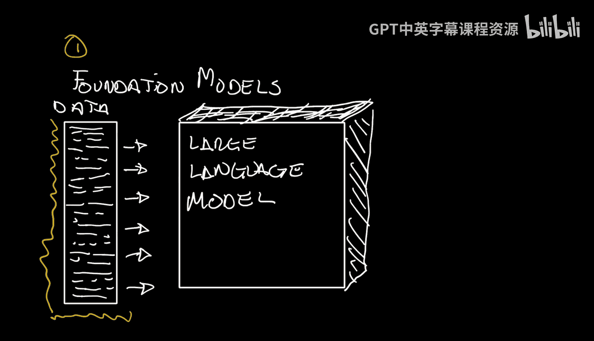
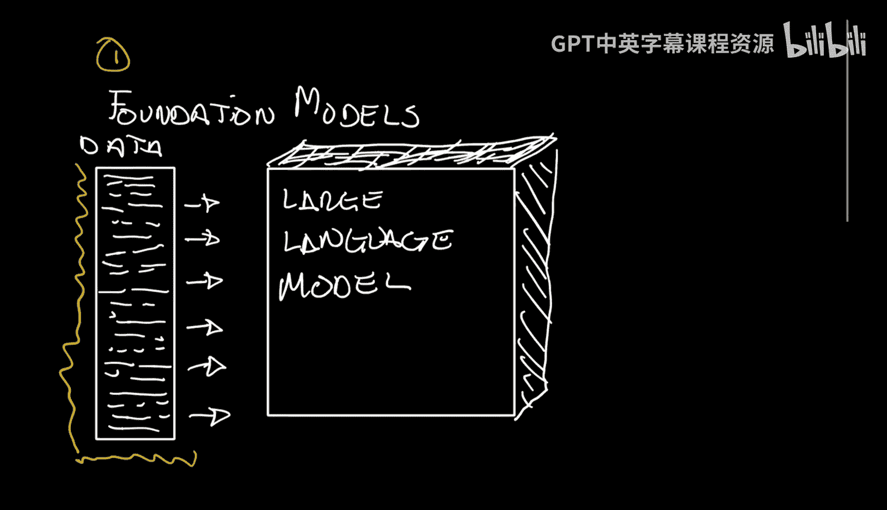
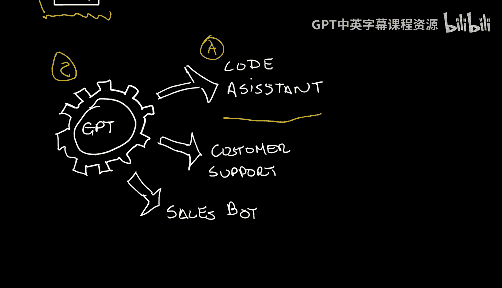
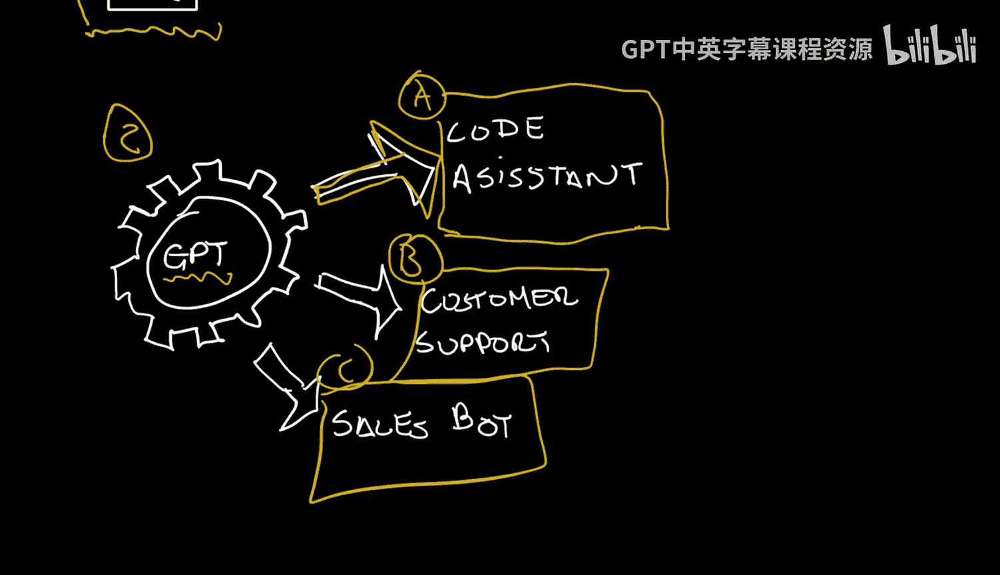
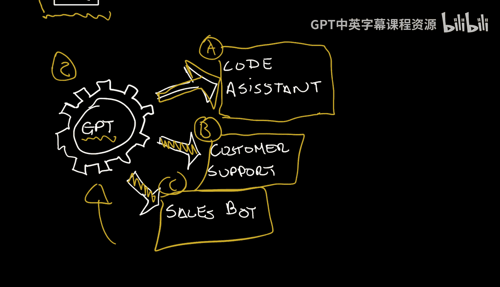
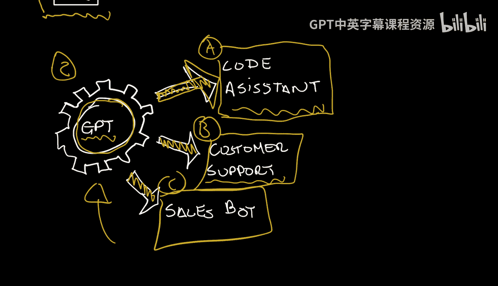
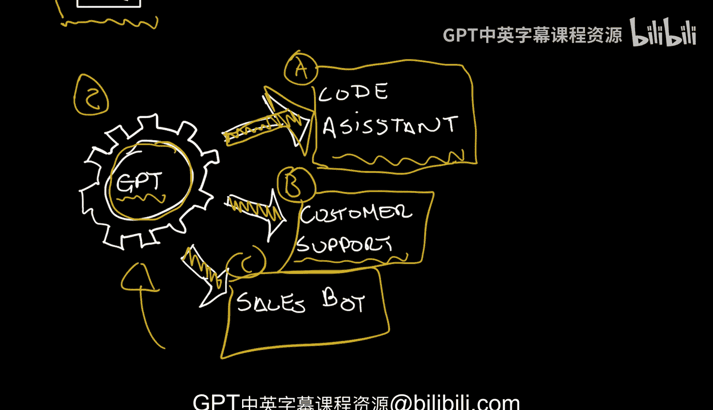

#  007：什么是基础模型 🧠

在本节课中，我们将要学习**基础模型**的核心概念。基础模型是现代人工智能应用的重要起点，理解它们是什么以及如何工作，是掌握大语言模型技术的关键。

## 概述

基础模型是经过大规模训练的大型深度学习模型，它们具备很强的适应性。这些模型最初是为自然语言处理任务而创建的，为构建基于人工智能的应用程序提供了一个坚实且强大的起点。

## 基础模型的核心特征

上一节我们介绍了基础模型的定义，本节中我们来看看它的几个关键特征。

基础模型的关键在于，它们基于海量的文本数据进行训练。数据量越大，模型的质量通常就越好。这些海量数据是创建大型语言模型的必要条件。

**公式表示**：`模型性能 ∝ 训练数据规模与质量`

## 基础模型作为起点

那么，基础模型如何成为一个“起点”呢？一旦模型具备了处理自然语言多个方面的能力，就可以将其重新调整用途，应用于其他类型的任务。

以下是基础模型可以适配的具体任务示例：

*   **代码助手**：开发人员、软件工程师、机器学习工程师和数据科学家正在使用代码助手。这些助手集成到开发环境中，基于大语言模型的文本生成能力，帮助开发者更轻松、更快速地编写代码。例如，GPT这样的基础模型可以作为起点，通过添加特定任务功能，将其转变为专用的代码助手。
*   **客户支持聊天机器人**：当你访问一个网站并遇到问题时，可能会与一个聊天机器人交互。它可以询问你的问题详情，并帮助你创建服务工单。这就是一个客户支持聊天机器人的例子。
*   **销售机器人**：销售机器人可以实现类似的功能，用于引导客户、回答产品问题或促进销售。

## 从基础模型到专用应用

需要明确的是，上述应用并非直接基于原始的基础模型。一个不好的例子是，应用程序直接与未经任何处理的基础模型对话，而不进行任何过滤或指令调整。

为了实现代码助手或客户支持等具体用例，必须在基础模型和手头任务之间进行一系列处理和调整。

这个过程主要包括：
*   **指令过滤与处理**：通过特定的指令来引导模型，使其输出更符合特定场景的要求。
*   **微调**：在基础模型之上，使用特定领域的新数据（例如海量的现有代码）对模型进行额外的训练，使其适应特定任务。

**核心流程**：`基础模型 (理解NLP) + 任务特定数据与指令 → 微调 → 专用应用模型`

## 总结

本节课中我们一起学习了基础模型。基础模型指的是那些允许其他更具体任务（如代码助手、客户支持和销售机器人）得以实现的基础模型。它们的特点是规模大、基于海量数据训练，并且可以通过**指令调整**和**微调**等技术，被重新调整用途以适应多样化的下游应用。