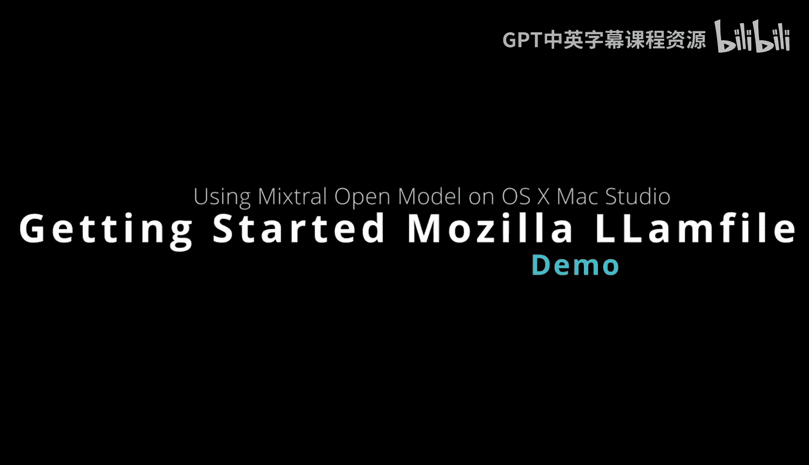
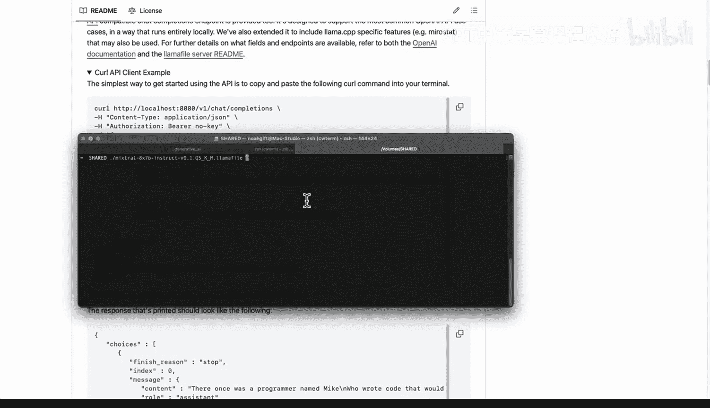
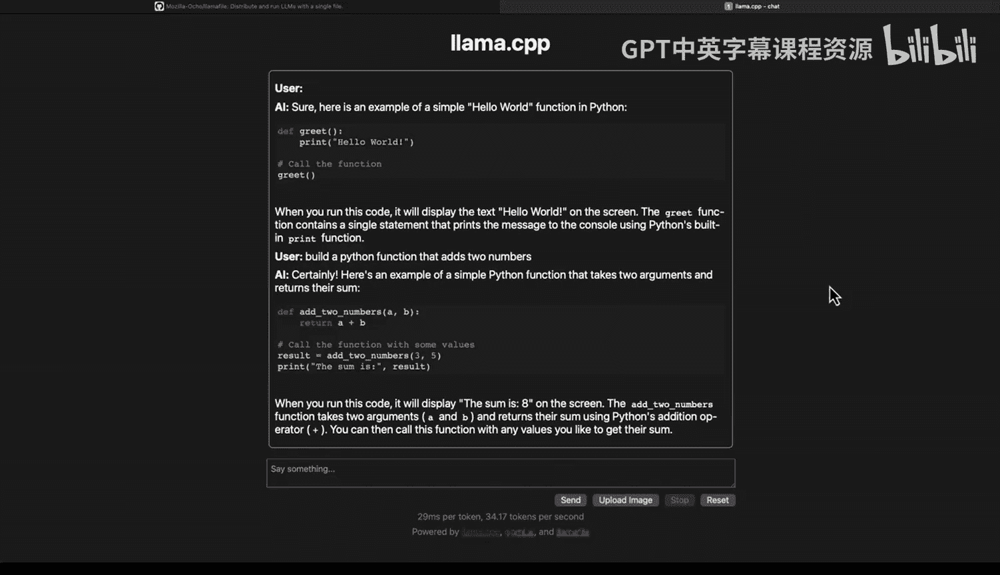
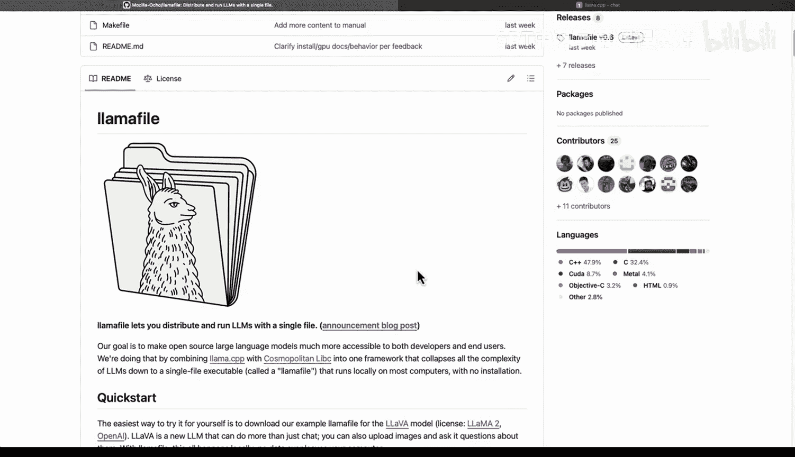

#  009：开始使用Llamafile 🚀

在本节课中，我们将要学习如何使用Mozilla的Llamafile项目，这是运行本地大语言模型最简单的方法之一。我们将了解其项目结构、核心优势以及如何实际操作。

---

## 项目概述与优势

许多人希望在本机运行大语言模型，主要出于隐私考虑，并且它是免费的。使用自己的机器，你可以直接深入探索Llamafile。

上一节我们介绍了本地运行模型的动机，本节中我们来看看Llamafile的具体实现。

Llamafile允许你通过单个文件分发和运行大语言模型。其最吸引人的特点是使用了**Cosmopolitan Libc**库，这使它能够将所有内容压缩成一个名为`llamafile`的单一可执行文件。

尽管项目名为Llamafile，但它并不局限于任何特定的大语言模型。

---

## 模型选择与获取

以下是Llamafile支持的一些模型示例：

*   **Lava**：一个能够读取图像的模型，是一个非常酷的项目。
*   **Mistral**：这是性能较好的开源模型之一，采用Apache2许可证。需要注意的是，它是一个约30GB的大文件。

获取模型后，你只需要下载它，然后运行`./run`命令即可。

---

## 接口与使用方式

Llamafile的一个很酷的特性是，它提供了一个模仿OpenAI API的Python API。这意味着你可以使用这个API，从封闭的商业专有模型轻松迁移或升级到开源模型。

此外，你也可以使用命令行接口。以下是可用的命令行指令示例。

这是一个非常有趣的项目，接下来让我们看看它是如何工作的。

---

## 实际操作演示

我将打开我的终端。可以看到，我已经下载好了Mistral模型。运行它非常简单，只需执行相应的命令。

现在，我们看到Llama.cpp正在本地运行。如果我想重置到某种默认状态，我可以执行重置操作，这将重置所有默认设置。

接下来，我将把机器人的名称改为“AI”。然后，我会让它执行一个任务。让我们尝试一个Python的“Hello, World”程序。我会输入：“Python Hello, World函数。展示给我看。”

然后点击发送。它将使用我Mac的GPU来获得非常快速的响应。

---

## 性能与优势总结

关于Mistral模型的一些指标显示，它的性能与封闭的专有模型不相上下。从响应来看，效果相当不错。如果需要，我可以继续让它执行更多功能，例如编写一个将两个数字相加的Python函数。

本节课中我们一起学习了运行本地大语言模型的核心要点。使用Llamafile的主要优势总结如下：

1.  **隐私性**：你的数据不会被发送到你不了解其数据政策的公司。
2.  **性能更佳**：由于延迟更低，调用本地API的性能通常优于调用外部API。
3.  **完全免费**：使用自己的硬件运行，没有额外费用。

因此，探索Llamafile项目具有显著的优势。建议你亲自查看这个项目，并分享你的使用体验。