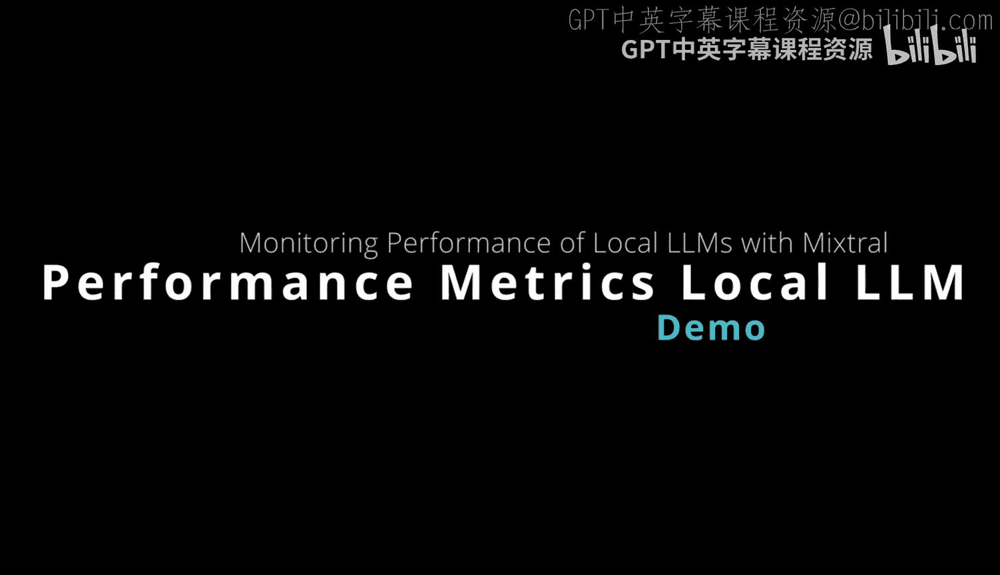
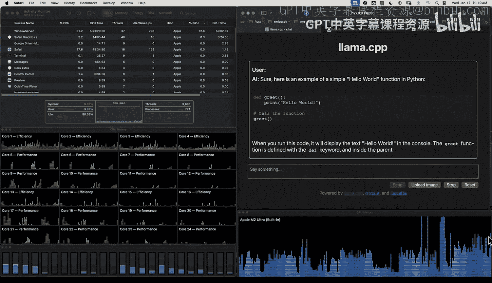

**本地大语言模型的基础：10：本地系统指标与Llamafile 🖥️📊**

在本节课中，我们将学习如何利用Llamafile来监控运行本地大语言模型时的系统指标，并评估其性能表现。

---

首先，我们可以从Elo评分角度来审视Llamafile的实际使用效果。下图展示了用户群体对该模型能力的感知评价。

可以看到，这个混合模型的表现与商业模型相差无几。这表明，只要本地模型的性能足够好，就会有大量用户有兴趣在本地运行它。那么，它的性能究竟如何呢？让我们进一步查看Llamafile项目。

上一节我们了解了模型的评价，本节中我们来看看其运行时的具体表现。我现在已经在网页浏览器窗口中运行了Llamafile，并且旁边实时显示着各项系统指标，让我们能够观察运行状态。

需要关注的指标包括：
*   **GPU时间**：这是一个关键指标。
*   **所有核心的使用情况**。
*   **M2 Ultra GPU**：我使用的这款芯片拥有60个GPU核心。得益于Llamafile和Llama.cpp开发者的出色工作，在Mac操作系统上，它能够充分利用所有这些GPU核心。

接下来，让我们通过实际操作来观察这些指标。如果我向下滚动并执行一个Python函数，看看GPU会有何反应。

我们会看到，GPU使用率确实会在这里出现峰值。同时，我们也应该能看到一些GPU活动。

实际上，我们可以看到这个`.a1.9`进程正在调用GPU。我们再次运行它，可以尝试另一个请求，例如：“给我一个Python中递归函数的例子。”

然后看看它做了什么。同样地，我们得到了一个Python递归函数，并且可以确认，它确实使用了GPU。由此可见，其性能实际上非常出色，并且能够有效利用历史GPU资源。

因此，对于目前使用商业模型的用户来说，虽然商业模型有其价值，但这无疑提出了一个长期问题：如果你可以下载一个性能足够好、表现惊人且完全免费的模型，那么长期来看，为什么还要使用商业模型呢？

在你尝试Llamafile，甚至考虑为大型语言模型签订商业协议之前，首先应该审视本地模型的真实性能。查看其运行指标后，你会发现它令人印象深刻。

---

**总结**

本节课中，我们一起学习了如何通过Llamafile监控系统指标（如GPU利用率）来评估本地大语言模型的运行性能。我们看到，当前的本地模型在性能上已接近商业模型，且能高效利用硬件资源（如M2 Ultra的所有GPU核心）。这促使我们思考，在本地模型性能足够强大且免费的情况下，长期依赖商业模型的必要性。