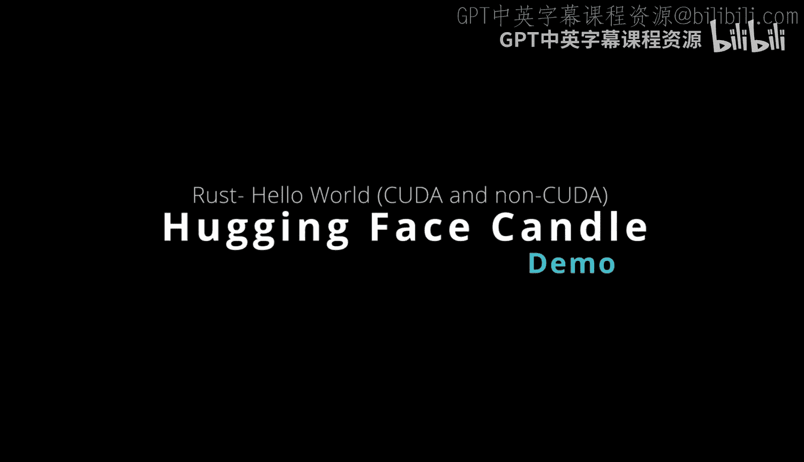
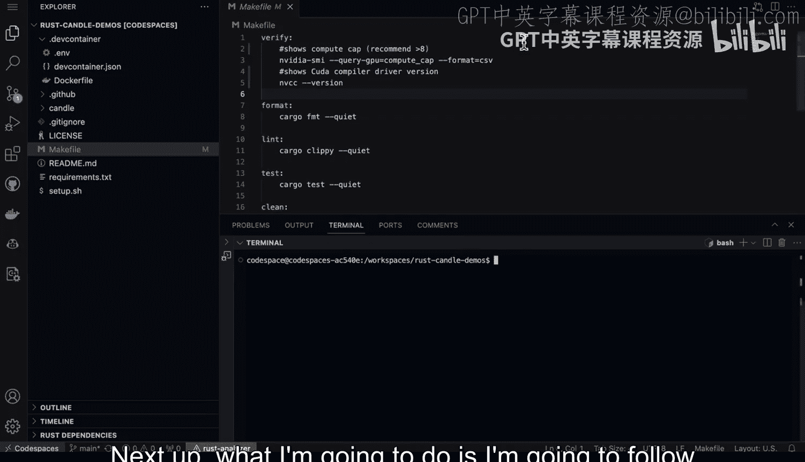
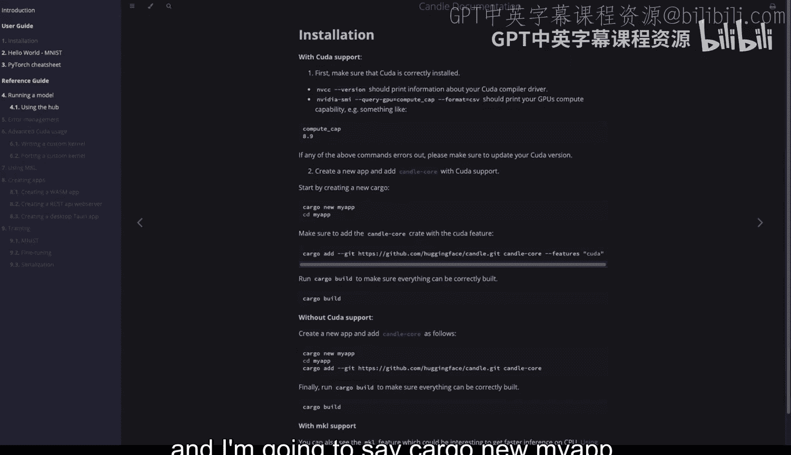
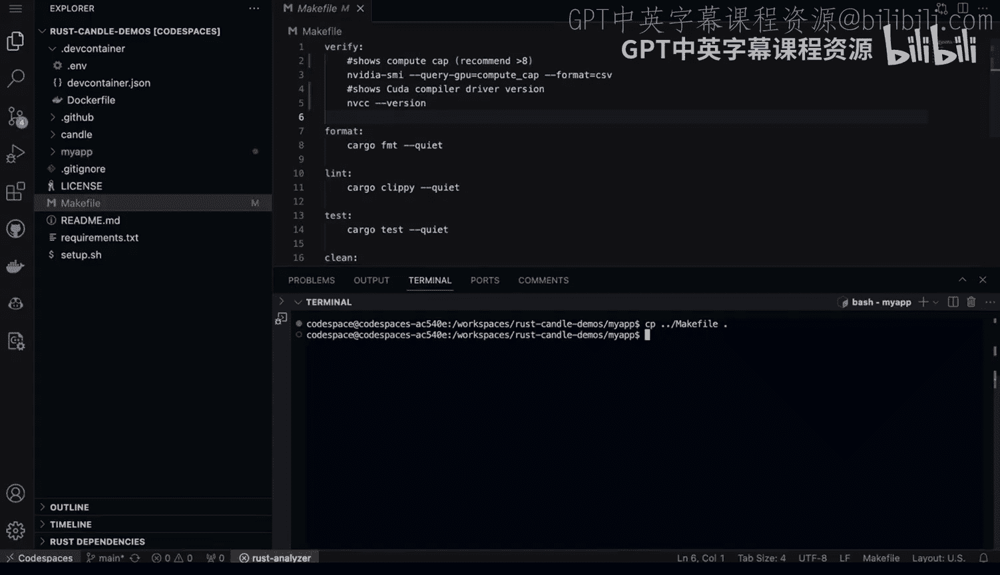
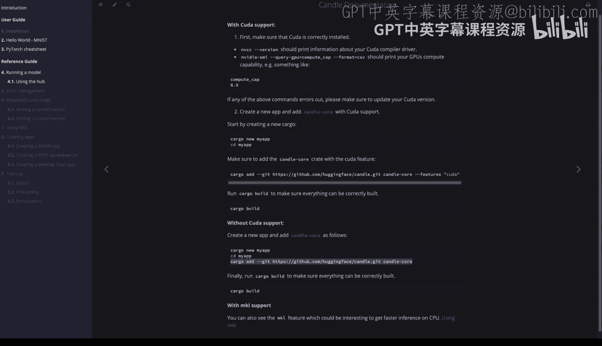
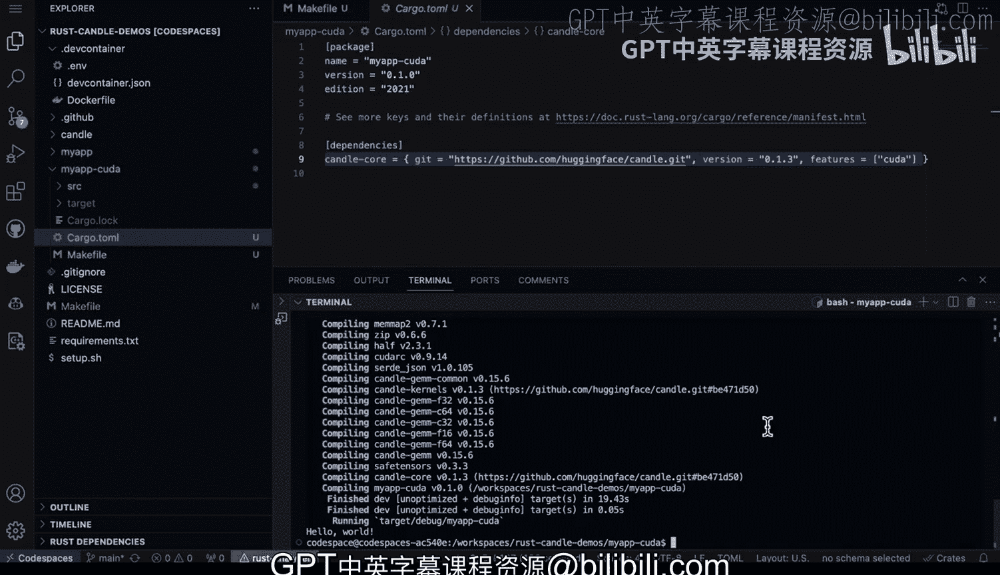

#  011：Candle框架的Hello World示例 🕯️



在本节课中，我们将学习如何设置一个基础的Rust开发环境，并使用Candle框架创建一个简单的“Hello World”项目。我们将涵盖从环境验证到项目构建的完整流程，包括如何添加GPU（CUDA）支持。

---

## 环境准备与验证

首先，我们需要确保开发环境已正确设置，特别是支持基于GPU的开发。以下步骤用于验证环境。

以下是环境检查命令：

*   **`R C digest version`**：此命令检查Rust的`digest`包版本，确认Rust环境已安装。
*   **`make verify`**：此命令执行验证脚本，显示计算能力并确认CUDA编译器驱动已就绪。

完成环境验证后，我们就可以开始创建项目了。

---

## 创建基础Rust项目

上一节我们验证了基础环境，本节中我们来看看如何初始化一个新的Rust项目。

我们将遵循Hugging Face Rust Candle的文档指引。首先，使用Cargo（Rust的包管理器）创建一个新项目。

**代码：创建项目**
```bash
cargo new my_app
```



项目创建成功后，进入项目目录。
```bash
cd my_app
```





为了便于使用快捷命令，可以将一个预设的`Makefile`复制到当前项目中。这样，我们就可以使用`make build`等命令来简化构建流程。

复制完成后，执行`cargo build`命令来构建项目，确保一切就绪。

---

## 添加Candle依赖并构建



现在，我们有了一个基本的Rust项目结构。接下来，需要将Candle框架添加为项目依赖。

使用`cargo add`命令可以方便地添加依赖。执行以下命令：
```bash
cargo add candle-core
```

此命令会自动更新项目的`Cargo.toml`配置文件，添加`candle-core`库。

添加依赖后，查看项目源代码。初始的`main.rs`文件仅包含一个简单的“Hello, world!”打印语句。这主要用于验证安装和构建流程。

为了构建项目，我们可以使用之前引入的`Makefile`。执行构建命令：
```bash
make build
```
或者直接使用Cargo命令：
```bash
cargo build
```

构建成功后，运行程序以验证所有组件工作正常：
```bash
cargo run
```
如果终端成功打印出“Hello, world!”，则表明基础安装和构建成功。

---

## 创建支持CUDA的项目

上一节我们创建了一个基础项目，本节中我们来看看如何创建一个支持GPU加速的版本。步骤与之前类似，但需要额外启用CUDA特性。

首先，创建一个新的项目。
```bash
cargo new my_app_cuda
cd my_app_cuda
```

同样，将`Makefile`复制到新项目中，为开发提供便利的脚手架。

此时，与基础项目唯一的区别是需要为`candle-core`依赖添加`cuda`特性。这可以通过`cargo add`命令的`--features`参数实现。

**代码：添加支持CUDA的Candle依赖**
```bash
cargo add candle-core --features cuda
```

执行此命令后，查看`Cargo.toml`文件，可以看到依赖已更新为`candle-core = { version = “…”, features = [“cuda”] }`。

现在，我们可以构建并运行这个支持CUDA的项目，以验证CUDA环境是否配置正确。
```bash
cargo build && cargo run
```
如果程序能够成功构建并运行，则说明CUDA支持已成功集成。

---

## 总结



本节课中，我们一起学习了使用Candle框架的入门步骤。我们从验证Rust和CUDA开发环境开始，然后创建了一个基础的Rust项目并添加了Candle依赖。通过构建和运行“Hello World”程序，我们确认了基础环境工作正常。最后，我们创建了另一个项目，并通过添加`cuda`特性为其启用了GPU加速支持，验证了CUDA环境的可用性。现在，你已经拥有了一个可以开始进行本地大语言模型开发的起点环境。