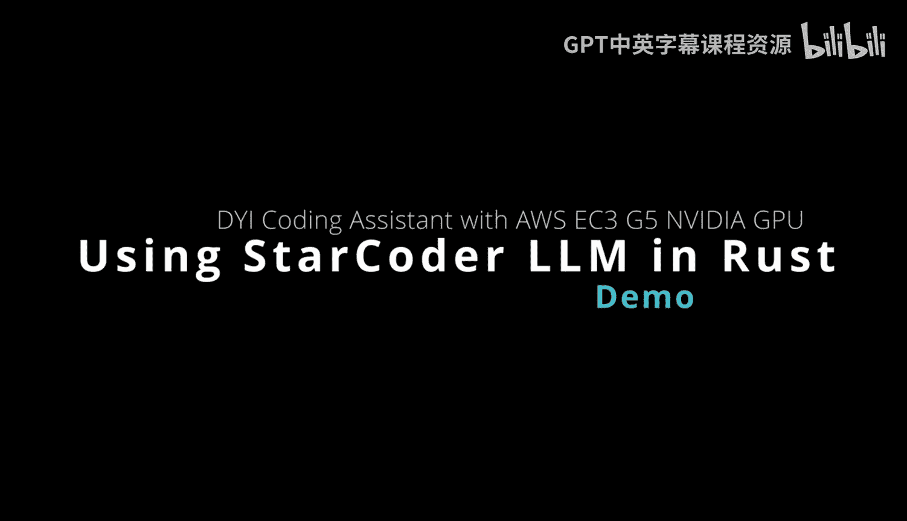
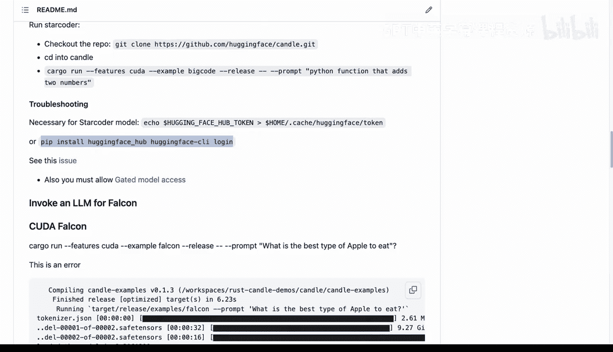
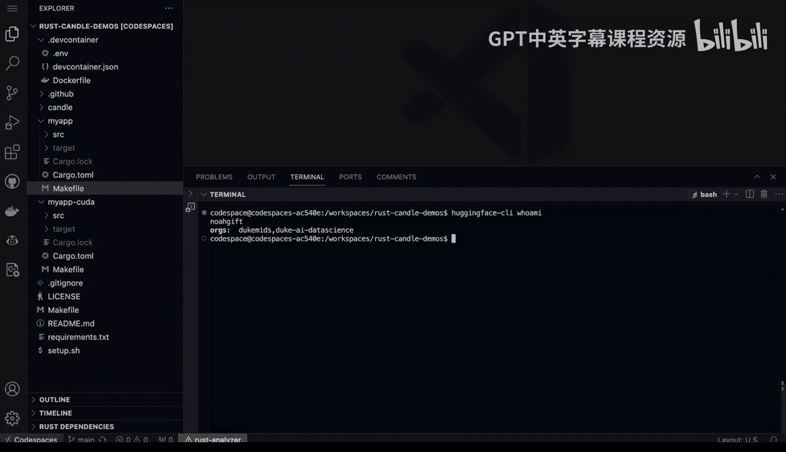
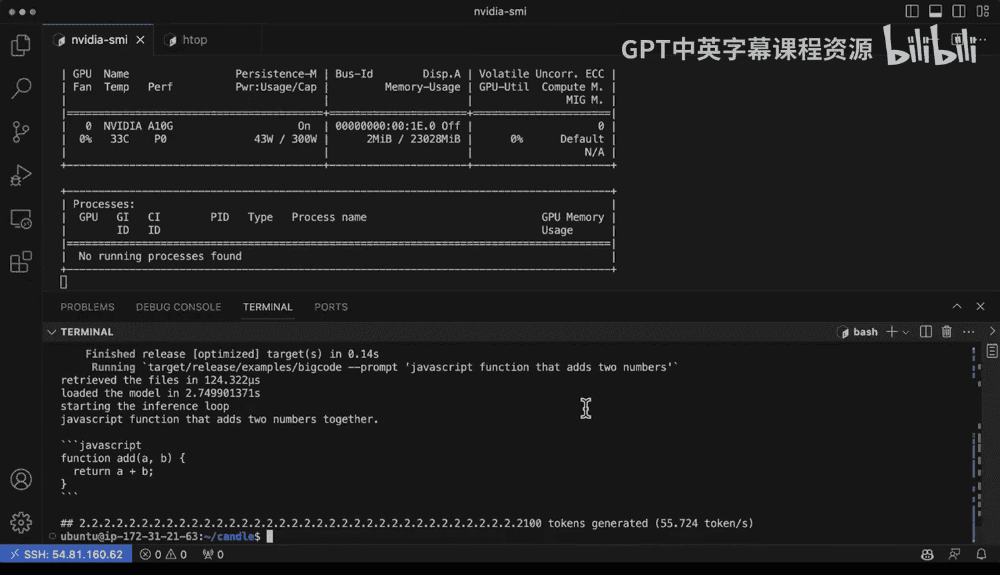

#  012：探索StarCoder的Rust实现 🚀



在本节课中，我们将要学习如何探索并使用一个名为StarCoder的开源代码生成大语言模型。我们将重点关注其基于Rust的实现，并演示如何在实际环境中运行它。

## 概述

StarCoder是Hugging Face推出的一个开源代码生成模型。它与其他生成式AI编码模型（例如GitHub Copilot）类似，但完全开源。该模型拥有**155亿**个参数，并在来自The Stack数据集的**80种**编程语言上进行了训练。其使命是通过发布数据、模型和实验，推动生成式AI革命的民主化，而不仅仅是将其掌握在风险投资家手中。

## StarCoder简介

上一节我们介绍了StarCoder的基本背景，本节中我们来看看它的一个具体实现版本。

这里我们看到的是Hugging Face的StarCoder模型，它比我最初想象的还要有趣。它是一个专门用于代码生成的LLM。一旦安装了初始的Hugging Face工具，身份验证过程就相当简单。

## 环境设置与验证

为了运行这个模型，我们需要一个合适的环境。以下是如何设置和验证环境的步骤。



首先，我们需要安装必要的工具并进行登录。在我的一个演示项目中，信息如下所示：

```bash
pip install huggingface_hub
huggingface-cli login
```

在我的Codespaces环境中，我可以看到这个操作的实际效果。输入`huggingface-cli whoami`后，显示我已经成功通过身份验证，可以使用这个项目了。



但是，由于我将要运行一个对GPU要求较高的任务，因此需要更强大的硬件。我将切换到一个运行着AWS新一代GPU（G5）的远程Visual Studio Code环境中。

在这个远程环境中，我们可以再次验证登录状态。输入`huggingface-cli whoami`，确认我已登录。

## 运行StarCoder模型

现在我们已经登录，接下来看看如何运行这个模型。这个环境的一个优点是，我可以打开第二个窗口来监控GPU的使用情况。

以下是运行模型的具体步骤：

1.  打开一个终端并运行`htop`命令，可以查看CPU核心的使用情况。这台机器拥有64个核心，性能强大。
2.  打开另一个终端，运行`nvidia-smi -l 1`命令，可以循环检查GPU的状态。
3.  准备好之后，就可以运行命令来测试模型了。

运行的核心命令是：
```bash
cargo run --features cuda --example bigcode -- --prompt "rust function that adds two numbers"
```

让我们逐步分析这个命令的含义：
*   `cargo run`是执行Rust项目的典型命令。
*   `--features cuda`表示使用已安装在此AWS深度学习基础AMI上的CUDA驱动程序。因为CUDA驱动程序是为神经网络优化的版本，使用它可以显著提升性能。如果我们想将其作为编码助手长期使用，那么采用最优化的方法是合理的。
*   `--example bigcode`指定运行Hugging Face项目中的`bigcode`示例。
*   `--prompt`后面是我们给模型的提示，例如“rust function that adds two numbers”。

执行这个命令后，你会看到GPU被触发，然后模型会给出一个关于如何用Rust编写两数相加函数的建议。

## 测试不同编程语言

模型加载完成后，我们可以轻松地测试它对不同编程语言的代码生成能力。

我们可以将提示词改为“Python function that adds two numbers”，模型会再次运行并给出Python版本的函数建议。

同样，我们也可以测试“Ruby function that adds two numbers”。如果我们想计时，可以看到它在微秒级别内检索了文件，在大约两秒钟内加载了模型，然后开始了推理循环。加载模型的时间似乎是这里的瓶颈，但这仍然不算太糟。

模型能够根据提示给出相当合理的建议。我们还可以继续测试其他语言，例如Java。

## 总结



本节课中我们一起学习了StarCoder开源代码生成模型及其基于Rust的实现。我们了解了它的背景、使命，并一步步演示了如何在配置了强大GPU的远程环境中设置身份验证、运行模型并测试其对不同编程语言的代码生成能力。对于希望拥有自己开源编码助手的研究者或开发者来说，借助Rust的性能和Hugging Face生态系统，这是一个非常有前景且直接可行的方案。