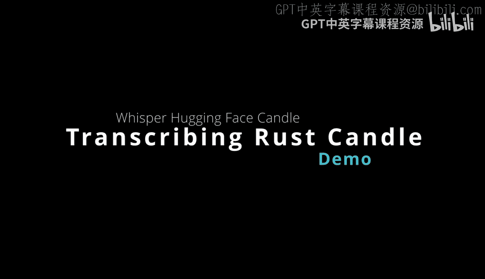
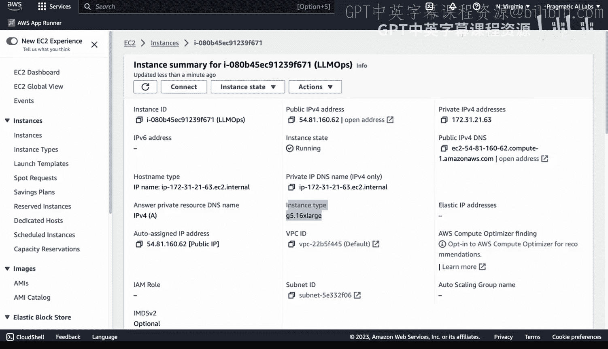
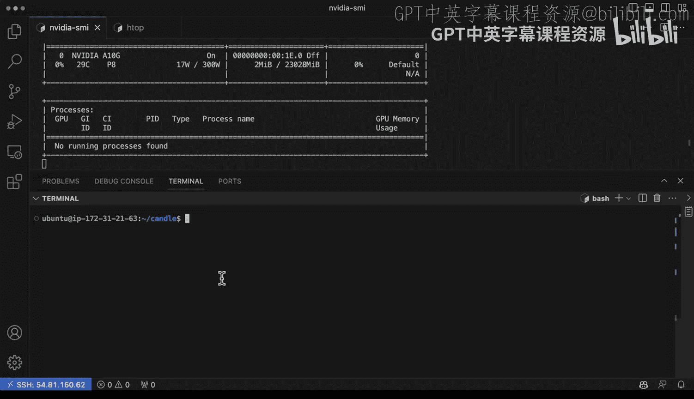
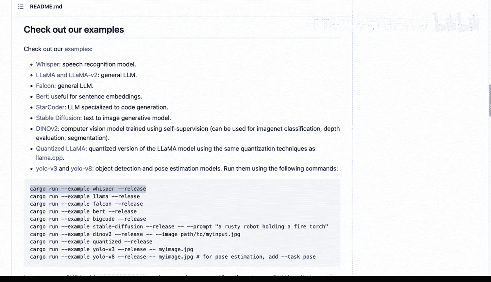
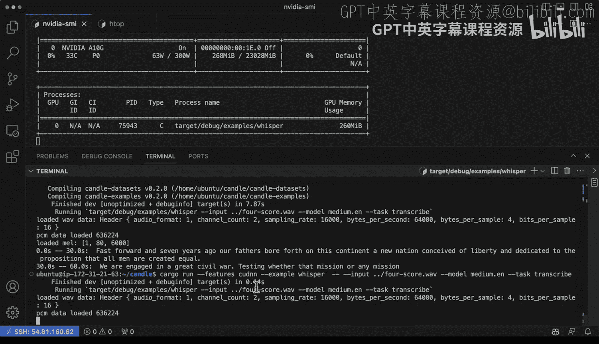

#  013：使用Whisper与Candle进行转录



## 概述
在本节课中，我们将学习如何使用Whisper模型与Candle框架进行自动语音识别。我们将从环境配置开始，逐步介绍如何运行示例代码，并最终使用自定义音频文件进行转录。

---

## 环境配置与GPU支持

上一节我们介绍了自动语音识别的概念，本节中我们来看看如何配置运行环境。

Candle是一个极简、高性能的框架，支持GPU加速。以下是使用Candle运行Whisper模型的基本步骤。

首先，建议使用配备较新NVIDIA GPU的EC2实例，例如G5实例类型。这些实例通常拥有强大的计算核心和快速的GPU。

通过Visual Studio Code的远程连接功能，可以方便地访问远程服务器。在终端中，可以使用 `nvidia-smi` 命令确认GPU状态。



## 运行Whisper示例

了解了环境配置后，我们来看看如何运行Whisper的示例代码。

Candle的代码库中提供了Whisper的示例。我们可以通过以下命令运行基础示例：

```bash
cargo run --example whisper
```





此命令会在CPU上运行，速度较快，并会自动下载一个示例音频文件进行转录。

## 启用GPU加速

虽然CPU运行速度尚可，但为了获得最佳性能，我们可以启用GPU加速。

Candle支持通过特性标志启用CUDA和cuDNN支持。cuDNN是针对神经网络操作的优化库。

以下是启用不同级别加速的命令：

```bash
# 启用CUDA支持
cargo run --example whisper --features cuda

# 启用CUDA和cuDNN支持
cargo run --example whisper --features cuda,cudnn
```

启用 `cudnn` 特性后，推理速度会更快，GPU利用率更高，是一种更高效的推理方式。

## 使用自定义音频文件进行转录

掌握了基础运行方法后，现在我们可以尝试使用自己的音频文件进行转录。

我们需要在命令中指定输入文件路径、模型大小和任务类型。以下是一个完整的命令示例：

```bash
cargo run --example whisper --release -- \
    --input ../four_score.wav \
    --model medium \
    --language en \
    --task transcribe
```

命令参数说明：
*   `--input`: 指定要转录的音频文件路径。
*   `--model`: 指定使用的Whisper模型大小，如 `tiny`, `base`, `small`, `medium`, `large`。
*   `--language`: 指定音频语言。
*   `--task`: 指定任务类型，`transcribe` 为转录，`translate` 为翻译。

在CPU上运行此命令可能会比较慢。为了提升速度，我们可以结合之前提到的GPU加速特性重新运行：

```bash
cargo run --example whisper --features cuda,cudnn --release -- \
    --input ../four_score.wav \
    --model medium \
    --language en \
    --task transcribe
```

启用GPU后，可以看到GPU利用率显著上升（例如达到70%），推理速度大幅加快。这种方法非常适合需要处理大量音频转录任务的场景，例如利用AWS Batch等服务构建数据处理系统。



## 总结
本节课中我们一起学习了使用Whisper模型和Candle框架进行自动语音识别的完整流程。我们从环境配置开始，学习了如何运行基础示例，接着探索了通过启用CUDA和cuDNN特性来利用GPU加速，最后实践了如何使用自定义音频文件和特定参数进行转录。这套工具组合为高效、本地化的语音转文字任务提供了强大的解决方案。