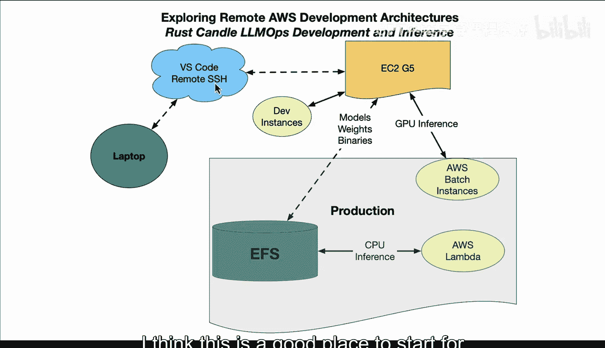

#  014：探索AWS远程开发工作流 🚀

在本节课中，我们将学习如何利用AWS云服务构建一个基于Rust和Hugging Face Candle库的异步开发与生产工作流。这个架构旨在高效、低成本地进行大语言模型的推理。

## 开发环境配置 💻

上一节我们介绍了本地开发的基础，本节中我们来看看如何利用云端强大的计算资源进行开发。

首先，你需要一个**EC2 G5实例**。这个实例的优势在于它拥有执行现代GPU推理任务的能力。为了节省成本，你还可以使用**Spot实例**。在开发阶段，你可以随时停止和启动这个实例。

你可以通过**Visual Studio Code Remote**插件连接到这个云端实例，这是一种非常高效的开发方式。只需安装插件，你的笔记本电脑就能无缝访问云端强大的计算环境。

这意味着，你可以在一个基于云的、功能强大的环境中开始编写代码，并且只需按使用量付费，而无需购买昂贵的硬件（例如一块价值4万美元的GPU）。

## 生产环境部署 🏗️

在配置好开发环境后，接下来我们看看如何将其部署到生产环境。

这里有一个有趣的方案：你可以结合使用**EFS（Elastic File System）**进行协同开发。EFS的挂载点可以设置在开发机器上，但**同一个挂载点也可以用于生产环境**。

以下是利用EFS的关键步骤：
*   你可以将庞大的模型和权重文件（数据量可能达到数十GB）下载到EFS中。
*   这个EFS存储位置可以作为贯穿开发到生产阶段的数据暂存区。
*   当你向**AWS Batch**部署任务时，Batch服务可以自动配置EC2 G5实例。
*   这些实例能够以高效、优雅且低成本的方式，使用强大的GPU执行基于Rust的现代推理任务。

因此，你不需要依赖Notebook或Python，可以纯粹使用Rust来完成所有工作。

## 架构扩展思路 💡

此外，还有一个值得考虑的扩展思路。

如果你的代码编译时也**兼容CPU目标架构**，那么**AWS Lambda**函数可以直接从EFS读取编译好的二进制文件，并同样能够对外提供生产级别的推理服务。

这为LLM Ops和MLOps领域展现了一个非常令人兴奋的、新兴的Rust技术栈故事。它意味着你可以更开放地尝试新事物、新想法，并持续追求效率。

对于许多希望部署大语言模型服务的公司而言，本节介绍的这种特定架构是一个很好的起点。

## 总结 📝

本节课中我们一起学习了如何构建一个基于AWS的远程开发与部署工作流。我们了解了使用EC2 G5实例进行开发、通过EFS共享模型数据、利用AWS Batch部署GPU推理任务，以及扩展至AWS Lambda的可能性。这套架构结合了Rust的性能优势与AWS云的弹性，为实现高效、低成本的大语言模型服务提供了坚实基础。