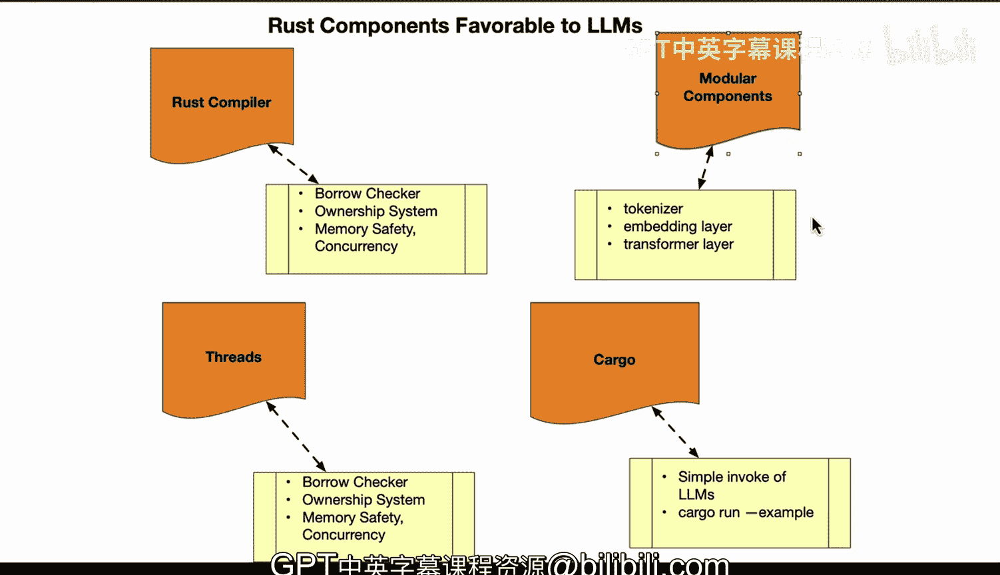

#  015：Rust在LLM中的应用 🦀


在本节课中，我们将探讨Rust编程语言在构建和部署大型语言模型（LLM）中的关键优势与应用。我们将逐一分析Rust的各个组件如何为LLM的开发带来安全性、性能与模块化。

## 概述

Rust的诸多特性使其非常适合用于大型语言模型。接下来，我们将逐步讨论这些特定的组件。

## Rust编译器的核心优势

上一节我们提到了Rust的整体优势，本节中我们来看看其编译器的具体特性。

在Rust编译器中，借用检查器（Borrow Checker）能够防止数据竞争和不安全的内存访问错误。其所有权系统（Ownership System）能在对象离开作用域时自动释放内存，因此无需手动管理内存。同时，编译时检查（Compile-time Checks）能在代码部署前发现错误，确保你的大型语言模型部署在模块化组件层面非常健壮。

## LLM的模块化组件设计

了解了编译器的基础保障后，我们来看看如何利用Rust的特性构建LLM的核心模块。

以下是LLM中关键的模块化组件及其在Rust中的实现方式：

*   **分词器（Tokenizer）**：将文本转换为用于词嵌入（Word Embeddings）的数值ID。
*   **嵌入层（Embedding Layer）**：将词语映射到高维密集向量。其核心操作可表示为：`embedding_vector = lookup(word_id)`。
*   **变换层（Transform Layer）**：使用神经网络模型（如Transformer）处理文本。这种模块化设计允许利用Rust的Trait来混合和匹配特定的组件。

## 并发与性能

模块化设计解决了结构问题，而高性能LLM还需要充分利用硬件资源。接下来我们看看Rust如何实现高效的并发。

轻量级的Rust线程（Lightweight Threads）允许并发与并行执行。通道（Channels）可以安全地在线程间传递数据，没有数据竞争的风险。这使得能够利用多核CPU来提升性能和可扩展性。

## Cargo包管理器与生态系统

要实现上述所有功能，离不开强大的工具链支持。本节将介绍Rust的包管理器Cargo。

Cargo是Rust内置的包管理器，它将管理应用程序的依赖关系。其庞大的生态系统提供了丰富的包，允许你扩展功能，例如构建命令行工具或Web框架。你也可以轻松地在项目和团队之间共享代码，并且它通过语义化版本控制（Semantic Versioning）来确保稳定性。

因此，这是调用大型语言模型的一种简便方法，我们在Rust Candle框架中可以看到这一点。你只需要执行：
```bash
cargo run --example
```



## 总结


本节课中，我们一起学习了Rust在大型语言模型中的应用。我们从其编译器提供的内存安全和早期错误检查开始，探讨了如何利用Rust的模块化特性构建LLM的核心组件（分词器、嵌入层、变换层）。接着，我们了解了Rust的轻量级线程和通道如何安全地实现并发以提升性能。最后，我们介绍了Cargo包管理器及其生态系统如何简化依赖管理和项目开发。这些特性共同使Rust成为部署健壮、高效LLM的一个有力选择。