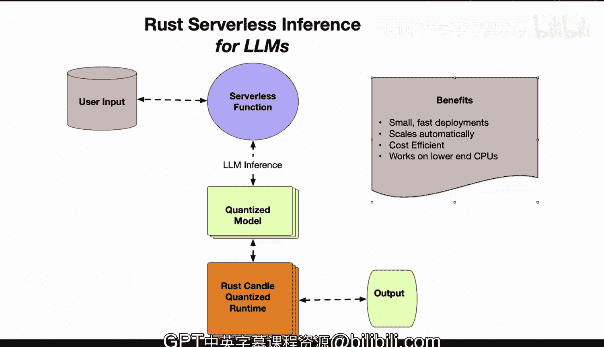

#  016：无服务器推理 🚀

在本节课中，我们将学习如何为大型语言模型（LLM）构建无服务器推理架构。我们将探讨其核心优势、工作原理以及如何利用量化技术实现高效、低成本的部署。

## 概述

无服务器推理为大型语言模型的部署带来了革命性的变化。它结合了量化模型和自动伸缩的云函数，旨在实现高可扩展性、成本效益和快速响应。

## 无服务器推理架构解析

上一节我们介绍了无服务器推理的概念，本节中我们来看看其具体的架构组成。下图展示了一个典型的无服务器推理流程：

以下是该架构的核心组成部分：

1.  **用户输入**：输入可以是文本、图像或其他形式的数据。
2.  **无服务器函数**：例如 AWS Lambda。该函数包含模型本身以及用于运行量化模型的 **Rust Candle** 运行时。
3.  **量化模型**：模型经过量化处理，使用低精度整数数据类型（如 `int8`）替代 32 位浮点数（`float32`）。这能使模型体积**缩小高达 4 倍**。
4.  **优化运行时**：Candle 运行时（类似 Llama.cpp）提供了专门优化的操作，以高效运行量化模型。
5.  **自动伸缩**：无服务器函数可根据流量自动伸缩，处理任意规模的请求，确保快速响应。当无请求时，函数实例会缩容至 0。
6.  **输出**：处理结果被快速返回给用户。

## 核心优势与特点

了解了架构之后，我们来看看这种方案带来的主要好处。

*   **成本效益**：模型体积小，且无闲置资源，使得部署非常经济。计费基于函数调用次数，而非持续运行的昂贵 GPU 实例。
*   **高性能**：量化后的整数模型运行速度更快，即使在低端或移动 CPU 上也能表现良好，这为许多新兴应用场景打开了大门。
*   **可扩展性**：架构自动伸缩以处理任何流量，同时通过就近部署最小化延迟。
*   **易于部署**：该架构使你能够将先进的机器学习模型以高效、经济的方式大规模部署到生产环境中。

## 总结

本节课中我们一起学习了大型语言模型的无服务器推理架构。我们了解到，通过结合**量化技术**（使用 `int8` 而非 `float32`）和**无服务器计算**（如 AWS Lambda），可以实现高性价比、可扩展且快速响应的模型部署方案，从而无需为许多模型配备昂贵的 GPU。