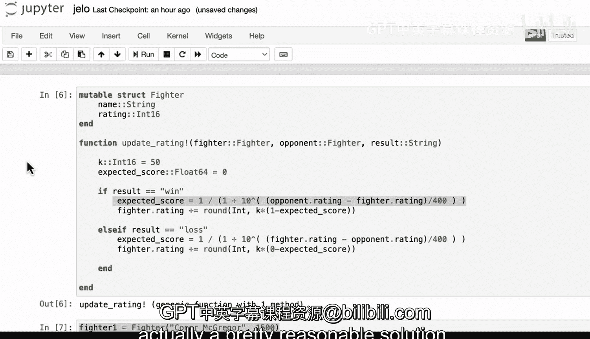

#  025：用Julia实现ELO评分系统 🏆


在本节课中，我们将学习如何使用Julia编程语言来实现一个ELO评分系统。我们将通过模拟两位UFC（终极格斗冠军赛）选手的比赛来演示如何计算和更新他们的评分。课程将涵盖Julia的基本数据结构、函数定义以及ELO算法的核心计算步骤。

## 概述

ELO评分系统是一种用于评估选手相对技能水平的方法，广泛应用于棋类、电子竞技和体育比赛。本节我们将用Julia语言编写代码，模拟两位UFC选手的比赛，并根据比赛结果动态更新他们的ELO评分。

## 定义选手结构体

首先，我们需要定义一个数据结构来存储选手的信息。在Julia中，我们可以使用`struct`来创建自定义类型。

以下是我们定义的`Fighter`结构体：

```julia
mutable struct Fighter
    name::String
    rating::Float64
end
```

这个结构体包含两个字段：`name`（选手姓名）和`rating`（ELO评分）。关键字`mutable`允许我们在后续修改`rating`的值。这是Julia语言一个精妙的安全特性，也是许多现代编程语言共有的特点。即使在脚本语言中，它也能提供这种安全保障。

## 实现评分更新函数

上一节我们定义了选手的数据结构，本节中我们来看看如何根据比赛结果更新选手的评分。我们将创建一个名为`update_rating`的函数。

以下是`update_rating`函数的定义：

```julia
function update_rating(fighter::Fighter, opponent::Fighter, result::String)::String
    K = 50
    expected_score = 1 / (1 + 10^((opponent.rating - fighter.rating) / 400))
    fighter.rating = fighter.rating + K * (parse(Int, result) - expected_score)
    return "Rating updated for $(fighter.name)"
end
```

这个函数接收三个参数：一个`Fighter`类型的选手、一个`Fighter`类型的对手，以及一个表示结果的字符串。函数内部定义了ELO计算的关键参数`K`（通常为常数），并计算了预期得分。最后，它根据实际结果更新选手的评分，并返回一个确认信息。函数签名中指定了参数和返回值的类型，这使代码意图更清晰。

## 模拟比赛与评分更新

理解了如何更新评分后，现在我们可以创建选手实例并模拟一场比赛，观察他们的ELO评分如何变化。

以下是模拟比赛的步骤：

1.  **初始化选手**：在比赛开始前，为每位选手分配一个默认的初始评分。
2.  **执行ELO计算**：调用`update_rating`函数，根据比赛结果更新评分。ELO系统通过衡量对手的竞争水平来评估选手的能力。
3.  **观察评分变化**：比赛结束后，胜者的ELO评分会上升，败者的评分会下降。

例如，假设选手Conor McGregor和Khabib Nurmagomedov在赛前拥有相同的评分。经过一场比赛后，根据ELO计算，胜者Khabib的评分会升高，而败者Conor的评分会降低。

## Julia语言的优势

通过这个简单的例子，我们可以看到Julia语言在数据科学领域的精妙之处。它融合了许多现代编程语言的特性：

*   **可变与不可变结构**：默认情况下，结构是不可变的，这提供了内置的安全机制。当需要修改时，可以使用`mutable`关键字。
*   **类型系统**：支持类型注解，使代码更健壮、更易理解。
*   **清晰的语法**：语言设计简洁，如上例中的函数，逻辑一目了然。

因此，在构建数据科学解决方案时，在Jupyter笔记本中使用Julia是一个非常合理的选择。

## 总结



本节课中我们一起学习了如何使用Julia实现一个基础的ELO评分系统。我们从定义存储选手信息的`mutable struct`开始，然后实现了包含ELO核心公式的`update_rating`函数，最后模拟了比赛过程并观察了评分的动态更新。这个过程展示了Julia语言在类型安全、代码清晰度和功能性方面的优势，使其成为执行此类计算任务的合适工具。