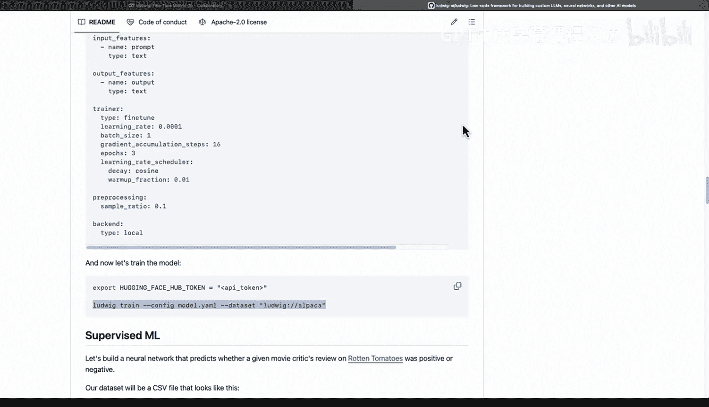
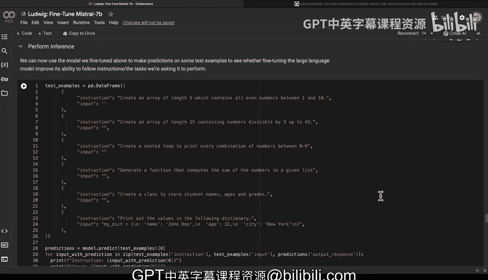

#  027：使用Ludwig微调Mistral-7B模型 🚀


在本节课中，我们将要学习如何使用Ludwig这一低代码框架来微调Mistral-7B大语言模型。我们将了解其基于YAML配置文件的简洁工作流程，并演示如何在Colab Pro环境中执行微调任务。

---

## 认识Ludwig：一个低代码微调工具 🛠️

许多人对训练大语言模型并深入了解其生态系统非常感兴趣。Ludwig是一个很好的选择，因为它是一个低代码框架。

上一节我们介绍了微调的基本概念，本节中我们来看看Ludwig如何简化这一过程。

Ludwig的核心特点是使用配置文件来定义任务，这深受许多开发者喜爱。它提供了入门指南，例如针对当前热门的开源大语言模型Mistral的微调教程。其基于YAML的方法非常直观，并且支持通过命令行进行训练，这使得它具备类似DevOps工作流的特性，能够通过一个YAML文件来简化整个流程。

---



## 在Colab Pro中设置环境 💻

为了进行微调，我们需要一个强大的计算环境。Colab Pro是一个很好的选择，因为它提供了GPU访问。

以下是设置Colab Pro运行时的关键步骤：

*   **选择运行时类型**：在“运行时”菜单中，可以选择不同的GPU类型以适应特定用例。
*   **检查资源**：可以确认运行时拥有充足的内存（RAM）和磁盘空间。
*   **获取更高算力**：如果需要，可以升级到更高规格的GPU（如A100）以获得更强的计算能力。

---

## 代码生成微调实战 📝

这个特定笔记本的目标是使用大语言模型进行代码生成。数据集中包含英语指令和对应的代码。

以下是微调任务的核心配置和工作流程：

首先，需要加载代码生成数据。微调的本质是让一个已经表现不错的模型，通过混合一些自定义代码和数据，从而变得更好。

具体流程如下：
1.  **准备数据集**：数据集中包含“指令”、“输入”和“输出”字段。
2.  **定义模型**：在YAML配置文件中指定基础模型（例如`mistralai/Mistral-7B-v0.1`）。
3.  **配置任务**：在YAML中定义输入和输出。

```yaml
model_type: llm
base_model: mistralai/Mistral-7B-v0.1

input_features:
  - name: instruction
    type: text

output_features:
  - name: output
    type: text
```

接下来，会进行一些标准的数据处理。然后，微调过程正式开始。

在微调执行期间，你可以看到实时的输出日志，包括损失值、评估指标以及正在使用的GPU类型。这使得监控训练过程变得非常方便。

---

## 总结 📚



本节课中我们一起学习了使用Ludwig框架微调Mistral-7B模型的全过程。我们了解到Ludwig通过**YAML配置文件**和**命令行接口**提供了可能是最简单的微调方式。从在Colab Pro中设置GPU环境，到准备代码生成数据集并配置微调任务，Ludwig的笔记本示例使得微调新的大语言模型变得直观且易于上手。对于初学者而言，这无疑是一个强大而友好的入门工具。