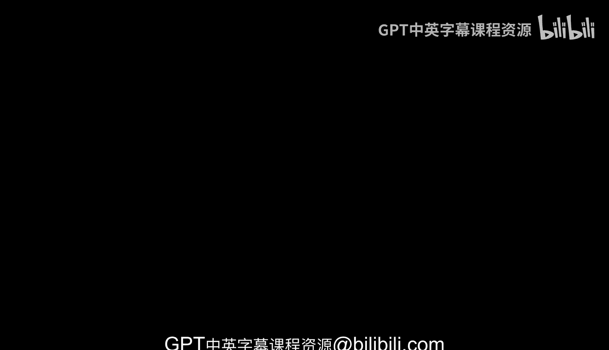

#  028：检索增强生成（RAG）简介

在本节课中，我们将要学习一个名为“检索增强生成”的核心概念。它能让大语言模型访问其训练数据之外的新信息，从而提供更准确、更相关的回答。

---

检索增强生成是一个初看难以掌握，但一旦理解其价值便会立刻想要实现的技术。它的实现具有一定复杂性，我们将一同探索其工作原理，并找到能在你自身系统中进行尝试的方法。

检索增强生成，通常以其英文首字母缩写 **RAG** 指代。接下来我们将看到，这是一种让大语言模型能够访问其训练数据之外的新数据或近期数据的方法，从而使其能够提供更优质的答案。

上一节我们介绍了RAG的基本概念，本节中我们将深入探讨如何管理我们希望用于检索增强生成的数据。

我们将深入研究如何管理那些我们希望用于检索增强生成的数据。具体来说，这个过程主要包含几个关键步骤。

以下是实现RAG所需的核心步骤：

1.  **数据准备与管理**：首先，需要整理和组织你想要提供给模型的外部知识源，例如文档、数据库或网页内容。
2.  **创建嵌入向量**：接着，使用嵌入模型将文本数据转换为数值向量（即嵌入）。这个过程可以用公式表示为：`embedding_vector = embedding_model(text_chunk)`。
3.  **使用向量数据库进行搜索**：将这些向量存储在一个专门的向量数据库中。当用户提出问题时，将问题同样转换为向量，并在该数据库中进行相似性搜索，以找到最相关的文本片段。
4.  **与大语言模型结合**：最后，将检索到的最相关文本片段与用户的原始问题一起，作为提示输入给大语言模型。模型会基于这些补充信息生成最终答案。其核心流程可概括为：`最终答案 = LLM(用户问题 + 检索到的相关文本)`。

---

本节课中我们一起学习了检索增强生成（RAG）的基本原理。我们了解到，RAG通过让大语言模型访问外部数据来增强其回答能力，并概述了实现RAG所需经历的数据准备、向量化、检索与合成四个关键阶段。