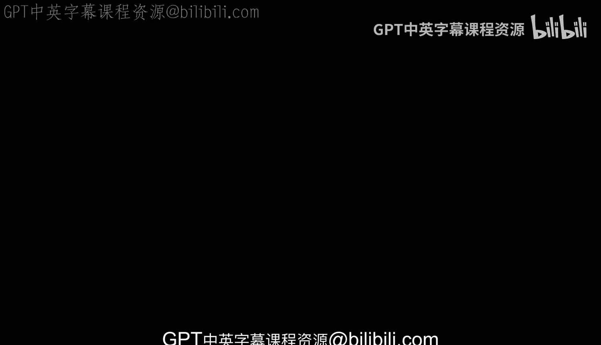
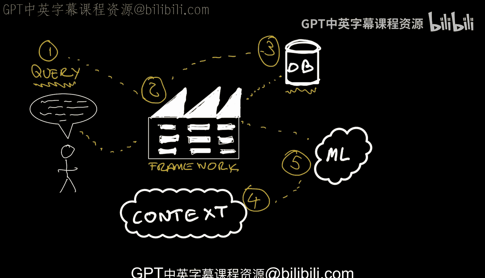

#  030：RAG应用概述 🧠

在本节课中，我们将学习检索增强生成（RAG）的基本工作流程。我们将了解一个用户查询如何通过框架、向量数据库和大语言模型的协作，最终生成一个包含外部知识的回答。

---

## 查询的起点

整个过程始于一个用户查询。通常，这个查询会直接发送给应用框架，然后由框架传递给大语言模型处理并返回结果。

在RAG架构中，情况有所不同。查询首先到达应用框架。这个框架可以是像LangChain或Semantic Kernel这样的专门框架，也可以是一个直接调用API的普通应用程序。

## 转向向量数据库

查询到达框架后，框架并不会直接将查询发送给大语言模型。相反，它会先将查询发送到**向量数据库**。

向量数据库会基于查询执行一次搜索。例如，如果用户的查询是“昨天的天气如何？”，向量数据库中可能存储了大语言模型本身不具备的、关于昨天天气的具体信息。

## 构建增强上下文

从向量数据库获取的检索结果不会直接返回给用户。这个结果会先返回到应用框架。

框架会执行一个关键步骤：它将原始查询和从向量数据库得到的答案结合起来，构建一个**增强的上下文**。这个上下文同时包含了问题（查询）和相关的答案（检索结果）。

## 大语言模型的“开卷考试”

接下来，这个增强的上下文会被发送给大语言模型。

可以这样理解：这就像是一个学生在参加开卷考试。大语言模型已经通过上下文拿到了“答案”。它的任务不再是凭空生成信息，而是将已有的答案（来自向量数据库的信息）用通顺、自然的方式组织起来，包装成一个完整的回复。

所以，大语言模型的工作可以概括为：基于给定的问题和现成的答案，生成一个格式良好、易于理解的最终响应。

## 路径总结与优势

最终，这个由大语言模型生成的响应会通过框架返回给用户。

这种来回交互的机制非常巧妙。它能够为大语言模型提供相关的额外事实和背景信息，而无需在模型训练阶段就注入所有知识。

这种架构的核心优势在于：
*   **成本效益**：训练大语言模型的成本极高，但向向量数据库中添加文档的成本相对很低，操作也简单。
*   **知识更新灵活**：可以随时更新数据库中的知识，而无需重新训练整个大模型。

---

本节课中，我们一起学习了检索增强生成（RAG）的基本工作流程。我们看到了用户查询如何经过框架路由到向量数据库进行检索，检索结果又如何与原始查询结合形成增强上下文，最终由大语言模型“润色”后返回给用户。这个流程的核心思想是为大模型提供“外部记忆”，使其能够回答超出其原始训练数据范围的问题。在后续课程中，我们将深入探讨如何向向量数据库中添加文档的具体过程。