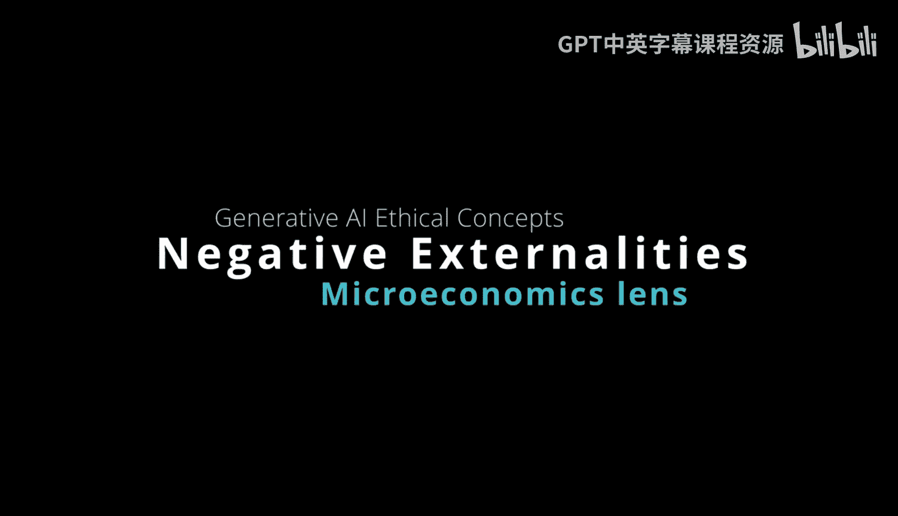
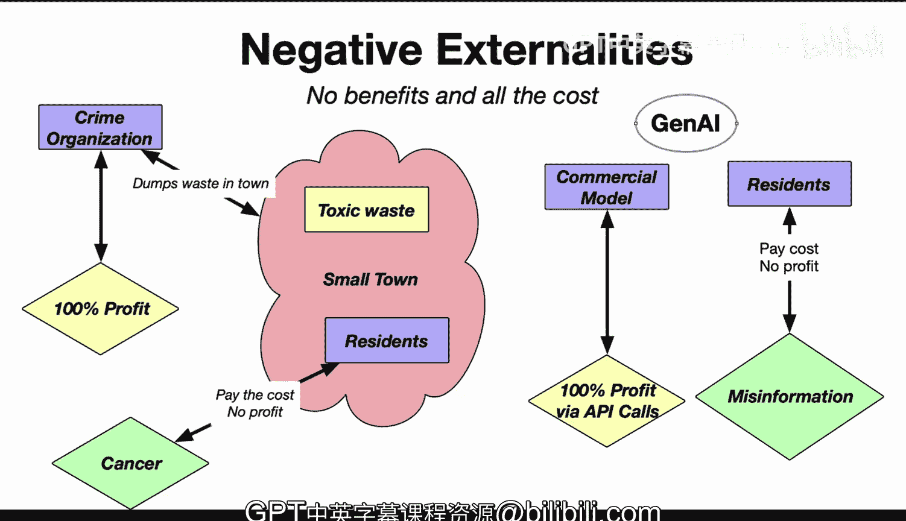

#  039：负外部性

## 📖 概述

在本节课中，我们将要学习经济学中的一个重要概念——**负外部性**，并探讨它如何应用于生成式人工智能等科技领域。我们将通过具体例子来理解，为何在追求利润的同时，也必须审视技术可能带来的潜在社会成本。

---

## 🔍 理解负外部性

负外部性是指，某些行为或产品在给一方带来利益的同时，却让未直接参与的第三方承担了成本，而第三方并未从中获得任何好处。

**公式**可以表示为：
`社会总成本 = 私人成本 + 外部成本（负外部性）`

上一节我们介绍了技术发展的基本驱动力，本节中我们来看看当发展不考虑社会影响时，可能产生的问题。

---

## 🏭 一个现实世界的例子

为了清晰地理解这个概念，我们可以看一个基于真实事件的极端例子。

假设一个犯罪组织受雇于某公司，将有毒废物（例如核废料或农药）非法倾倒在某个小镇上。以下是这个过程中的利益与成本分配：

*   **犯罪组织**：获得了100%的利润。
*   **小镇居民**：没有从倾倒有毒废物中获得任何利润，却要承担全部代价。这些代价可能包括：
    *   癌症风险增加。
    *   各种疾病。
    *   土地污染导致农业减产。

这个犯罪行为导致了所有的**负外部性**都转移给了小镇居民。虽然这是一个极端案例，但它清晰地展示了负外部性的核心矛盾。

---

## 🤖 生成式AI中的潜在负外部性

理解了基本概念后，让我们将视角转向生成式人工智能。一个商业公司发布AI模型并通过API调用获利，情况可能类似。

*   **AI公司**：通过提供AI服务获得100%的利润。
*   **社会公众**：可能并未从AI服务中直接获利，却有可能需要承担其滥用或意外后果带来的成本。

以下是AI可能产生的一些潜在负外部性场景：

*   生成高度逼真、模仿知名政治人物的语音，干扰选举结果。
*   生成关于特定个人的不实信息，损害其个人声誉或公司利益。
*   传播错误的健康信息，导致公众做出有害健康的决策。

理论上，这些都可能因生成式AI的不负责任使用而发生。商业公司获得了所有利润，而承担代价（即承受负外部性）的却是广大公众。

---

## 💡 如何负责任地思考

因此，负外部性是一个重要的思考框架。它并不意味着所有技术都会产生极端的负面影响，但其重要性在于提醒我们，在提出技术解决方案时，不能只关注利润。

在评估任何技术方案时，应采取负责任的思维方式：
1.  **审视利润**：这是商业运营的基础。
2.  **评估负外部性**：分析你的技术可能产生的、甚至是无意的真实社会影响。

这是一种负责任地部署人工智能解决方案的思考方式。

---

## 📝 总结

本节课中我们一起学习了**负外部性**的概念。我们了解到，它描述了利益由一方独占，而成本却由不相关的第三方承担的现象。我们通过犯罪组织倾倒废物的例子理解了其核心机制，并探讨了生成式AI可能带来的类似风险，如传播错误信息。最后，我们强调了在技术开发中，除了追求利润，必须主动评估和尽量减少潜在的负外部性，这是构建负责任AI的关键一步。