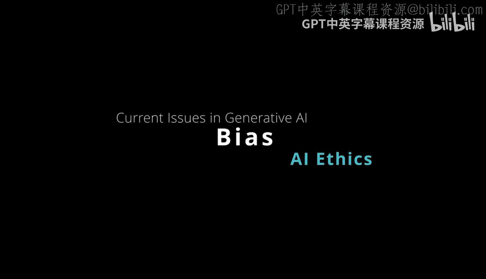
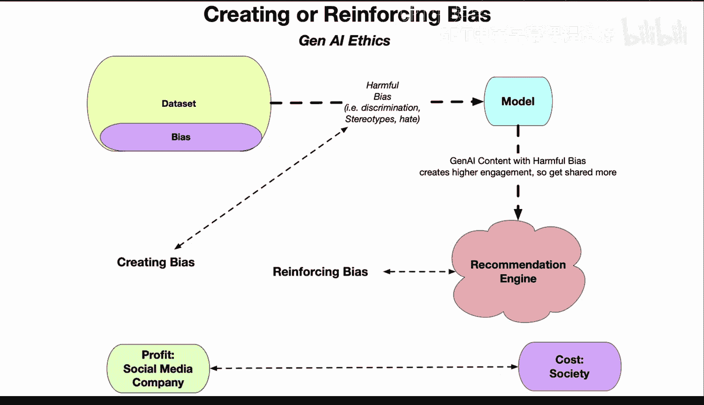

#  041：创建或强化偏见 🧠



在本节课中，我们将探讨生成式人工智能中一个关键的伦理问题：偏见如何在数据集中产生，并可能被模型训练和系统推荐所创建或强化。

上一节我们讨论了生成式AI的伦理挑战，本节中我们来看看一个具体且影响深远的问题——偏见的创建与强化。

## 概述：偏见的产生与放大

创建或强化偏见是生成式人工智能在伦理方面必须解决的一个问题。其核心机制在于，如果一个模型在包含偏见的数据集上进行训练，并且未对此进行处理，那么该系统就可能生成甚至放大这些偏见。

## 偏见的创建与强化机制

以下是偏见从数据到社会影响的典型传导路径：

1.  **收集有偏见的数据集**：初始数据集可能包含了刻板印象、歧视或仇恨言论。
2.  **基于偏见数据训练模型**：在此类数据上训练模型，而不加以修正，会将偏见编码进模型中。
3.  **系统生成更多偏见**：训练好的模型在生成内容时，会输出带有偏见的信息。
4.  **推荐系统放大偏见**：若将生成的内容置于推荐引擎中，有害的偏见内容可能因其高互动率（如点击、分享）而被算法优先推荐。
5.  **形成恶性循环**：推荐导致更多曝光和互动，这反过来“告诉”系统此类内容更受欢迎，从而进一步强化推荐，形成“过滤气泡”和有害的个性化推送。

**公式表示**：`偏见输出 ∝ 偏见数据 × 优化目标（如互动率）`

## 短期利益与长期社会成本

这个过程会带来一个严重的矛盾：短期商业利益与长期社会危害的冲突。

*   **对公司的短期收益**：煽动性、误导性的偏见内容往往能带来更高的用户参与度和停留时间，这意味着更多的广告收入和利润增长。在短期内，这看起来像是正确的商业方向。
*   **对社会的长期成本**：然而，被传播的歧视性数据和对边缘群体的刻板印象，其代价需要由整个社会来承担。这可能导致：
    *   进一步加深社会隔阂与分裂。
    *   侵蚀对复杂议题的理解。
    *   助长极端主义、暴力事件的风险上升。

因此，这绝不是一个理论问题，而是必须认真对待的现实挑战。

## 可能的解决方案

要应对这一问题，需要从多个层面进行思考和改革：

*   **算法监督**：对优化用户参与度的算法进行伦理审查和监督，改变仅以互动率为核心的优化目标。
*   **纳入伦理考量**：在系统设计之初就将伦理因素作为必要组成部分。
    *   **代码示例（理念层面）**：
        ```python
        # 伪代码：在损失函数中加入偏见惩罚项
        def custom_loss_function(predictions, labels, bias_penalty):
            standard_loss = calculate_standard_loss(predictions, labels)
            total_loss = standard_loss + lambda * bias_penalty # lambda是权衡系数
            return total_loss
        ```
*   **政策改革**：通过立法和税收等手段，治理这些有毒的商业模式。例如，对传播有害偏见内容的行为征税，或出台相关法规进行约束。
*   **伦理培训**：加强对AI开发人员、产品经理的伦理教育。

所有这些措施的共同起点是，我们需要超越单纯的利润思维，全面审视所构建的系统将如何被人们使用，以及它会对社会产生何种影响。

## 总结



本节课中，我们一起学习了偏见在生成式AI中的创建与强化机制。我们了解到，基于偏见数据训练并追求互动率的模型，会通过推荐系统放大有害内容，为公司带来短期利润，却让社会承担歧视、分裂等长期成本。解决这一问题需要算法监督、伦理设计、政策改革等多管齐下，以实现更负责任的技术发展。