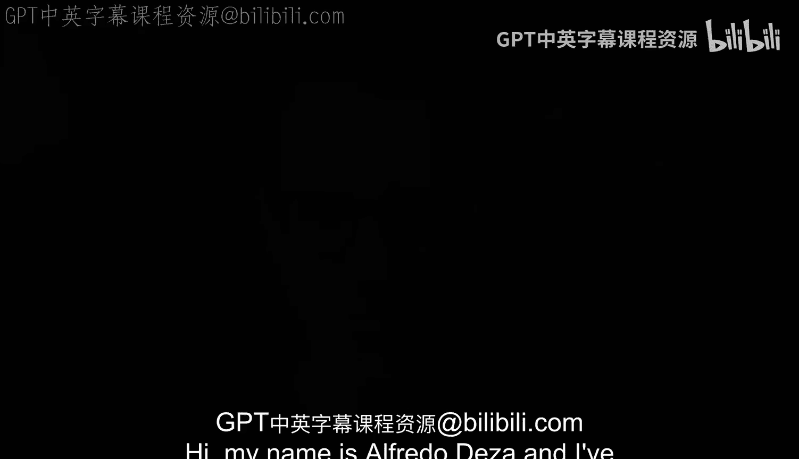

# 本地大语言模型的基础：02：认识课程讲师-阿尔弗雷德·德萨

在本节课中，我们将认识本课程的讲师阿尔弗雷德·德萨，并了解他的专业背景以及本课程将要涵盖的核心内容。

大家好，我是阿尔弗雷德·德萨。我从事机器学习和编程课程教学已有很长时间。

我的背景和经验主要集中在软件工程、自动化、DevOps以及系统管理领域。

在本课程中，我们将深入探讨如何使用和发挥本地大语言模型的能力。

我们将了解它们在哪些情况下非常有用，以及在何种场景下您可能需要考虑使用它们。

我们还将学习如何在本地应用特定技术，以便您能够开始与这些大语言模型互动，并充分利用其所有功能。

我们将探讨这一切如何成为可能，以及您如何才能最有效地利用它们。

---

本节课中，我们一起认识了讲师阿尔弗雷德·德萨，并初步了解了本课程将围绕**本地大语言模型**的**使用场景**和**应用技术**展开。在接下来的课程中，我们将逐步深入学习这些内容。