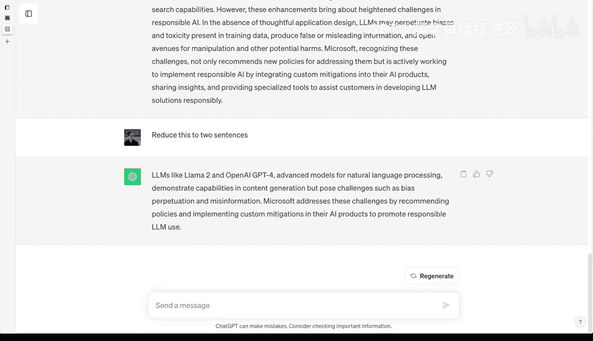

# 本地大语言模型的基础：05：使用LLM的优势与风险 🎭


在本节课中，我们将探讨大型语言模型（LLM）在实际应用中的主要优势与潜在风险。我们将通过具体的示例，帮助你理解如何有效利用LLM，同时识别并规避其可能产生的问题。

上一节我们介绍了LLM的基本概念，本节中我们来看看它在实际使用中的表现。

## 优势：作为高效的内容生成与总结工具

LLM能够快速生成文本内容或对现有信息进行总结，这为内容创作和知识整理提供了极大的便利。以下是其优势的具体体现。

### 生成个人简介示例

当请求ChatGPT为特定人物生成简介时，它能够基于公开信息组合出一段看似合理的描述。例如，当输入“give me a summary of myself Alfredo Deza”时，模型生成了一段关于贡献和社区参与的总结。

**代码示例：生成总结**
```
用户输入: "give me a summary of myself Alfredo Deza"
模型输出: "Alfredo Deza has made significant contributions to projects related to Python packaging..."
```

尽管部分内容（如“Python packaging”）可能与事实不完全相符，但整体框架可用作进一步创作的起点。

### 执行具体指令

当指令更明确时，LLM能生成更贴合需求的输出。例如，以项目需求为背景请求生成简介。

**代码示例：为项目生成简介**
```
用户输入: "I am Alfredo Deza, and I need a quick bio for a README in a Rust project."
模型输出: "Passionate technologist from Peru... deep love for open source and Rust..."
```

这个结果在核心事实（如来自秘鲁、热爱开源）上基本准确，展示了LLM在遵循清晰指令下的实用性。

### 文本总结功能

LLM能有效提炼长段文本的核心信息。你可以通过指令控制总结的详细程度。

**代码示例：总结并精简**
```
用户输入: "Summarize the following paragraph... Now reduce it to two sentences."
模型输出: [生成更简洁的两句话总结]
```

这个功能对于快速获取文档大意或准备摘要材料非常有用。

## 风险：可能产生不准确或虚构信息

然而，LLM并非全知全能，其本质是一个基于概率预测的模型。这导致了其最主要的缺点：可能生成看似合理但实际不准确或完全错误的信息。

### “幻觉”问题示例

当我们尝试让另一个模型（Claude AI）生成关于同一人物的信息时，出现了明显的错误。

**代码示例：模型产生不实信息**
```
模型输出: "He is a mathematician... born on November 14th... a seasoned Ruby developer..."
```
事实上，这些描述（数学家、特定生日、Ruby专家）都是不正确的。这清晰地展示了LLM可能“自信地”输出错误信息，即所谓的“幻觉”。

### 隐私与伦理边界

有时，出于隐私和伦理考虑，LLM会拒绝生成关于个人的特定信息。这本身是一种风险控制机制，但也提示用户需注意信息的来源和授权。

**代码示例：模型拒绝生成**
```
用户输入: "Please create me a short bio about Alfredo Deza."
模型输出: "Creating biographical information without the person's consent... I recommend checking official sources."
```

## 核心概念与使用原则

要安全有效地使用LLM，必须理解其核心工作机制并遵循关键原则。

### 理解其本质：概率机器

从根本上说，LLM是一个**概率机器**。其运行原理可以简化为：
**公式：P(输出 | 输入, 训练数据)**
即，模型根据给定的输入和其训练数据，计算下一个最可能出现的词或句子的概率分布。它生成的是“最 plausible（看似合理）”的文本，而非绝对真理。

### 关键使用原则

以下是使用LLM时必须牢记的几点：

1.  **永远验证关键信息**：不要完全信任模型输出的任何事实性陈述，尤其是涉及日期、数据、具体成就时。务必通过权威渠道进行二次核实。
2.  **提供清晰、具体的指令**：模糊的提问容易导致模糊或错误的回答。明确的指令能获得更相关、更准确的输出。
3.  **将LLM视为助手，而非权威**：最佳使用方式是将LLM的输出作为灵感来源、初稿或总结工具，然后由人类进行审核、修正和润色。
4.  **注意隐私与伦理**：避免要求模型生成未经授权的个人隐私信息或可能造成伤害的内容。



本节课中我们一起学习了大型语言模型在实际应用中的双重性。我们看到了它作为强大的内容生成和总结工具所带来的效率优势，同时也深入了解了其可能产生不准确信息（幻觉）的核心风险。关键在于牢记LLM是一个基于概率的模型，并始终以批判性思维对待其输出，将其用作增强我们工作的智能助手，而非替代我们判断的绝对权威。