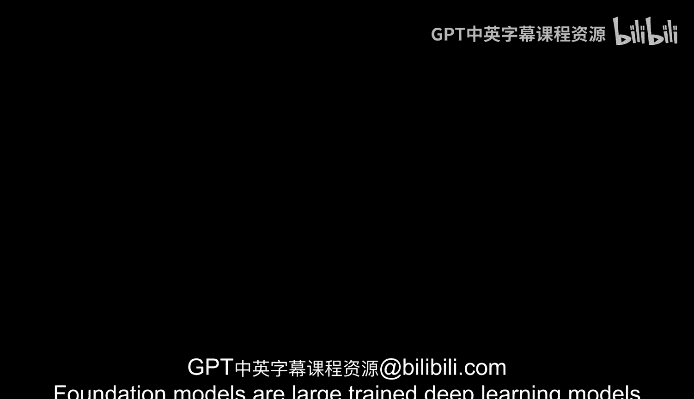
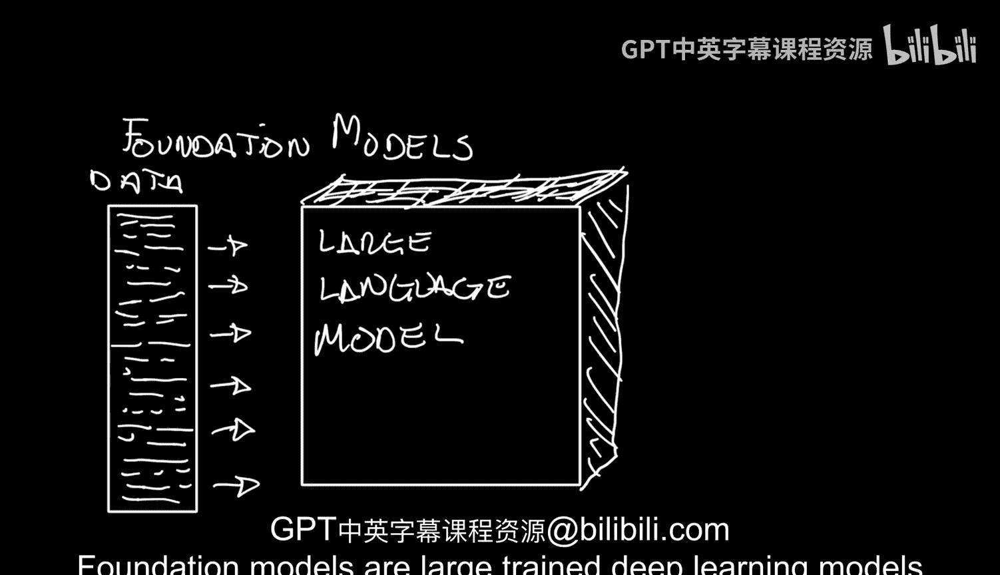
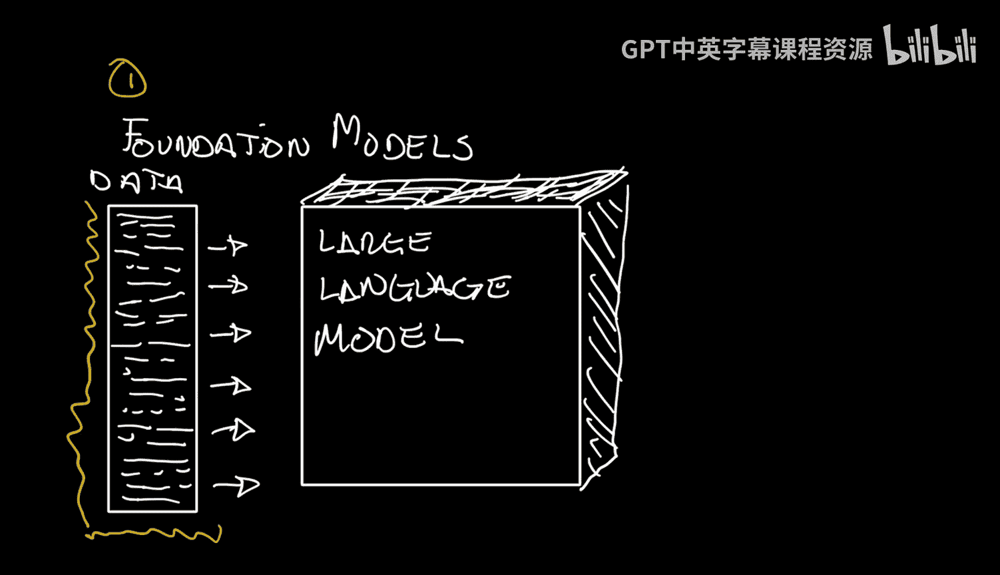
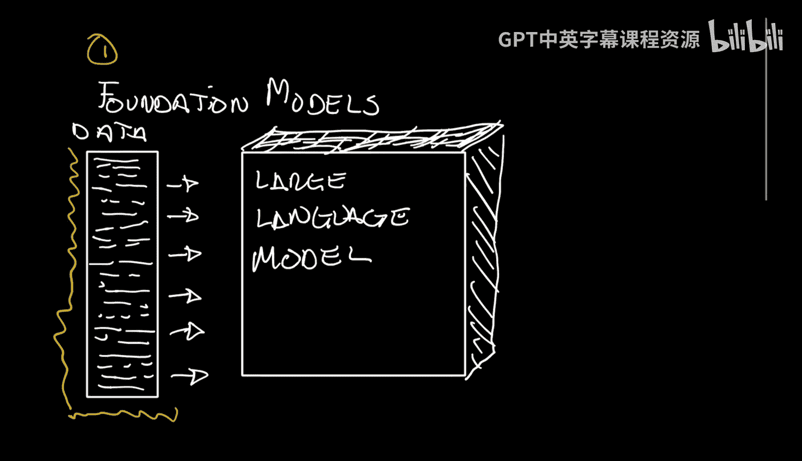
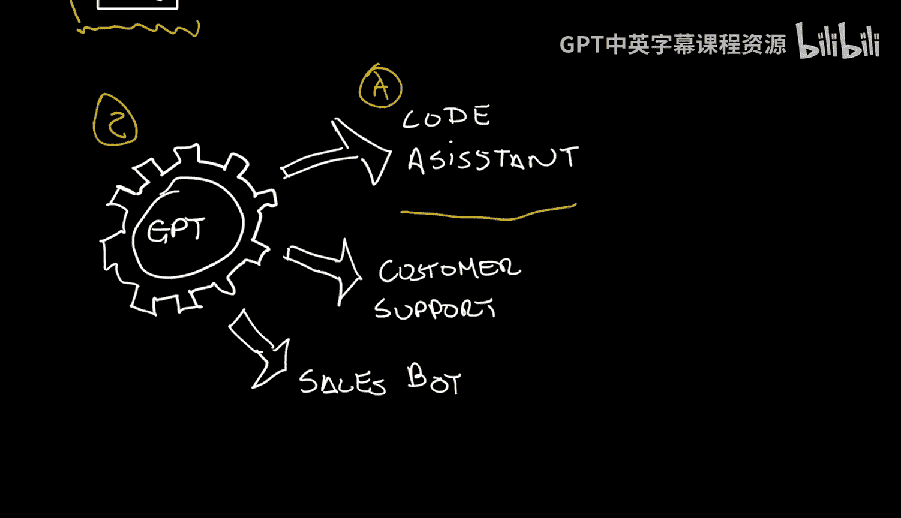
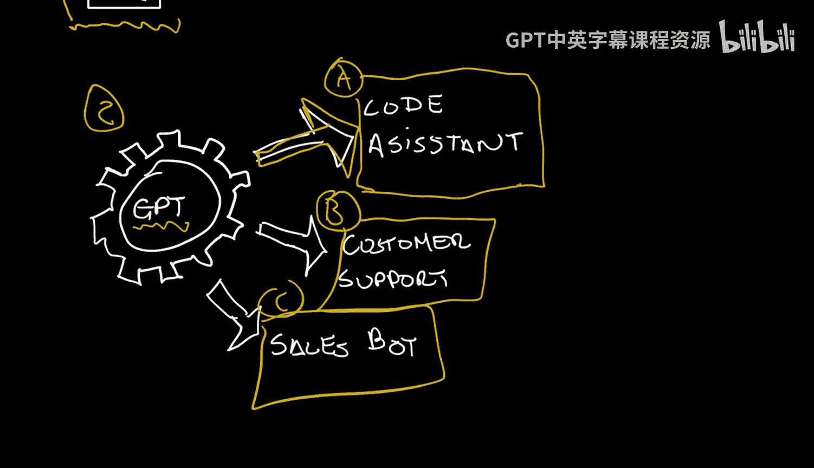
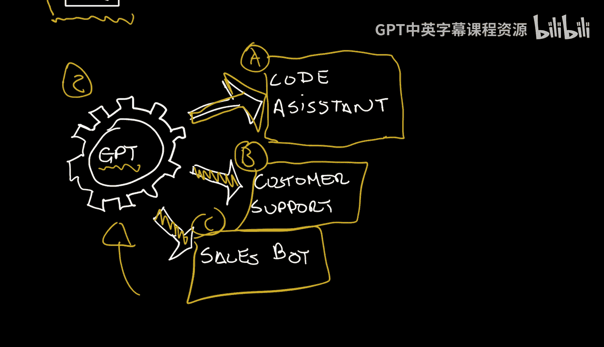
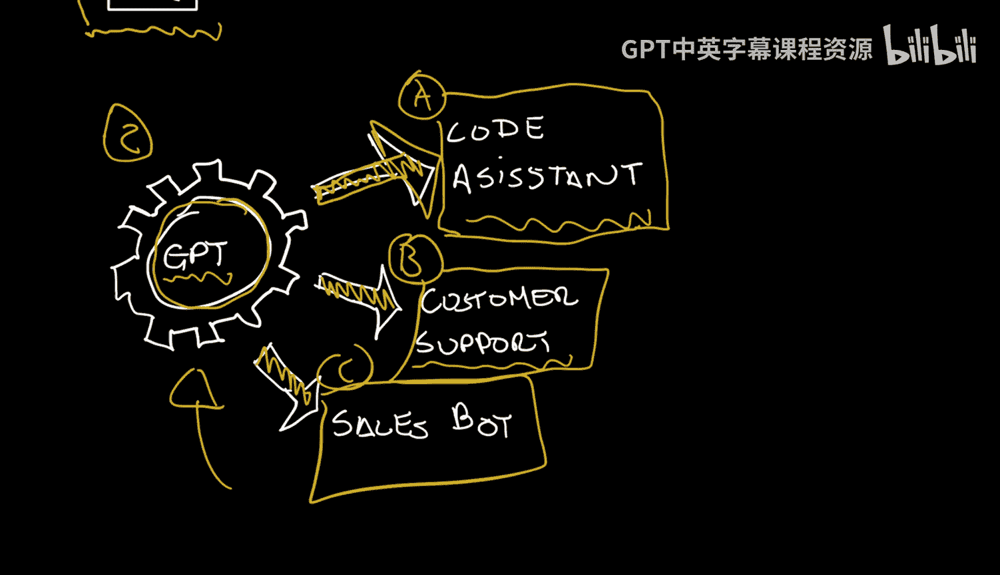
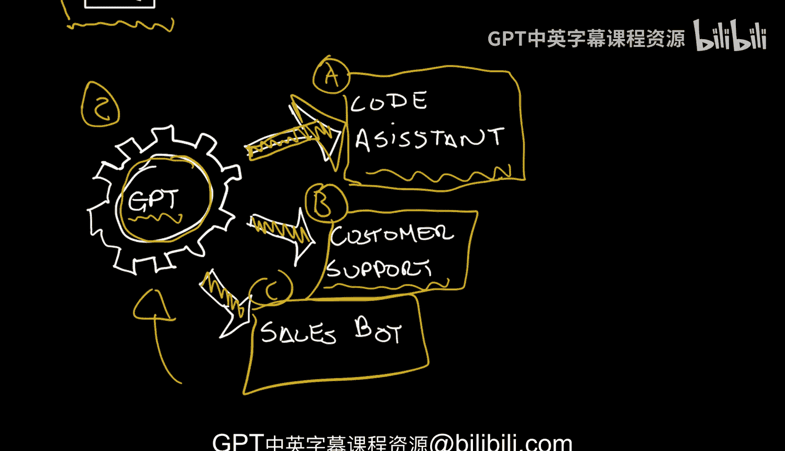

# 杜克大学《本地大语言模型的基础｜Foundations of Local Large Language models》中英字幕 p07 07_01_07_什么是基础模型.zh_en -BV19M4m1m72W_p7-

Foundation models are large， trained， deep learning models that can be adapted。

In order to apply be applied to other types of tasks they are created with natural language processing in mind and they provide a great solid starting point for building applications based in AI Now the key point here is that these models are based on massive amounts of data so that data again。

 is based on text and that text will allow large large language models to be created and come to exist Now these are ginormous amounts of data and that data is necessary because the more the better the data again。

 the better is going to be the model and in this case a very large language model is the starting point。

 so how is it that this is a starting point well。Once it has the capability of processing multiple aspects of natural language。

 it is then possible to repurpose repurpose this model into other types of tasks。

 so let's see how these are tasks maybe， so in here we have one of these models that is the GPT model。

And the GPT model allows to be repurposed into other more specific tasks One common one is right here the coding assistant。

 so coding assistants now are becoming very common developers， software engineers。

 machine learning engineers， data scientists are using coding assistants applying to their development environments that allows them。

To develop develop code and develop easily and faster using text generation based on a large language model the large language model in this case GT allows for a foundational starting point so that specific tasks can be added on and this can be incorporated into that and create a single purpose or more specific purpose rather than a generic one like the large language model that foundational model Another good example is the customer support you may have a chatbot that you know says allows you to respond like you go to a website and say。

 hey you know I'm having issues okay so what kinds of issues you're having on well。

You know this thing that I bought is no longer working Oh。

 it looks like you might want to contact I might want to create a ticket。

 but if you explain to me what are kind of like the pros you're having。

 I can create a ticket for you and that would be a customer support chatbot and similarly the salesbo will allow you to do something similar Now these are not based directly on the foundational model like bad examples of this po or chatbot implementations are models that or applications that are talking directly to a foundational model without any sort of filtering so filtering and specific instructions are happening。

And in some cases pretraining or fineting the model， not pretraining。

 but finetning the model so that it adapts itself to specific tasks like in this case code assistant or customer support there are several patterns here and several things and several technologies that happen for to make this possible but it's just useful to keep in mind that for these three use cases to happen。

 there has to be a type of filtering and processing between the foundational model。

 and the task at hand so that we can make it as specific based on instructions。

 perhaps based on new data in the case of code assistance。

 they require to go through massive amounts of pre-existing code so that they can be fine-t and trained also on the data in addition。

To the foundational model that understands natural language processing。

So those are the things that are make foundational models distinct things。

 so whenever you hear about foundational models， it refers to the base models that allow other more specific tasks to happen like code assistance。

 customer support in sales pots。

