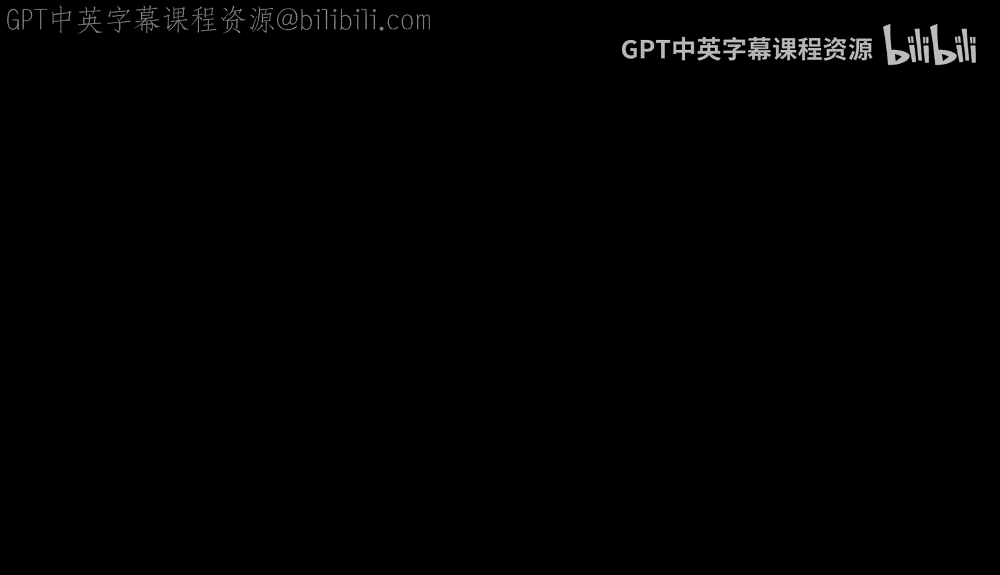
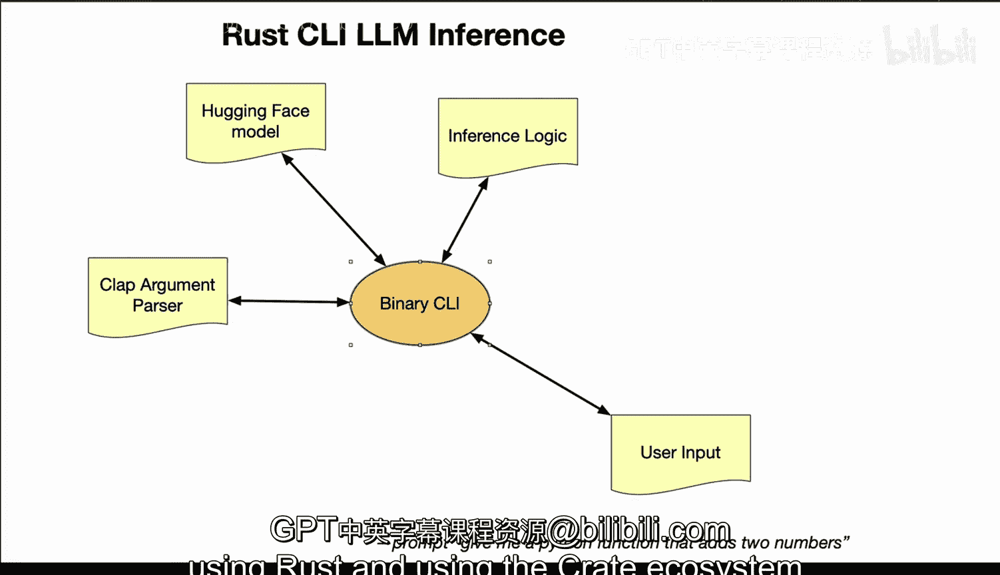

# 本地大语言模型的基础：17：Rust命令行推理



在本节课中，我们将学习如何构建并运行一个Rust命令行界面程序，该程序将使用Hugging Face的Transformer模型进行推理。整个过程从下载预训练模型开始，到最终通过命令行接收用户输入并输出推理结果结束。

## 概述

我们将分步构建一个Rust命令行推理工具。首先，从Hugging Face Hub下载预训练模型。接着，在Rust中加载模型。然后，构建命令行界面以接收用户输入。之后，实现将用户输入传递给模型进行推理的逻辑。最后，运行程序并查看结果。

## 构建流程详解

上一节我们概述了整体流程，本节中我们来看看每个步骤的具体内容。

### 第一步：下载模型

首先，需要从Hugging Face Hub下载一个预训练Transformer模型。你可以选择如BERT或GPT-2等模型。

### 第二步：在Rust中加载模型

下载模型后，需要在Rust代码中加载它。以下是两种主要方式：

*   使用 `rust-bert` 或 `transformers` crate。这些库提供了Hugging Face模型的Rust绑定。
*   使用 `rust-candle` 接口。这也允许在Rust代码中使用模型进行推理。

### 第三步：构建命令行界面

模型加载完成后，下一步是构建命令行界面。你可以使用 `clap` crate来轻松解析命令行参数，从而允许灵活的用户输入。

以下是 `clap` 的基本使用示例：
```rust
use clap::Parser;

#[derive(Parser)]
struct Cli {
    prompt: String,
}
```

你甚至可以定制提示词。例如，如果你想为每个提示词添加一个固定的前言以获得更好的结果，可以将此逻辑集成到代码中。

### 第四步：实现推理逻辑

命令行界面构建好后，需要实现推理逻辑。该逻辑负责接收用户输入，将其传递给之前加载的Hugging Face模型，并返回结果。

`rust-bert` crate 将通过处理数据转换和推理过程使这一步变得简单。

### 第五步：运行与推理

最后，用户通过运行命令行工具并提供文本输入来使用它。该输入通过命令行界面传递给Hugging Face模型，推理过程在Rust中执行，结果将打印输出给用户。

## 总结

本节课中我们一起学习了构建Rust命令行推理工具的完整流程。简而言之，步骤如下：
1.  从Hugging Face下载模型。
2.  使用模型crate在Rust中加载模型。
3.  使用 `clap` 构建命令行界面。
4.  实现推理逻辑并将其与模型集成。
5.  运行命令行工具，对用户输入执行推理。



使用Rust及其crate生态系统是执行大语言模型推理的一种高效方式，在许多情况下可能是最高效的方式。