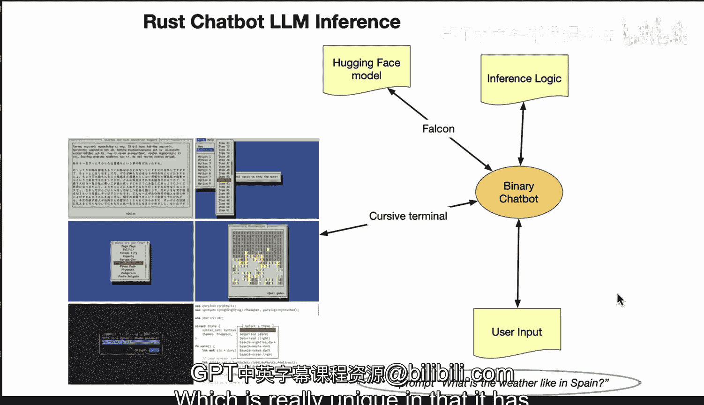

# 本地大语言模型的基础：18：使用Rust构建聊天推理应用 🦀

在本节课中，我们将学习如何利用Rust生态系统中的即插即用组件，构建一个用于大语言模型推理的聊天机器人。我们将从选择模型开始，逐步完成加载模型、构建用户界面和实现核心聊天逻辑的整个过程。

## 概述

我们将构建一个基于终端的Rust聊天机器人，它能够加载预训练的大语言模型，与用户进行自然语言对话。整个过程涉及几个关键步骤：选择合适的模型、在Rust程序中加载模型、构建用户界面以及实现处理用户输入和生成回复的核心循环。

## 选择与加载模型 🧠

上一节我们介绍了项目的整体目标，本节中我们来看看如何选择并加载模型。

首先，你可以考虑使用Falcon模型。这是一个非常适合入门的模型，在自然语言对话任务上表现出色。

接着，你可以使用像`candle`这样的Rust库将模型加载到程序中。`candle`是一个Rust机器学习框架，能够访问Hugging Face上的模型库。

## 构建聊天机器人界面 💬

在成功加载模型之后，下一步是为我们的应用构建一个用户界面。

你可以使用`cursive`这类库来构建一个基于终端的用户界面。这个界面将负责接收用户输入并显示机器人的回复。

以下是构建核心聊天循环的步骤：
1.  持续提示用户输入。
2.  获取用户输入的文本。
3.  将文本传递给之前加载的Hugging Face模型。
4.  打印模型生成的回复。

## 实现核心聊天逻辑 ⚙️

我们已经有了界面，现在需要实现驱动对话的核心逻辑。

这个Hugging Face模型将处理所有的自然语言处理任务，包括分析用户输入、生成连贯的回复，甚至考虑对话的上下文。

Rust代码则负责促进这种交互。你还可以添加额外的逻辑，例如情感分析，以使回复更加自然。在完成这个原型之后，你甚至可以将界面适配成Web应用程序。

总而言之，你需要做的是：
1.  从Hugging Face选择合适的模型（例如最新的Falcon模型）。
2.  将其加载到Rust程序中。
3.  构建聊天用户界面。
4.  结合Hugging Face模型实现聊天逻辑。
5.  实现持续提示用户并生成回复的循环。

## 总结

本节课中我们一起学习了使用Rust构建大语言模型推理聊天机器人的完整流程。这是一个令人兴奋的时代，开发者能够将这些强大的工具集成到像Rust这样命令行友好的语言中。Rust的独特之处在于，它在构建高性能二进制程序方面拥有巨大优势，使得开发此类应用变得高效而强大。