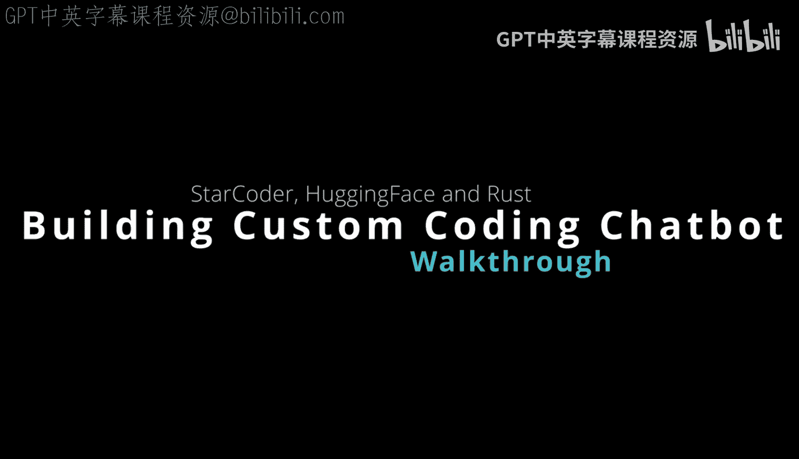
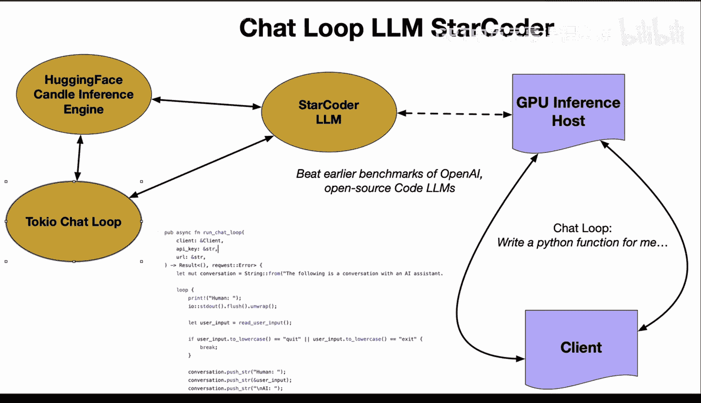

# 本地大语言模型的基础：19：使用StarCoder构建聊天循环

## 概述
在本节课中，我们将学习如何利用Hugging Face的StarCoder大语言模型，构建一个属于你自己的代码助手聊天循环。我们将了解其核心组件和工作流程，并看到它如何超越早期的模型。

---

## 构建自定义对话式AI

上一节我们介绍了StarCoder模型的潜力，本节中我们来看看如何实际构建一个自定义的对话式AI。

观察这里的提示词，我们的目标是生成一个经过深思熟虑的响应。为此，你需要调用一个StarCoder终端点。

这个终端点可以部署在GPU实例上，例如AWS的G5实例。来自客户端的异步请求将允许非阻塞的异步调用。

因此，聊天机器人将能够非常轻松地作出响应。同时，你还需要将每一组消息对附加到对话历史中，以便为AI提供上下文。

以下是构建此聊天循环的核心步骤：

*   **调用StarCoder**：向部署在GPU实例（如AWS G5）上的StarCoder模型端点发送请求。
*   **使用异步请求**：采用非阻塞的异步请求，确保聊天界面响应流畅。
*   **维护对话历史**：将每次的问答消息对添加到历史记录中，为模型提供连续的对话上下文。
*   **序列化数据**：使用JSON格式可以方便地进行数据序列化。

## 利用Rust与Hugging Face Candle

为了确保聊天机器人既健壮又安全，我们可以利用Rust强大的类型系统和内存安全特性。

我们还可以使用Hugging Face的Candle推理引擎，来轻松集成StarCoder大语言模型。

在此基础上，我们能够构建自定义的Tokio聊天循环。你可以看到这里有一个`pub async fn`函数，它包含一个聊天循环，能够遍历并回复用户输入的内容。

## 总结
本节课中我们一起学习了使用StarCoder构建聊天循环的核心方法。简而言之，这个过程非常直接：利用从StarCoder模型、Hugging Face推理引擎、Tokio异步运行时，到开源JavaScript客户端等构建模块，你就可以打造属于自己的代码助手聊天循环，而无需向任何人支付费用。