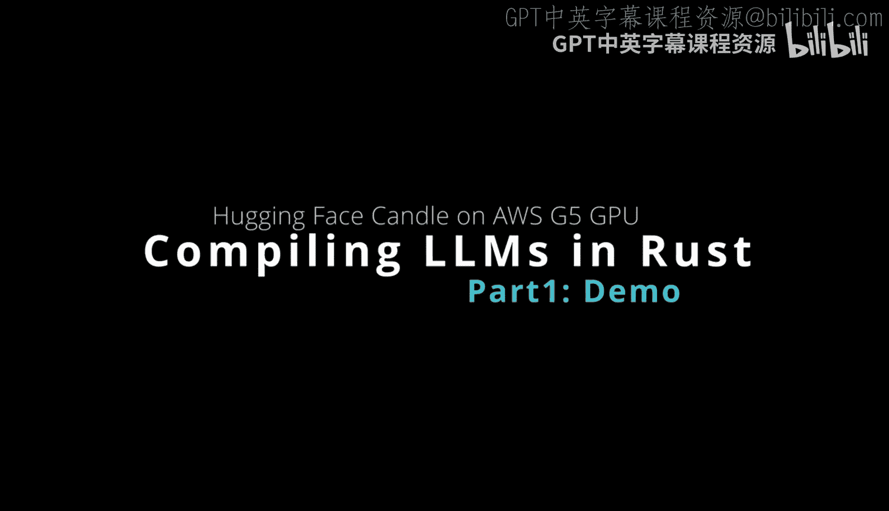
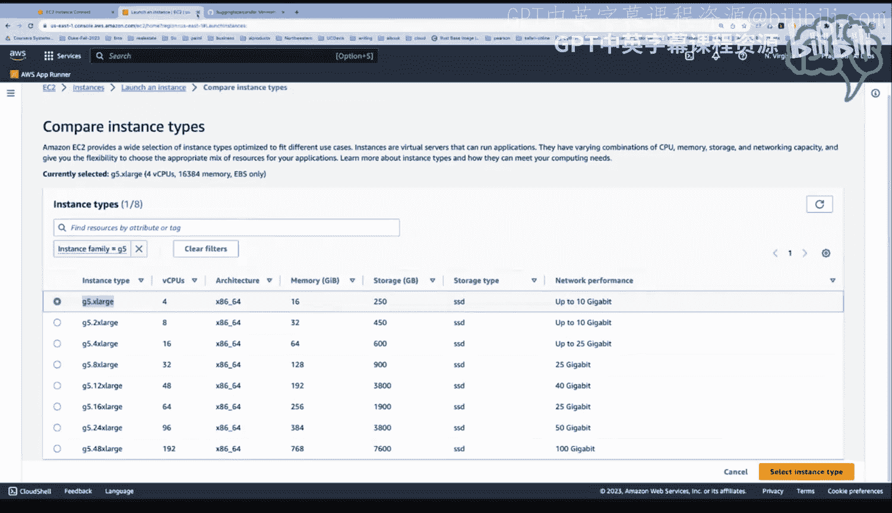
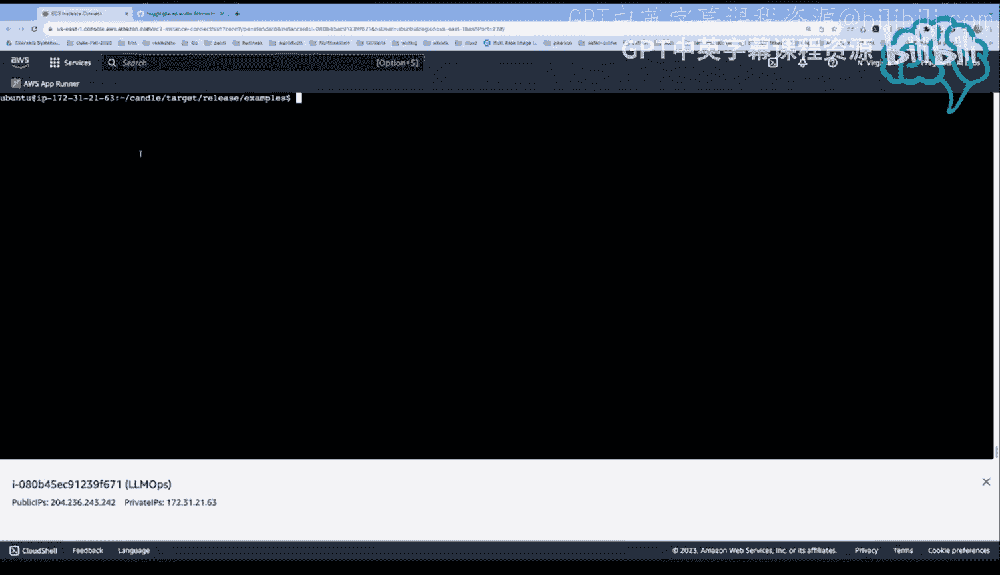
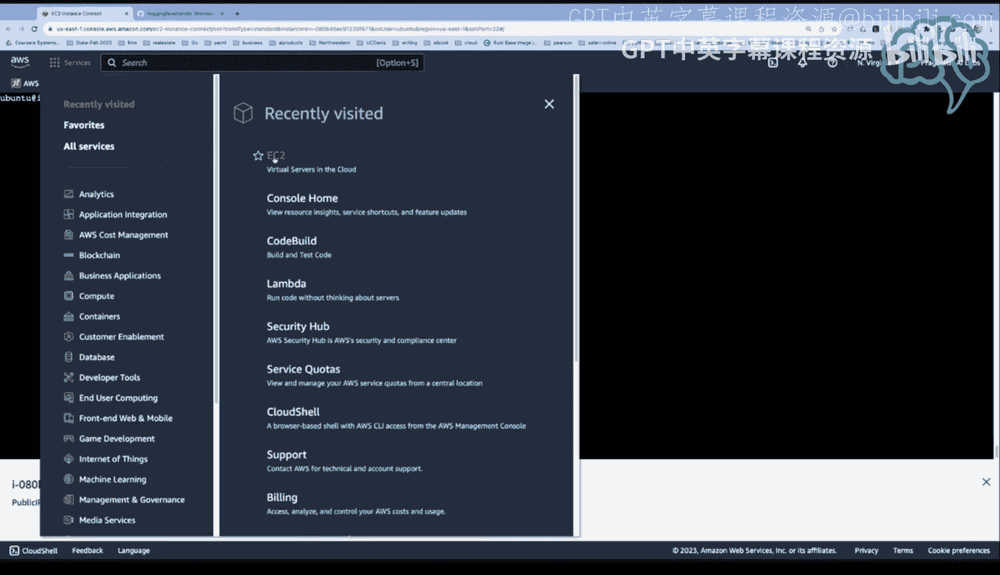
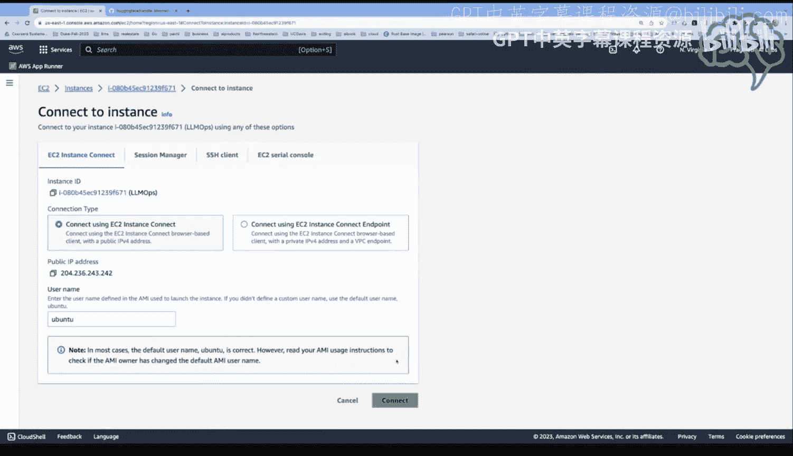
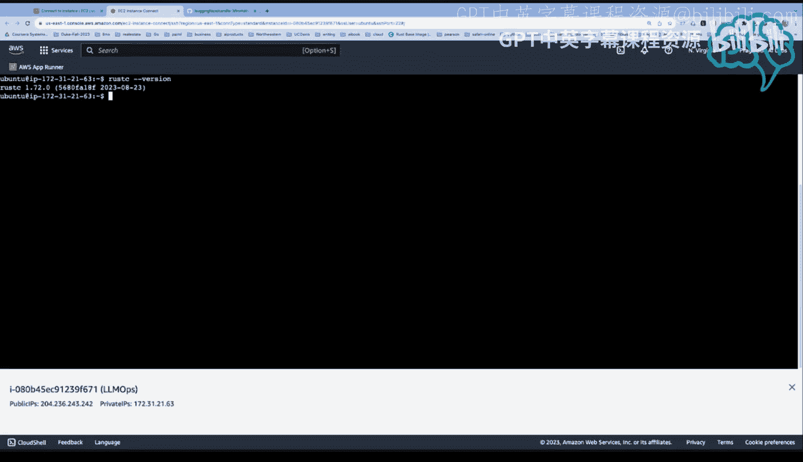
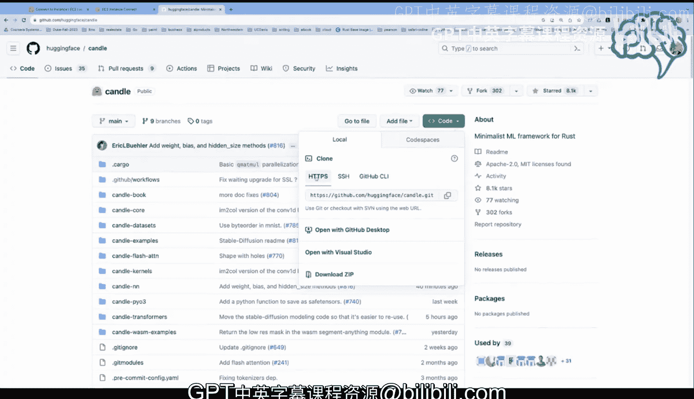

# 本地大语言模型的基础：20：在AWS GPU上调用Rust Candle（第一部分）



## 概述
在本节课中，我们将学习如何利用Rust的包管理系统，在AWS的GPU实例上调用大型语言模型。我们将使用Hugging Face的Candle框架，这是一个为Rust设计的极简机器学习框架。通过本教程，你将能够自行运行模型，而无需依赖外部API服务或复杂的配置。

## 核心概念与工具介绍
本节我们将介绍本次实践的核心工具：Rust的Cargo包管理系统和Hugging Face Candle框架。Candle框架的代码非常简洁，其最令人兴奋的特点是，你只需运行一行命令就能调用各种大型语言模型。这极大地简化了LLM的部署流程。

## 在AWS上配置GPU实例
上一节我们介绍了核心工具，本节我们来看看如何配置运行环境。首先，你需要在AWS控制台中启动一个实例。

以下是配置实例的关键步骤：

1.  **选择基础AMI**：建议选择“Deep Learning Base AMI”。这个镜像只包含必要的CUDA驱动和cuDNN库，没有多余的软件，非常适合我们的需求。
2.  **选择实例类型**：这是关键步骤。你需要选择基于NVIDIA GPU的实例类型。在筛选器中，选择“加速计算”或直接查找“G5”系列实例。G5系列实例预装了NVIDIA驱动，适合运行机器学习工作负载。

配置完成后，你可以在EC2控制台看到正在运行的实例。通过“EC2 Instance Connect”功能，你可以无需设置SSH密钥直接连接到该实例，这非常方便。

## 设置Rust开发环境
现在我们已经有了可用的GPU服务器，接下来需要在服务器上设置Rust环境。

连接至你的EC2实例后，只需运行一个命令来安装Rust：
```bash
curl --proto ‘=https’ --tlsv1.2 -sSf https://sh.rustup.rs | sh
```
安装完成后，你可以通过 `rustc --version` 命令验证安装。

## 克隆并准备Candle代码库
环境准备就绪后，最后一步是获取Hugging Face Candle的代码。







你需要克隆Candle的代码仓库到本地。可以使用以下命令：
```bash
git clone https://github.com/huggingface/candle.git
```
至此，所有前期准备工作已经完成。在接下来的部分，我们将深入如何使用Cargo来实际运行模型。







## 总结
本节课我们一起学习了在AWS GPU实例上为运行大型语言模型做准备的全过程。我们介绍了Hugging Face Candle框架的简洁性，逐步讲解了如何选择合适的AWS AMI镜像和GPU实例类型，如何连接到实例，以及如何安装Rust和克隆必要的代码库。这一切都是为了一个目标：让你能够轻松地通过Rust的包管理系统调用强大的LLM。