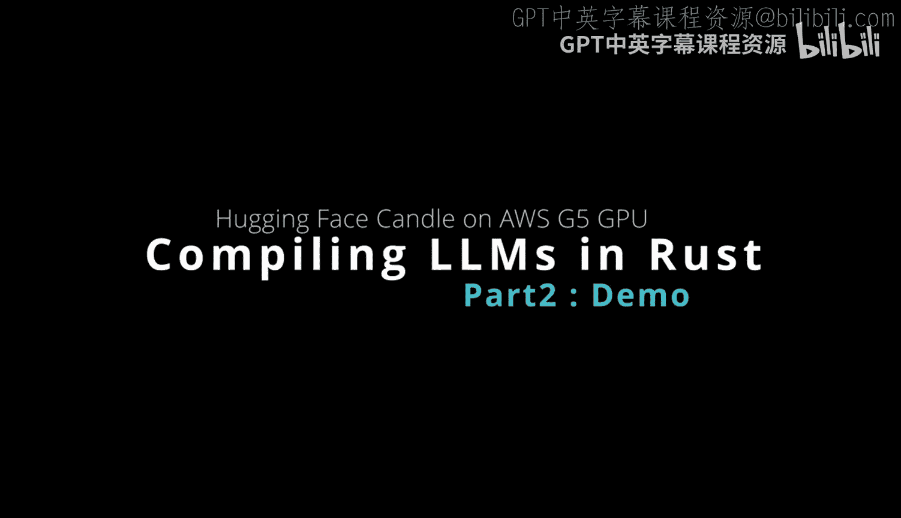
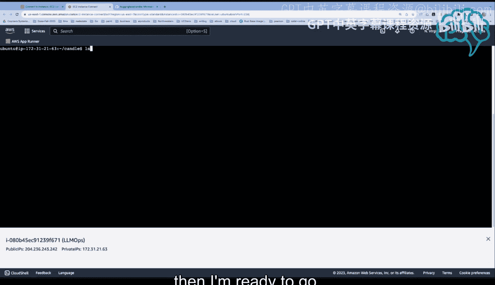
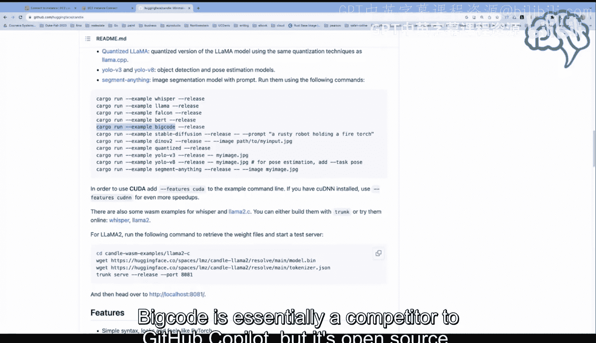
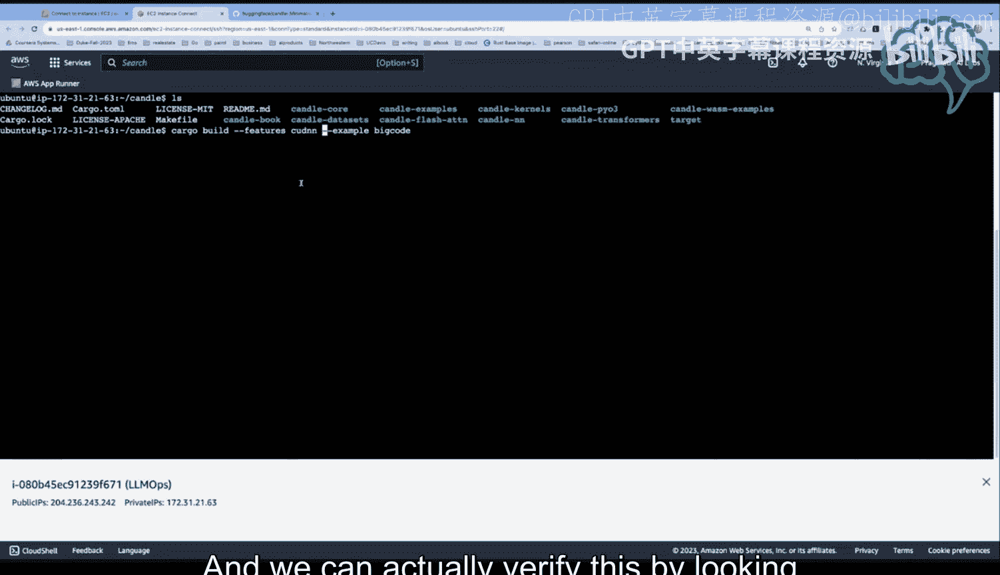
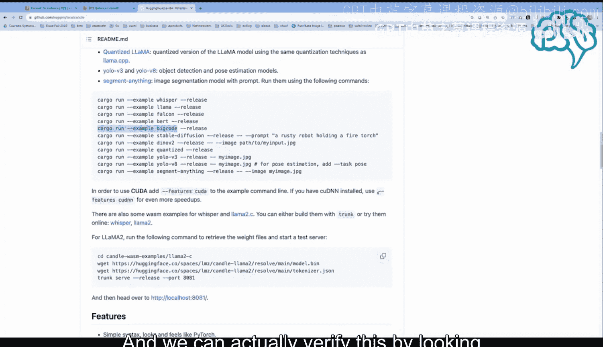
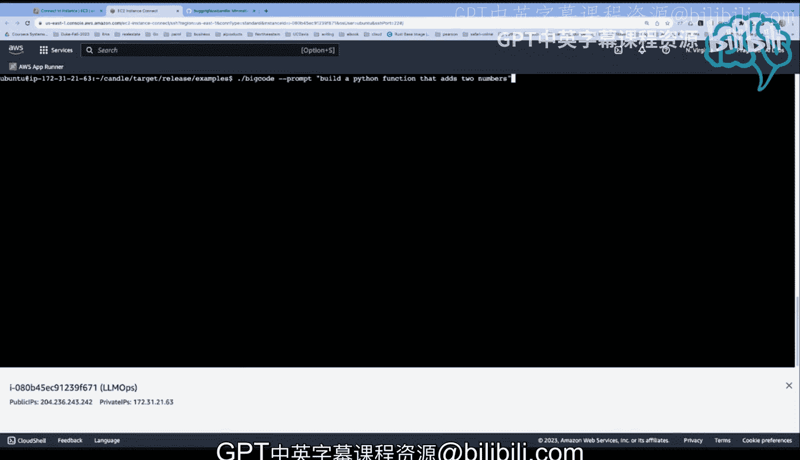

# 杜克大学《本地大语言模型的基础｜Foundations of Local Large Language models》中英字幕 p21 21_01_07_在AWS GPU上调用Rust Candle（第二部分）.zh_en -BV19M4m1m72W_p21-

So you go here， copy and clone it once you've done that。In case I've already done that。

 I could just say get poll， right， get whatever latest updates。

 they're actively changing this thing and then I'm ready to go and how it actually run things now。

 Well， you can look at the instructions if we go down here。

And we would want to actually， you know， basically build one of these models。

 So there's two ways to actually invoke these large language models。 One is to just run it。

 but I think a better way to invoke it would be to build it then go to the target directory and then play around with the model。

 So let's take a look at this one， for example， big code is essentially a competitor to Github copit。

 But it's open source So if we wanted to actually run this， How would we do this。

 We would just go through here。

And start a command like this but。That we want to tweak this a little bit。

 So we want to say cargo build， right， because we actually want to build a binary that we're going to play around with。

 We would also。Want to say Das features。We want to say CD and in and what this would do is this would actually。

Look at the optimized kuda driver for neural networks。

 and we can actually verify this by look at this， looking at this， see， use features。

Use features this is going to do is going to build this for us。Perfect。

And so I think not enough people are using this， right because again。

 everybody's signing up for expensive services that are $20 a month。

But you actually can just spin up your own instance and you can run a large language model。

That has in many cases， better performance and in fact CD into the target director。

 you see how it says target of one called big code， so I just type in big code like that。

That's it like a whole large language you know pair programming assistant here。

 so now I would just say big code。G has prompt and say build a Python function。That adds two numbers。

Pretty crazy I can't believe more people when I'm talking about this。

 So this again is the power of rust is that you can do things like this。

 and look we can see it's very fast right and if I want to run something even faster or wrap this up in a bash script or whatever that is I need to do。

 I have my own peer programming assistant so we also could tweak it。😊。

