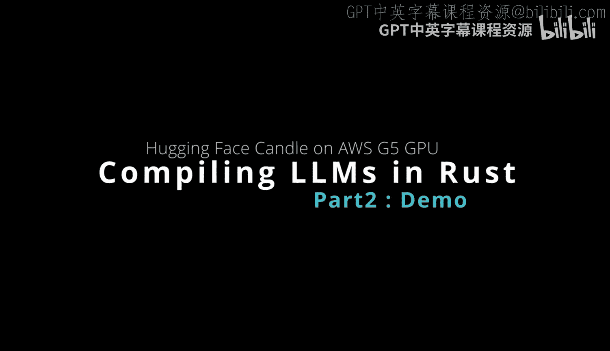
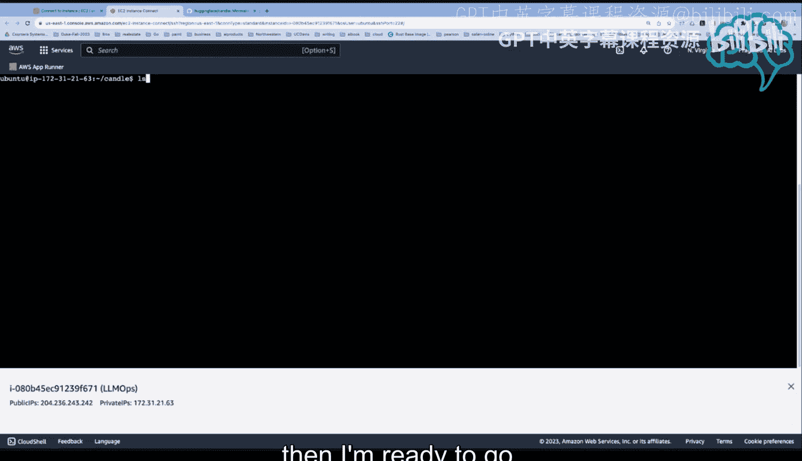
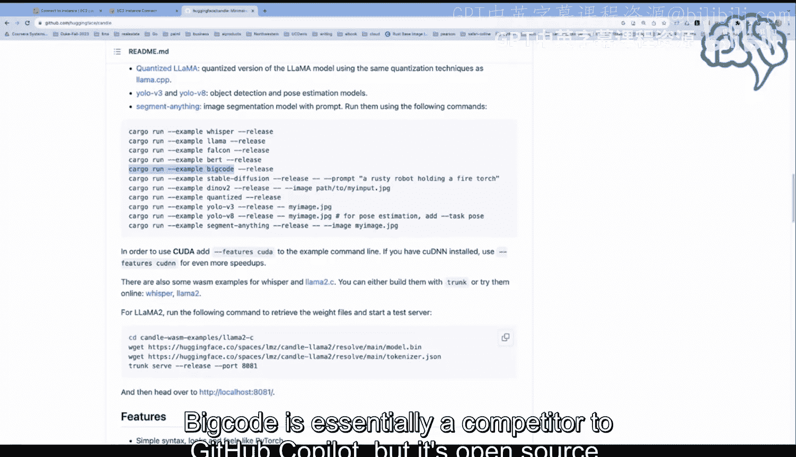
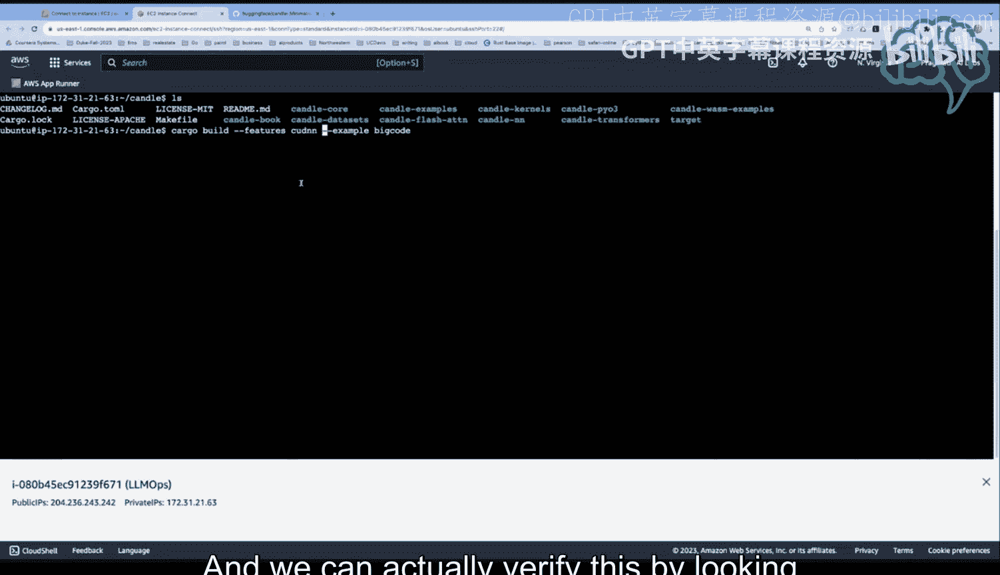
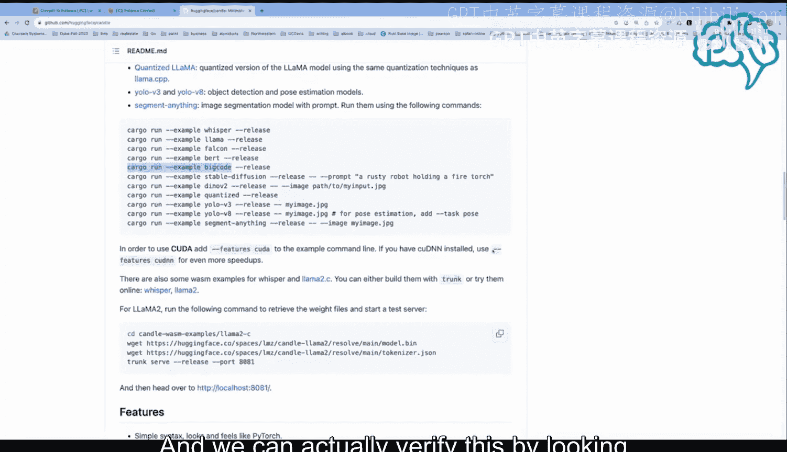
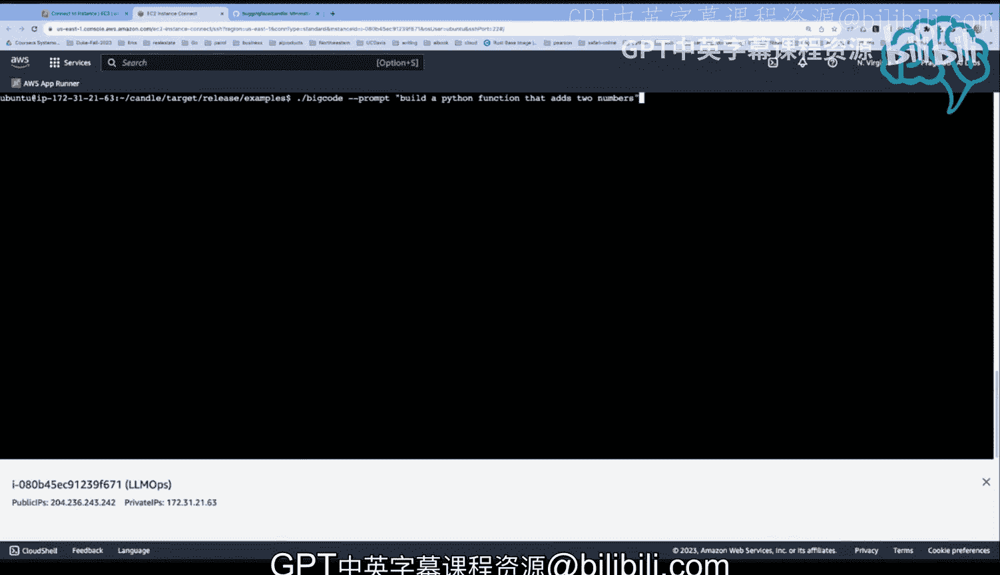

# 本地大语言模型的基础：21：在AWS GPU上调用Rust Candle（第二部分）



在本节课中，我们将学习如何从源代码构建并运行一个基于Rust Candle框架的大语言模型。我们将以BigCode模型为例，演示从克隆仓库到最终运行模型的完整流程。



上一节我们介绍了如何在AWS GPU实例上设置Rust Candle环境。本节中我们来看看如何具体构建和运行一个模型。

## 克隆与准备代码仓库

首先，你需要访问项目仓库并复制克隆命令。完成克隆后，你可以通过 `git pull` 命令获取最新的代码更新，因为该项目正在积极开发中。

## 构建模型的方法



有两种主要方式来调用这些大语言模型：一种是直接运行，另一种是先构建再运行。通常，更好的方式是先构建模型，生成可执行文件，然后在目标目录中进行操作。

以下是构建模型的具体步骤：

1.  **进入项目目录**：使用 `cd` 命令进入你克隆的Candle示例仓库目录。
2.  **执行构建命令**：运行 `cargo build` 命令来构建可执行二进制文件。
3.  **启用CUDA特性**：为了利用GPU加速，在构建时需要指定 `--features cuda` 参数。这会针对神经网络计算优化CUDA驱动。





完整的构建命令如下：
```bash
cargo build --features cuda --release
```
此命令会为我们在 `target/release` 目录下生成一个优化后的可执行文件。

## 运行BigCode模型

BigCode是一个开源的大语言模型，可视为GitHub Copilot的竞争对手。构建完成后，我们可以运行它。

进入构建输出目录并执行模型：
```bash
cd target/release
./bigcode
```
现在，你就拥有了一个本地的结对编程助手。你可以通过提示词与它交互，例如：
```
bigcode -p "构建一个将两个数字相加的Python函数"
```
模型会快速生成相应的代码。整个过程展示了Rust在性能上的优势，使得本地运行大语言模型成为可能。

## 进一步应用

你可以将此过程封装到Bash脚本中，以便快速启动，或者根据需求调整模型参数。这为你提供了一个私有、高效且功能强大的编程辅助工具。



本节课中我们一起学习了如何构建和运行基于Rust Candle的BigCode模型。从克隆代码、启用CUDA加速构建，到最终运行模型并与之交互，我们完成了一个完整的本地大语言模型调用流程。这为在自有基础设施上部署高效AI助手提供了实践基础。