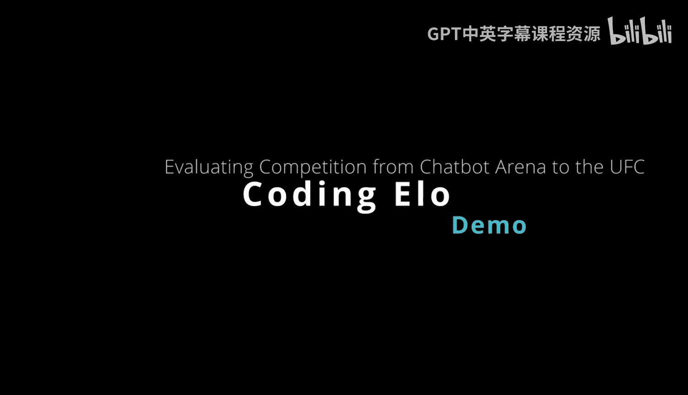
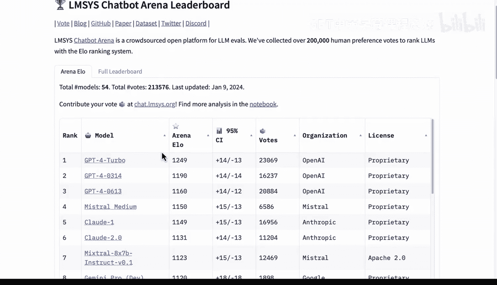
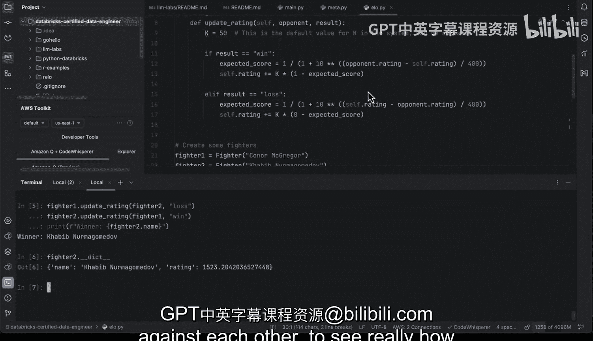

# 本地大语言模型的基础：22：用Python实现ELO评分系统 🏆



在本节课中，我们将学习如何用Python实现ELO评分系统。ELO系统是一种用于评估竞赛参与者相对技能水平的评分方法，广泛应用于国际象棋、电子竞技，乃至大型语言模型的对比评估中。我们将通过一个简单的代码示例，理解其核心逻辑。

## 概述

Chatbot Arena之所以令人兴奋，是因为它为大语言模型提供了“头对头”的对比测试平台。我们可以在此看到商业模型、开源模型和专有模型之间的较量。其真正酷炫之处在于，我们可以从数值角度深入分析哪个模型更优。

我们能够进行这种量化比较，其核心在于ELO评分系统。ELO是一种“赛程强度”指标。它评估的不仅是你赢了多少场，更是你战胜了多强的对手。例如，一个20胜0负但对手全是业余选手的记录，其含金量可能不如一个有几场失利但对手都是顶尖高手的记录。这正是ELO评分要告诉我们的信息：赛程强度。

## 用Python实现ELO

接下来，我们通过Python代码来具体实现ELO系统。我们将创建一个简单的类来模拟参赛者及其评分变化。

以下是实现ELO评分系统的核心代码。我们定义了一个`Fighter`类，它代表一名参赛者，包含姓名和初始评分。`compete`方法用于模拟一场比赛并更新双方的评分。

```python
class Fighter:
    def __init__(self, name, rating=1500):
        self.name = name
        self.rating = rating

    def compete(self, opponent, result, K=32):
        """
        与对手进行比赛并更新评分。
        result: 1 表示胜利，0 表示失败。
        K: 评分调整幅度系数。
        """
        expected_score = 1 / (1 + 10 ** ((opponent.rating - self.rating) / 400))
        self.rating = self.rating + K * (result - expected_score)
```

### 代码解析

上一节我们介绍了ELO的基本概念，本节中我们来看看代码中的关键部分。

*   **预期胜率公式**：`expected_score = 1 / (1 + 10 ** ((opponent.rating - self.rating) / 400))`。这个公式计算了参赛者战胜对手的预期概率。当双方评分相同时，预期胜率为0.5。
*   **评分更新公式**：`self.rating = self.rating + K * (result - expected_score)`。这是ELO系统的核心。评分根据比赛结果（`result`，1为胜，0为负）与预期胜率（`expected_score`）的差值进行调整。`K`值决定了单场比赛评分变动的最大幅度。

### 参数说明



以下是关于代码中关键参数的说明：

*   **K值**：在示例中，`K`值设为32，这是国际象棋中常用的数值。`K`值越大，单场比赛对评分的影响也越大。在实际应用中，可以根据比赛频率和希望评分系统的灵敏度来调整`K`值。例如，UFC比赛场次较少，可能会使用更大的`K`值。
*   **初始评分**：通常设为1500，这是一个基准值。

## 运行示例

现在，让我们创建两名参赛者并模拟一场比赛，看看他们的评分如何变化。

```python
# 创建两名参赛者
conor = Fighter("Conor McGregor", rating=1500)
khabib = Fighter("Khabib Nurmagomedov", rating=1500)

# 打印赛前评分
print(f"赛前评分: {conor.name}: {conor.rating}, {khabib.name}: {khabib.rating}")

# 模拟比赛：Khabib 获胜
khabib.compete(conor, result=1)  # Khabib 获胜
conor.compete(khabib, result=0)  # Conor 失败

# 打印赛后评分
print(f"赛后评分: {conor.name}: {conor.rating:.0f}, {khabib.name}: {khabib.rating:.0f}")
```

运行上述代码，我们将看到类似以下输出：
```
赛前评分: Conor McGregor: 1500, Khabib Nurmagomedov: 1500
赛后评分: Conor McGregor: 1475, Khabib Nurmagomedov: 1525
```

可以看到，获胜者Khabib的评分上升了，而失败者Conor的评分下降了。如果进行多轮比赛，这个系统就能根据对手的强弱，而不仅仅是胜负记录，生成一个衡量参赛者实力的数值指标。这正是ELO系统的强大之处，它是衡量竞赛水平的绝佳方法。

## 交互式探索

我们也可以在交互式Python环境（如IPython或Jupyter Notebook）中探索这个对象。这让我们能够即时实验并观察对象的状态。

例如，我们可以导入`Fighter`类，创建实例，并查看其内部状态（本质上是一个包含姓名和评分的字典）。这说明了ELO并非神秘的魔法指标，其实现相当简单直观。

```python
# 在交互式环境中
from elo import Fighter

conor = Fighter("Conor", 1500)
print(conor.__dict__)  # 输出: {'name': 'Conor', 'rating': 1500}
```

## 总结




本节课中，我们一起学习了ELO评分系统的原理，并用Python实现了一个简易版本。我们了解到，ELO通过考虑对手的强度来评估参赛者的技能水平，而不仅仅是胜负场次。我们实现了核心的预期胜率计算和评分更新公式，并通过示例看到了评分如何随比赛结果动态变化。这个直观而强大的评分系统，是评估大语言模型（无论是开源还是专有模型）在真实竞争场景中表现的优秀指标。