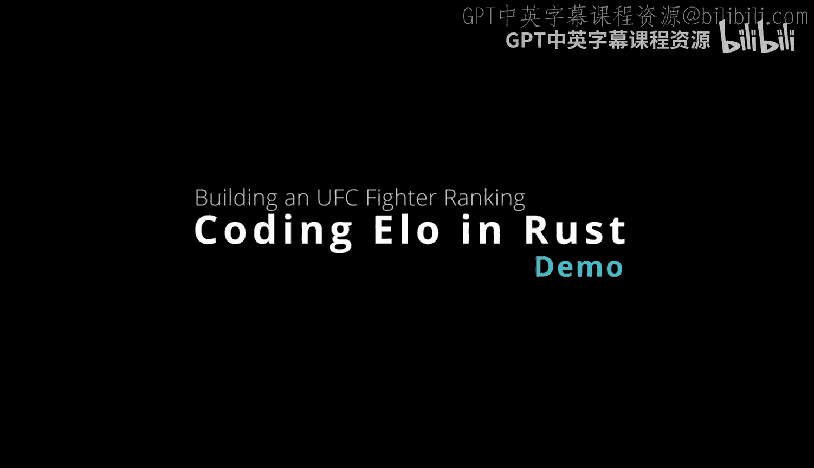
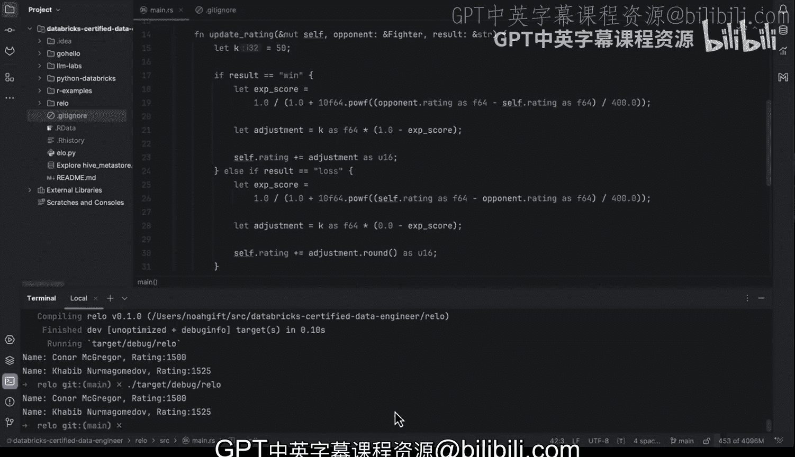

# 本地大语言模型的基础：23：用Rust实现ELO评分系统 🦀



在本节课中，我们将学习如何使用Rust编程语言实现一个ELO评分系统。ELO系统是一种用于比较两个竞争者相对水平的方法，它根据赛程强度动态调整评分。我们将从零开始，构建一个简单的拳击手评分模拟器。

## 概述

ELO评分系统广泛应用于棋类、电子竞技和体育赛事中，用于量化选手的技能水平。其核心思想是：根据比赛结果（胜、负）和双方赛前评分，计算赛后新的评分。我们将用Rust实现这个逻辑，并理解Rust中诸如结构体、方法实现、可变性等关键概念。

## 项目结构与核心概念

首先，我们定义一个表示拳击手的结构体（`struct`）。结构体是Rust中自定义数据类型的主要方式，它允许我们将相关的数据项组合在一起。

```rust
struct Fighter {
    name: String,
    rating: u16,
}
```

这个`Fighter`结构体包含两个字段：`name`（姓名，字符串类型）和`rating`（评分，16位无符号整数类型）。

上一节我们定义了数据结构，本节中我们来看看如何为这个结构体添加行为（即方法）。在Rust中，我们使用`impl`块为结构体实现方法。

以下是`Fighter`结构体相关的方法实现：

*   **`new`方法**：这是一个关联函数（类似于其他语言中的静态方法），用于创建并返回一个新的`Fighter`实例。
*   **`update_rating`方法**：这是核心方法，它根据比赛结果更新拳击手的评分。它接受另一个拳击手的评分和本次比赛的结果（胜或负）作为参数。

## 核心逻辑：更新评分

现在，让我们深入`update_rating`方法，这里是ELO计算逻辑的核心。

```rust
fn update_rating(&mut self, opponent_rating: u16, result: &str) {
    let k_factor = 32; // K因子
    let expected_score = 1.0 / (1.0 + 10.0_f64.powf((opponent_rating as f64 - self.rating as f64) / 400.0));
    let actual_score = match result {
        "win" => 1.0,
        "loss" => 0.0,
        _ => 0.5, // 平局
    };
    let rating_change = (k_factor as f64 * (actual_score - expected_score)).round() as i16;
    self.rating = (self.rating as i16 + rating_change) as u16;
}
```

**代码解释**：
1.  **K因子（`k_factor`）**：这是一个常数，决定评分调整的幅度。在本例中设为32。如果比赛频繁（如国际象棋），K值会设得更小，使评分更稳定；反之，对于比赛较少的项目（如拳击），K值可以更大，使评分对新结果反应更灵敏。
2.  **期望胜率（`expected_score`）**：根据双方当前评分差，计算本方获胜的期望概率。公式为：`E = 1 / (1 + 10^((R_opponent - R_self)/400))`。
3.  **实际得分（`actual_score`）**：根据比赛结果赋值，胜利为1.0，失败为0.0，平局为0.5。
4.  **评分变化（`rating_change`）**：计算公式为 `评分变化 = K * (实际得分 - 期望胜率)`。然后将结果四舍五入取整。
5.  **更新评分**：将计算出的变化值应用到当前评分上。

这里需要注意Rust的一个重要概念：**可变性（mutability）**。由于`update_rating`方法需要修改`self`（即调用该方法的`Fighter`实例）的`rating`字段，因此方法的第一个参数是`&mut self`，表示对自身的一个可变引用。调用该方法的变量也必须声明为可变的（`mut`）。

## 模拟比赛流程

理解了核心算法后，我们来看看如何在主函数（`main`）中模拟一场比赛。

以下是模拟康纳·麦格雷戈（Conor McGregor）与哈比布·努尔马戈梅多夫（Khabib Nurmagomedov）之间比赛的步骤：

1.  **初始化选手**：创建两名拳击手，并将他们的初始评分都设为1500。
    ```rust
    let mut fighter1 = Fighter::new(String::from("Conor McGregor"), 1500);
    let mut fighter2 = Fighter::new(String::from("Khabib Nurmagomedov"), 1500);
    ```
2.  **模拟比赛并更新评分**：假设`fighter2`（哈比布）获胜，`fighter1`（康纳）失败。我们分别调用他们的`update_rating`方法。
    ```rust
    fighter1.update_rating(fighter2.rating, "loss");
    fighter2.update_rating(fighter1.rating, "win"); // 注意：此处传入的是fighter1更新前的旧评分
    ```
    请注意，在更新`fighter2`的评分时，我们传入的是`fighter1`**更新前**的评分（1500），这是ELO系统标准做法，即使用比赛发生时的“即时”评分进行计算。
3.  **输出结果**：最后，打印两名拳击手赛后的新评分。

## 运行与编译

Rust项目通常使用`Cargo`工具进行管理。在运行代码前，保持良好的代码格式是一个好习惯。

我们可以使用以下命令来格式化代码并运行程序：
```bash
cargo fmt   # 格式化代码
cargo run   # 编译并运行程序
```
运行后，我们将在终端看到输出结果。获胜者（哈比布）的评分会上升，而失败者（康纳）的评分会下降。

`cargo run`默认会编译并运行**调试（debug）**版本。如果你需要更优的性能用于生产环境，可以使用`cargo run --release`来编译**发布（release）**版本，编译器会进行大量优化，使程序运行得更快。

## 总结

本节课中我们一起学习了如何使用Rust实现一个基础的ELO评分系统。我们首先定义了`Fighter`结构体来封装数据，然后为其实现了包含核心ELO计算逻辑的`update_rating`方法。在模拟比赛中，我们实践了Rust的可变性概念。最后，我们使用Cargo工具编译和运行了程序。



Rust以其安全性（严格的类型系统和所有权模型）和高性能而著称。正如示例所示，即使是一个简单的程序，也能受益于这些特性。这使得Rust成为需要大规模生成或计算指标（例如，在公司内部使用ELO系统评估不同大语言模型性能的模拟器）场景下的一个绝佳选择。