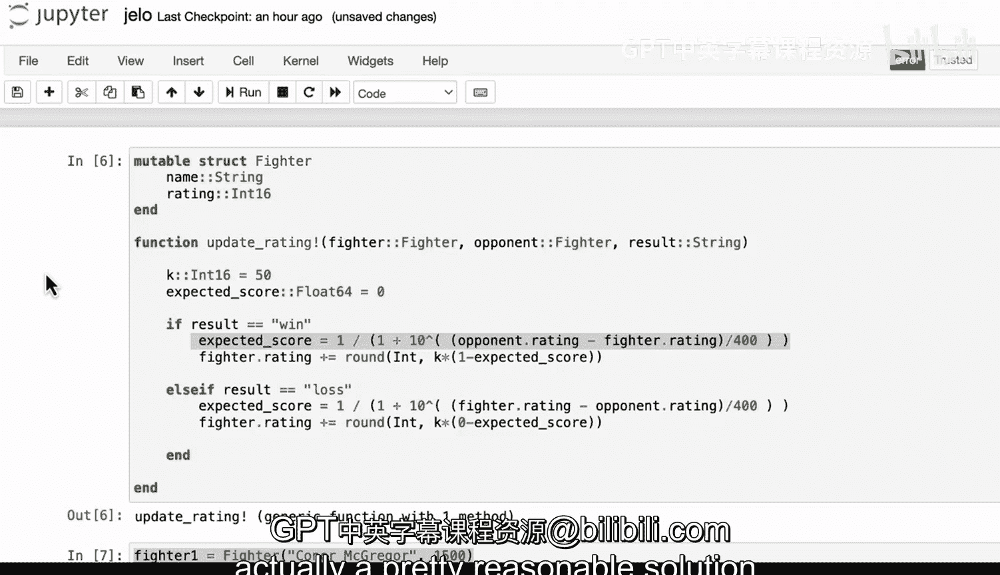

# 杜克大学《本地大语言模型的基础｜Foundations of Local Large Language models》中英字幕 p25 25_02_05_用Julia实现ELO评分系统.zh_en -BV19M4m1m72W_p25-

Here we have some Julia code that I'm going to use to simulate the elo calculation。

 the strength of schedule calculation for two UFC fighters。

 so first up here we have a struct and so this mutable struct here and has a name and a rating and again this mutable keyword allows us to update the rating later so this is a safety feature of the Julia language that's very sophisticated and really a feature of many modern languages and even though this is a scripting language it has that ability to really give you this safety Now if we take a look at this function。

You can see it's a function because we call it function update rating It takes in a fighterstruct。

 This is what we defined earlier and an opponentstruct and then also the result and notice that we have types here which is nice so we know exactly what's going to come in we have these fighter types and then we also have a return type which is going to be this return string now one of the things that we can think about when we're looking at this update rating method is that it is going to mutate the fighter right so this is going to change that value so let's go ahead and run this we can see again it has some metrics inside。

There we go。 So we see that this K equals 50。And the expected score here are all parts of the calculation。

 and we also have as well， the the equation that will give us the values that we are going to update。

 Now， if we have the next fighter here， what we can look at is that we've assigned a default value for each of these fighters before they begin their match。

 and so this is so that we can actually understand。

How to weight the the win or loss based on this initial encounter。 So here we go。

 We see that conne Mc Gor and can be before the match each or equal。

 But if we do this e low calculation， which measures。

The ability of a opponent based on their competition， we can see that things have changed。

 and after the match， the fighter Econom Mc Gregor has a lower elo and fighterer Kabeb has a higher elo。

 So you can see that the Julia language is actually very sophisticated in terms of a data science language and some of the sophistication is that it has newer features。

 more modern features like the ability to have mutable structures and by default fault。

 things are immutable so that you have this safety mechanism built in。 we also have types。

 we also have a very clean language as well。 if you look at the function here。

 pretty straightforward to see actually what's happening。 So when you're building out solutions。

 Julia in Jupyter notebook is actually a pretty reasonable solution。

