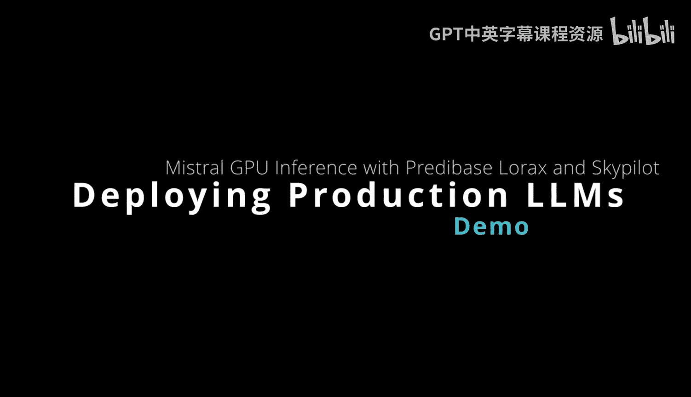
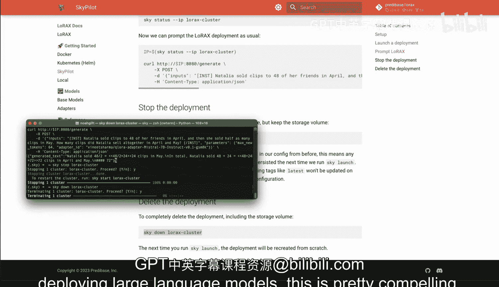

# 杜克大学《本地大语言模型的基础｜Foundations of Local Large Language models》中英字幕 p26 26_02_02_开始使用Lorax与SkyPilot.zh_en -BV19M4m1m72W_p26-

One of the big problems that you face when you're working with large language models is how do you deploy those and one of the solutions here is Lx。

 And if we take a look at the documentation here from perbase。

 it's actually surprisingly simple you can see that you can run a container with a base large language model in this case we're gonna to do myel and then you could choose the GPUs。

 and then that's it。 you're really ready to go and you can see here there's some examples of how to prompt it。

 So this is pretty compelling and what's also nice about this is it's actually built in rust and it's got great inference performance。

 Now I think one of the easier ways to deploy this is to actually use a cloudbased GP。

 So if we go to Skyile it here and we click on it all we have to do is do a Pip install and then make sure that it's ready to go and then it's actually surprisingly simple because all you need to do is actually paste in a YaAml file This is one of the things that I like about。

taase is they've done a lot of great work with Yaml files。 So for example， fine tuning。

 you can use a Yal file， but look at this。 This is just really beautiful right you look at it。

 you see AWS， you can see the accelerator， the port etc， I have my model。

 I mean this is in my opinion， as good as it gets right and so if you have your AWS key set up。

 all I need to do next here is launch the lax job。 So what I'm going to do is actually pull in my environment over here where I've got this running let's go ahead and take a look at what that looks like。

 So once you've got this thing running， you can see here all this stuff is pumping here and we even can see these Hp request and what I'm going to do is actually run their official documentation。

 So let's go ahead and take a look at what that would look like if we scroll down here and we want to find the status we're gonna actually gonna do this in another window。

 So I'm going go ahead and I'm gonna say Sky status。Dsh I， Lrex。Cluster。

And we can see it I've got the IP address Next up， let's go ahead and take a look at the promptier。

 which is pretty simple。And in fact， it's just going to do a curl。

 but we're going actually take that IP address and pipe it into our command。

 So what we can actually do is run both side by side here so you can see the server output on this side right here and then we can run maybe right underneath here we can actually run the code and so all I need to do is actually copy this let's go ahead and go here。

Let's go ahead and piece it in。And there we go， and we can actually see what's going to happen。

We're doing a query using the mystrel。 And you can see that it's actually generated that code example。

 So what's really great about this is you can see we've got a high performance。😊。

Inferant server using open source model。 All we needed to do was do a Yaml based configuration to finish it。

 And even further what's cool about this is if we go and we run the stop we can actually go through here and actually stop our deployments。

 So we're not paying money for it。 we're going to go ahead and say yes。

 so this is I think one of the most compelling solutions that is out there currently for actually doing deployment of large language models。

 especially open source large language models So I would say hats off to Pretabase and the team there this is really an impressive workflow and if I was the CT of a company and I was going to consider deploying large language models this is pretty compelling。

