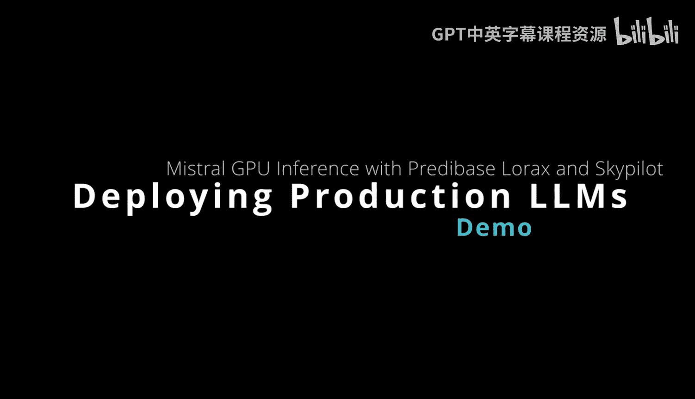
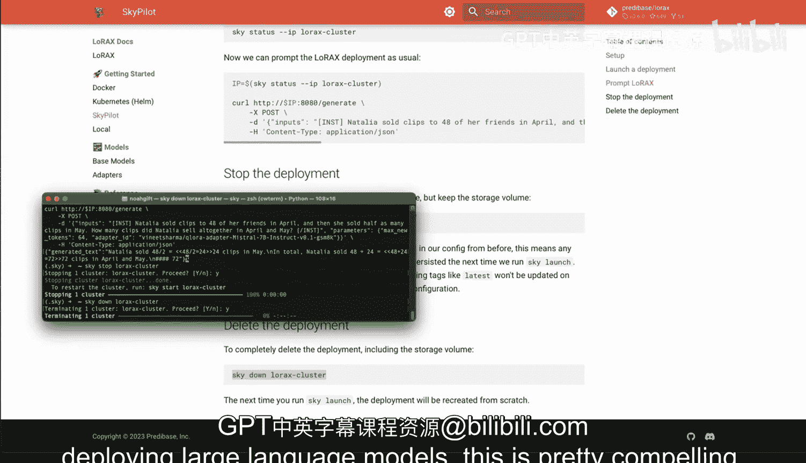

# 本地大语言模型的基础：26：开始使用Lorax与SkyPilot 🚀



在本节课中，我们将学习如何部署大型语言模型，并重点介绍两个强大的工具：Lorax和SkyPilot。我们将了解如何通过简单的配置，在云端快速启动一个高性能的推理服务器。

---

## 概述

部署大型语言模型是一个常见的挑战。Lorax是一个解决方案，它简化了部署过程。结合SkyPilot，我们可以通过云服务轻松配置和启动模型服务器。

## Lorax简介

上一节我们介绍了部署大语言模型的挑战，本节中我们来看看Lorax如何解决这个问题。

Lorax的文档显示，其部署过程非常简单。你可以运行一个包含基础大语言模型的容器。例如，我们可以选择`myel`模型，并指定所需的GPU资源。完成这些步骤后，服务器就准备就绪了。文档还提供了如何向服务器发送提示的示例。

Lorax使用Rust语言构建，因此具有出色的推理性能。

## 使用SkyPilot进行云部署

我认为部署Lorax更简单的方法是使用基于云的GPU服务。接下来，我们看看如何通过SkyPilot来实现。

访问SkyPilot后，我们首先需要执行`pip install`命令进行安装，并确保环境准备就绪。之后的过程非常简单，因为你只需要粘贴一个YAML配置文件。

以下是关于TaaS的一点说明，他们在YAML文件方面做了大量优秀的工作。例如，微调模型也可以使用YAML文件。但请看这个部署配置，它非常清晰明了。

```yaml
# 示例YAML配置结构
resources:
  cloud: AWS
  accelerators: V100:1
  ports: 8000
  # ... 其他配置
```

配置中清晰列出了云服务商（如AWS）、加速器类型、端口等信息。在我看来，这已经非常完善了。如果你已经设置好了AWS密钥，接下来只需要启动Lorax任务。

## 实战演示

我将切换到我的已配置环境中进行演示。一旦服务运行起来，你可以看到各种日志信息输出，甚至能看到HTTP请求记录。我将按照官方文档进行操作。

首先，我们需要检查服务状态。在另一个终端窗口中，运行以下命令：

```bash
sky status --show-ips lorax-cluster
```

命令执行后，我们可以获取到服务器的IP地址。

接下来，我们看看如何向服务器发送请求。这个过程非常简单，本质上就是使用`curl`命令。我们需要将上面获取的IP地址填入命令中。

我们可以并排运行服务器和客户端，以便观察。在服务器输出日志的同一界面下方，我们可以运行查询代码。我只需复制文档中的示例命令，粘贴并执行。

我们正在使用`mystrel`模型进行查询。可以看到，服务器成功生成了代码示例。

## 核心优势与操作

这种方法最棒的地方在于，我们获得了一个使用开源模型的高性能推理服务器。我们所做的仅仅是通过一个YAML文件进行配置。

更酷的是，当我们完成工作后，可以轻松停止部署以节省成本。运行停止命令，并确认即可。

```bash
sky stop lorax-cluster
# 系统提示确认时，输入 yes
```

## 总结

本节课中我们一起学习了如何部署大型语言模型。我认为，对于部署大型语言模型，尤其是开源模型，Lorax结合SkyPilot是目前最引人注目的解决方案之一。



向Pretabase及其团队致敬，他们构建了一个令人印象深刻的工作流程。如果我是一家公司的CTO，并考虑部署大型语言模型，这个方案会非常有吸引力。