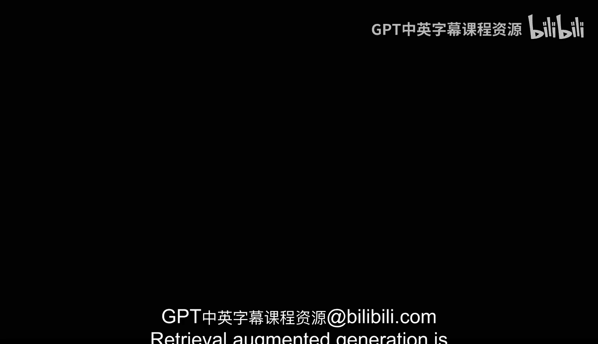
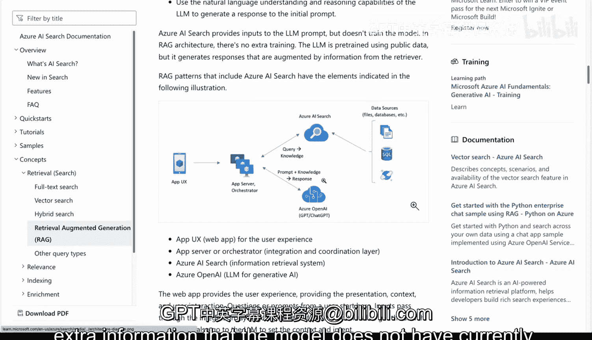

# 杜克大学《本地大语言模型的基础｜Foundations of Local Large Language models》中英字幕 p29 29_02_03_什么是RAG.zh_en -BV19M4m1m72W_p29-

Retrieval augmented generation is a technique by extending。

 grounding and improving results by using a search database or a search engine sometimes also referred to as a vector database so in this case and I really like this example where we're looking at kind of like a basic implementation of what rag means so we have the input from the user and then parallel to the large language model output which is usually you know one to one with the input and the large language model and then producing an output what we have is a set of documents that will get vectorized will get split into chunks that the large language model can understand and in return we can use those documents to。

h the large language model is almost as saying hey， large language model， I'm going to be asking you。

 say for example about politics that things that happen in politics today in the USA of course the language model will have that limited capability of answering correctly or answering accurately because it probably wasn't trained with that data so that's where the database the search engine the vector database will come into place because you can actually enhance make that up to date。

 make it super accurate and then you can when you're processing that input that request to the large language model you can first go to the documents。

 get that information and then proceed to send that information to the large language model so the large language model actually gets the question。

And any relevant search results from the documents。

 So that's one graphic that I wanted to show you and the other one comes from Microsoft Learnn and the retrieval augmented generation in Azure AI search note that Azure AI search recently changed its name from Azure cognitive services search so just keep in mind that if you were used to Azure cognitive services search now this is Azure AI search So let me scroll here all the way down because like this goes into the details of the components of Azure Azure AI search we will cover later but when I wanted to concentrate on is specifically on this graph right here So you may have an application then that goes like this is a more fully fleshed out application and we see something like this later but the request goes into the application you might have something like an API like some Python codes。

 some container that is doing。Processing and then you will submit your request first to the Azure AI search so the Azure AI search will use lots of the information that was preloaded with and you will produce that response necessary to enhance these then with that enhanced request you will go to Azure open AI or one of the other models and then it will go back to the orchestrator and then back to the user so in essence that is what we're looking at here and what we're trying to do with Ra and what that exactly means and when folks are talking about search when they're talking about vector databases when they're talking about retrieval augmented generation they are all talking about similar implementations where we're just enhancing how the model will behave with something like previously loaded documents that might provide。

Extra information that the model does not have currently。

