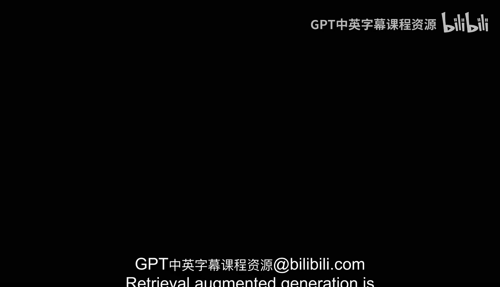
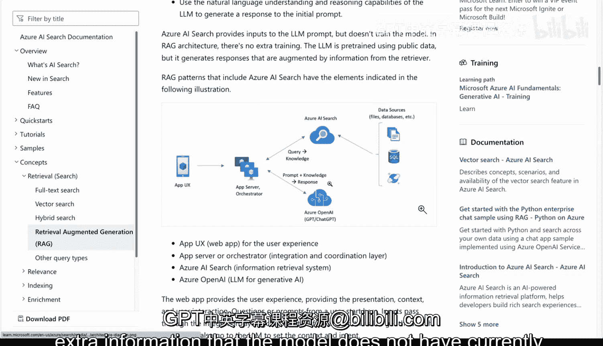

# 本地大语言模型的基础：29：什么是RAG 🧠

在本节课中，我们将要学习检索增强生成技术。这是一种通过利用外部知识库来扩展、锚定和提升大语言模型输出结果的方法。

## 什么是检索增强生成？

检索增强生成是一种技术，它通过使用搜索数据库或搜索引擎来扩展、锚定和改善结果。这种数据库有时也被称为向量数据库。

为了帮助理解，我们来看一个RAG基本实现的例子。用户提供输入，通常大语言模型会直接处理输入并产生输出。但在RAG中，我们有一组文档，这些文档会被向量化并分割成大语言模型能够理解的块。随后，我们可以利用这些文档来增强模型的回答能力。

## RAG的工作原理 🛠️

上一节我们介绍了RAG的基本概念，本节中我们来看看它的具体工作流程。

大语言模型的能力存在局限性。例如，如果你询问关于美国当前的政治事件，模型可能无法准确回答，因为它可能没有使用最新的数据进行训练。这时，数据库、搜索引擎或向量数据库就派上用场了。你可以用最新的、高度准确的信息来增强模型。

在处理用户请求时，系统会首先查询文档库，获取相关信息，然后将这些信息连同原始问题一起发送给大语言模型。这样，大语言模型就能接收到问题以及来自文档的相关搜索结果。

以下是一个示意图，展示了RAG的基本流程：

## 一个更完整的应用架构

另一个图示来自Microsoft Learn，展示了Azure AI搜索中的检索增强生成架构。请注意，Azure AI搜索最近从“Azure认知服务搜索”更名而来。

这个架构描述了一个更完整的应用程序流程。请求首先进入应用程序，应用程序可能包含API、Python代码或容器进行处理。然后，请求会被提交到Azure AI搜索。Azure AI搜索利用预先加载的大量信息，生成必要的响应来增强原始请求。接着，这个增强后的请求会被发送到Azure OpenAI或其他模型。模型的响应会返回给协调器，最终呈现给用户。

本质上，这就是RAG的核心思想。当人们谈论搜索、向量数据库或检索增强生成时，他们指的都是类似的实现方式：通过预先加载的文档来增强模型的行为，为模型提供其当前所不具备的额外信息。

以下是Azure AI搜索中RAG的架构示意图：

## 核心概念总结

本节课中我们一起学习了检索增强生成技术。其核心思想可以概括为以下流程：

1.  **文档处理**：将外部文档**向量化**并**分块**。
2.  **请求增强**：用户查询时，先到**向量数据库**中检索相关文档片段。
3.  **模型生成**：将原始问题与检索到的**相关上下文**一并提交给大语言模型，生成最终答案。

这种方法的核心优势在于，它能用**外部、最新、特定领域**的知识来弥补大语言模型自身知识的不足，从而提供更准确、更可靠的回答。