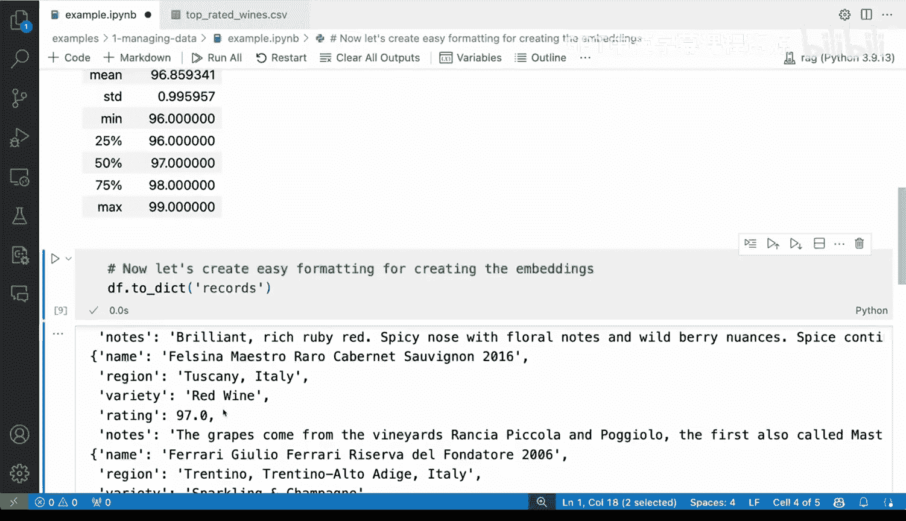

# 杜克大学《本地大语言模型的基础｜Foundations of Local Large Language models》中英字幕 p31 31_02_05_RAG的数据管理.zh_en -BV19M4m1m72W_p31-

Let's see how we can manage data so that we can create our retrieval augmented generation application。

 so we're going to create this application but first we need to understand data and here what I have is a CSP with wines from all over the world and what we have is specifically we have name。

 we have the region， the variety， some ratings and some notes。What is this all about。

 well the name is the name of wine， the region might be something like say for example， Nava Valley。

 like you can see here， and then we have other information like the notess and the ratings。

Now the data itself could be anything right， but we have here CSB is nicely formatted。

 we have these columns and we're going to be using that in order to create our data。

 we're going to a these so that we can create our data and this data is going to go later for our application。

We're going to be using Python and specifically the pandas library so that we can interact with this comma separator value file。

 It's within the repo and you can see here I am loading bit first let's make sure that we have everything ready and I'm making running on this and I'm going to make this a little bit bigger I've imported pandas as Pd that means that pandas is now going to be referenced as PDd this is fairly common and now I'm going to go ahead and load these comma separator value from the top level。

 the root level of the directory and I'm going to run these and you can see that I am getting a little bit of the representation that I was looking for getting the name getting the region。

 the variety， the rating， the nodes and this should be a lot of a lot of entries so let's call this。

は？So that we can see how many we have， well， we have 1365 entries and this is looking at the rating specifically。

 the rating usually goes from the high 80s to 100。And you can see here that well we have a bunch at 96。

97， and that is because I previously prune these from a larger data set that had many different ratings and what we have here is at least ones from 96 points and upwards。

All right， so we have a subset， we floated everything into pandas， what we're going to do next， well。

 we are going to create a dictionary。And we're going to use records。

 and I'm going to show you why in a second。 So let me run this。 It's going to take just a little bit。

 and then we're going to have this representation of the data。

So this is going to be within a Python dictionary。 We're going to have some keys。

 and we're going to have some values。 So it is what's happening here is taking the names of the columns。

 name region variety rating and notes and assigning these values right next to it no problem And why are we doing this for every single wine。

 well we're doing this so that we can later load that into our vector database。

 we are going to be using this type of format， so that later when we're uploading these when we're creating the embeddings。

 we're tokenizing all of these input， we are going to be able to communicate to the vector database。

 hey， this is our data and this is how you need to consume it so that we can search it later with more success。

 So that is in essence， what we've done And I know this is a lot of a lot of data but it is a very simple step。

It took three，4 cells to actually load everything and pour everything to records。 Now。

 if I didn't use records here for this， if I did that and then run this again。

 the the formatting wouldn't be exactly correct。 You see here that the index would be the key and then the value would be something else。

 this is not what we want。 So this is why I chose to do records I'm going to run this again and this is exactly exactly what we need and what we're going to be using for the vector database。

