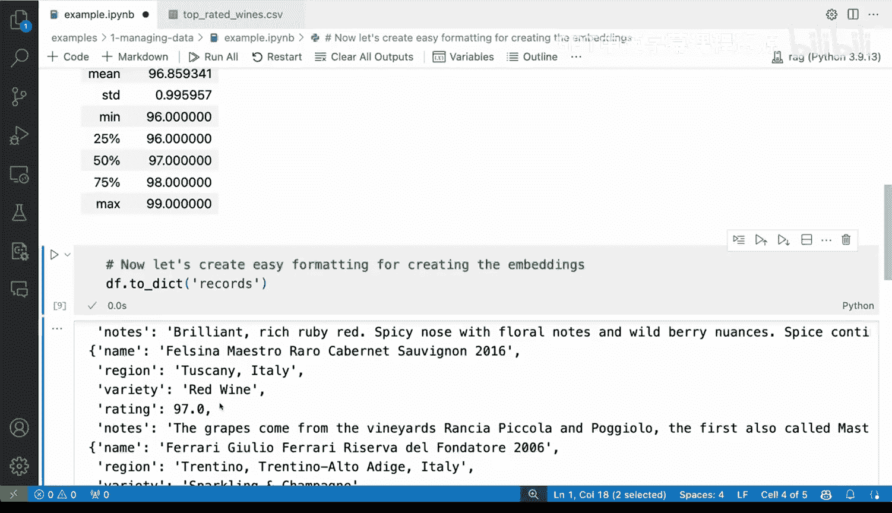

# 本地大语言模型的基础：31：RAG的数据管理 📊


在本节课中，我们将学习如何为检索增强生成应用准备和管理数据。我们将从一个包含全球葡萄酒信息的CSV文件开始，逐步将其处理成适合向量数据库使用的格式。

## 概述

为了构建一个检索增强生成应用，我们首先需要准备数据。本节将演示如何加载一个结构化的CSV文件，并使用Python的pandas库将其转换为适合后续创建嵌入和存入向量数据库的格式。

## 数据加载与查看

首先，我们需要加载数据。我们使用一个包含葡萄酒信息的CSV文件，其字段包括：名称、产区、品种、评分和品酒笔记。

以下是加载和查看数据的步骤：

```python
import pandas as pd
df = pd.read_csv(‘./wine_data.csv’)
print(df.head())
```

运行上述代码后，我们可以看到数据的前几行。数据包含1365条记录，评分主要集中在96分及以上，因为这是从一个更大的数据集中筛选出的子集。

## 数据格式转换

上一节我们成功加载了数据，本节中我们来看看如何将其转换为向量数据库所需的格式。直接使用DataFrame的默认格式可能不符合要求，因此我们需要将其转换为字典列表（records格式）。

以下是转换数据格式的步骤：

```python
data_dict = df.to_dict(‘records’)
print(data_dict[:2]) # 查看前两条转换后的记录
```

通过调用 `df.to_dict(‘records’)`，我们将每一行数据转换成一个字典，其中键是列名，值是对应的数据。这种格式便于后续向量数据库处理，因为它清晰地定义了每个字段及其内容。

## 为何选择Records格式

我们选择`records`格式而非其他格式（如`list`或`series`）有特定原因。其他格式可能将行索引作为键，导致数据结构不符合我们的预期。

以下是不同格式的对比说明：

*   **`records`格式**：生成一个字典列表，每个字典代表一行数据，结构为 `[{‘column1’: value1, ‘column2’: value2}, …]`。这是我们需要的格式。
*   **默认格式（`dict`）**：生成一个以列名为键，以该列所有值组成的序列（如Series）为值的字典，结构为 `{‘column1’: {0: value1, 1: value2}, …}`。这种格式不适合直接用于我们的场景。

因此，使用`records`格式能确保数据以正确的结构传递给向量数据库，为后续的嵌入创建和高效检索奠定基础。

## 总结



本节课中我们一起学习了RAG应用数据管理的基础步骤。我们从加载一个结构化的CSV文件开始，使用pandas库进行初步查看，最后将DataFrame转换为字典列表（`records`格式）。这个处理后的数据格式是后续创建文本嵌入并存入向量数据库的必要前提。整个过程虽然涉及多个步骤，但每个步骤都清晰明了，为构建检索增强生成应用准备好了数据基石。