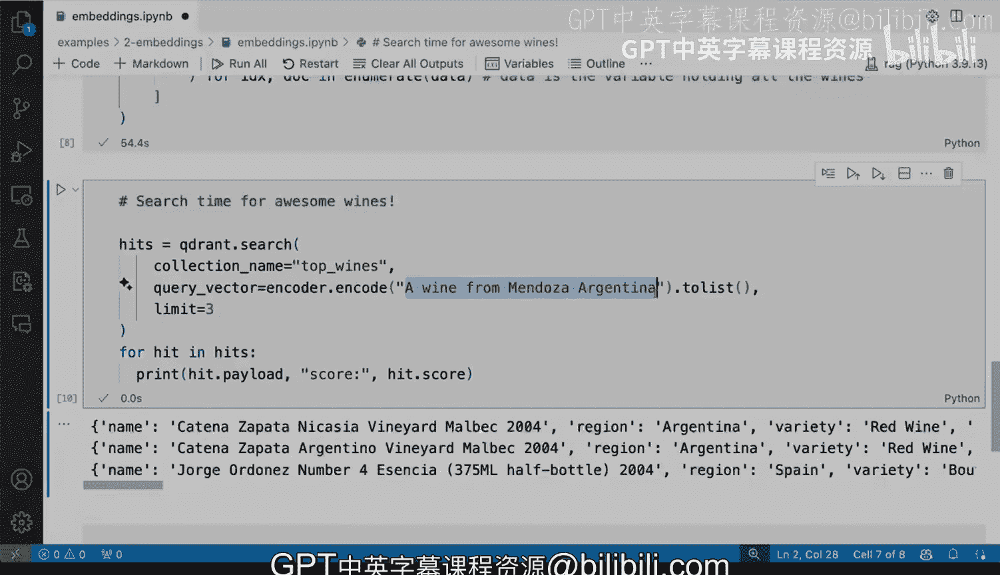

# 杜克大学《本地大语言模型的基础｜Foundations of Local Large Language models》中英字幕 p32 32_02_06_验证嵌入与搜索.zh_en -BV19M4m1m72W_p32-

I'm going to repeat some of the steps in order to load the comma separator value file。

 and I'm going to load that into pans， I'm still going to be using pandas as you can see right here and I'm going to do a little bit of changes here where I'm going to still be dropping that to a dictionary。

And what I'm doing here is essentially making sure that I don't have not a number values。

 That means that anything， any field that doesn't have any values will be dropped。

 So I'm making sure that effectively I' pruning I'm pruning that data set and making sure because otherwise I could get into travel trouble when when I'm doing that serialization。

 Al right， so let's run these。And again similar as we've seen like I'm going to get the name。

 the region， some data， some information here， 1300 rows。

 and now I'm going to use the software needed in order to have this vector database search and I'm going to use quadrant and for a quadrant specifically I'm going to import these things。

 the models， the quadrant client and I'm going to import sentence transformers。

 I'm going to go into details as to why that is and in each one in details so that you have a good understanding of why each one is needed。

So the sentence transformers will give us the ability to do the encoding。

 the encoding is absolutely needed， and we're going to be using the all mini LML6 V2 and this will automatically download the machine learning model locally so that we can do the tokenization dec embeddings so that it goes into the vector database this is required in order to later be talking to the large language model。

But then we're going to use the quadrant client and the quadrant client is what we need in order to talk to the database。

 is's an instance of the database that is going to be coming from right here。

 so this import is the one that is going to allow us to talk to this database and one of the cool things here is that we're going to be able to use in memoryory database we don't need to create a found based database or a network based database this is very convenient for examples and it is what I've chosen today to make this pretty compelling。

Alright， so next what'm going to do is going to create a collection。

 the collection will be able to reside within the database and when I pass in certain parameters and we're going to say what's the distance the distance is to basically do a comparison and find what phrases from what I'm searching will be closer to the data the information that I'm going to be storage I'm going create configuration actually the collection the vector's configuration is to is going to be this one and the vector size。

 the find byus model it is coming from this guy right here so this is just making sure that the size is actually correct and I'm using the cosine distance and once this is done then I am able to create create these index and when I be able to upload everything into our。

Vctor database。 All right so we're gonna name our collection tab wines and what we're going pass is we're gonna pass the nodes to as the vector。

 So we're going encode that and that is going to go to the vector and then the rest is going to go into the payload here。

 that's the meta data。 we're going put everything in there。

 we're going loop over that create the index doc and we're going to enumerate we're gonna run this and this is going to take a while because we're going to do about 1300 records and this is going to take a second。

 I'm going to run this and we'll wait until we completes。

 All right in my system that took 4 54 seconds that was quite a lot My suggestion would be to reduce the number of entries for a demo though we make do I had to wait these 54 seconds for this to complete。

 All right so this is done now we the moment of truth we are going to search and for that we're going to use the search。

Function right here。 we're going to specify our collection， and we're going to pass our query。

 And this is also going to go through the encoder。 We're going to limit three results。

 and'm going to see what we come back，99 points carbonness when youm from Napa Valley。

 and we get a few that are coming back。 So you can see here that basically the vector is using the notes。

So it's making sure that he's capturing right here the notes specifically。

 and that is what's being searched and that comes pretty， you know， pretty， pretty good。

 but we could actually try to change it up a little bit and say something something else。

 we could say something for example， a wine from Mendoa， art andna。

And then we could run this again and we will get something completely different in this case Kaana Sabata which is a very good wine。

 but you can see now that these results are coming back so why is this useful。

 why is this relevant because we've configured this vector database so that it understands our language or natural language processing that will happen later with the large language models so that we can get relevant results and then it can enhance the response from the large language model。

