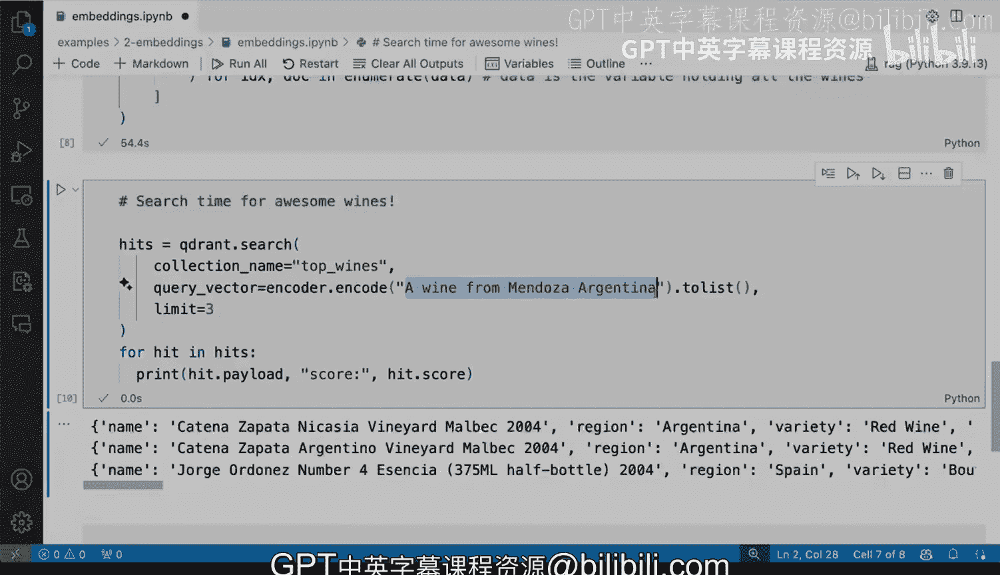

# 本地大语言模型的基础：32：验证嵌入与搜索 🔍


在本节课中，我们将学习如何加载数据、创建向量数据库，并执行语义搜索。整个过程将涉及数据清洗、文本嵌入以及使用向量数据库进行相似性查询。

---

上一节我们介绍了数据处理的基本步骤，本节中我们来看看如何具体实现数据加载与清洗。

我将重复一些步骤来加载CSV文件，并使用pandas将其加载进来。这里我仍然会使用pandas，你可以在此处看到。我会做一些调整，确保将数据转换为字典格式。

此处的核心操作是确保数据中不包含“非数字”值。这意味着任何没有值的字段都将被删除。我这样做是为了有效地修剪数据集，否则在后续序列化过程中可能会遇到问题。

以下是加载和清洗数据的代码：

```python
import pandas as pd

# 加载CSV文件
df = pd.read_csv('your_file.csv')
# 删除包含NaN值的行
df_cleaned = df.dropna()
# 转换为字典列表
data_dict = df_cleaned.to_dict('records')
```

运行这些代码后，我们将获得名称、地区等信息，共1300行数据。

---

现在，我们将使用必要的软件来建立向量数据库搜索功能。我将使用Qdrant，并导入相关组件。

以下是所需的导入语句：

```python
from qdrant_client import QdrantClient
from qdrant_client.models import Distance, VectorParams
from sentence_transformers import SentenceTransformer
```

我将详细解释每个组件的作用，以便你理解为何需要它们。

`sentence_transformers` 库为我们提供了编码能力，这是生成文本嵌入所必需的。我们将使用 `all-MiniLM-L6-v2` 模型，它会自动在本地下载机器学习模型，以便我们进行分词和生成嵌入向量，这些向量随后会存入向量数据库。这一步对于后续与大语言模型交互至关重要。

接着，我们将使用 `QdrantClient` 来与数据库通信。它是一个数据库实例，允许我们进行各种操作。其中一个很酷的功能是我们可以使用内存数据库，无需创建基于文件或网络的数据库，这对于示例演示非常方便，也是我今天选择它的原因。

---

接下来，我们将创建一个集合。这个集合将存在于数据库中，我们需要传入一些参数来配置它。

我们将指定距离度量方式，用于比较搜索查询与存储数据之间的相似性。我们将创建集合的向量配置，确保向量大小与所选模型匹配，并使用余弦距离。

以下是创建集合的代码：

```python
# 初始化编码器
encoder = SentenceTransformer('all-MiniLM-L6-v2')
# 初始化Qdrant客户端（使用内存模式）
client = QdrantClient(":memory:")
# 创建集合
client.create_collection(
    collection_name="fine_wines",
    vectors_config=VectorParams(size=encoder.get_sentence_embedding_dimension(), distance=Distance.COSINE),
)
```

配置完成后，我们就能创建索引并将所有数据上传到向量数据库中。

---

我们将把集合命名为 `fine_wines`。上传数据时，我们会将“品酒笔记”字段编码为向量，其余信息则作为元数据存入载荷中。

以下是上传数据到向量数据库的步骤：

1.  遍历清洗后的数据字典。
2.  对“品酒笔记”文本进行编码，生成向量。
3.  将向量和元数据封装为索引文档。
4.  将文档上传至集合。

```python
for i, record in enumerate(data_dict):
    # 编码文本笔记，生成向量
    vector = encoder.encode(record['notes']).tolist()
    # 准备元数据载荷
    payload = {key: value for key, value in record.items() if key != 'notes'}
    # 上传点（向量+载荷）到集合
    client.upsert(
        collection_name="fine_wines",
        points=[PointStruct(id=i, vector=vector, payload=payload)]
    )
```

运行此过程需要一些时间，因为我们要处理大约1300条记录。在我的系统上，这花费了54秒。对于演示，我建议减少条目数量以节省时间。

---

数据上传完成后，就到了验证的时刻：执行搜索。我们将使用Qdrant的搜索功能。

以下是执行搜索的代码：

```python
# 定义搜索查询
query_text = "一款带有浆果味的浓郁红酒"
# 对查询文本进行编码
query_vector = encoder.encode(query_text).tolist()
# 执行搜索
search_result = client.search(
    collection_name="fine_wines",
    query_vector=query_vector,
    limit=3  # 返回最相似的3个结果
)
```

例如，当我们搜索“一款来自纳帕谷、带有浆果味的浓郁红酒”时，可能会得到评分99分的“Caymus”等结果。你可以看到，向量数据库主要利用“品酒笔记”字段进行语义匹配，搜索结果相当不错。

我们可以尝试不同的查询，例如“一款来自门多萨、口感丝滑的马尔贝克葡萄酒”。再次运行搜索，会得到完全不同的结果，比如“Catena Zapata”。这说明系统能够根据自然语言查询找到相关的葡萄酒信息。

---

那么，这为何有用且相关呢？因为我们配置的这个向量数据库能够理解我们的语言（通过嵌入模型），这为后续的自然语言处理（与大语言模型结合）奠定了基础。它可以帮助我们获取高度相关的信息片段，从而增强大语言模型最终回复的准确性和丰富性。

---



本节课中我们一起学习了从加载清洗数据、使用Sentence Transformers生成嵌入、到配置Qdrant向量数据库并执行语义搜索的完整流程。关键在于，我们建立了一个能理解文本语义的检索系统，它可以作为外部知识库，为大型语言模型提供精准的上下文信息。