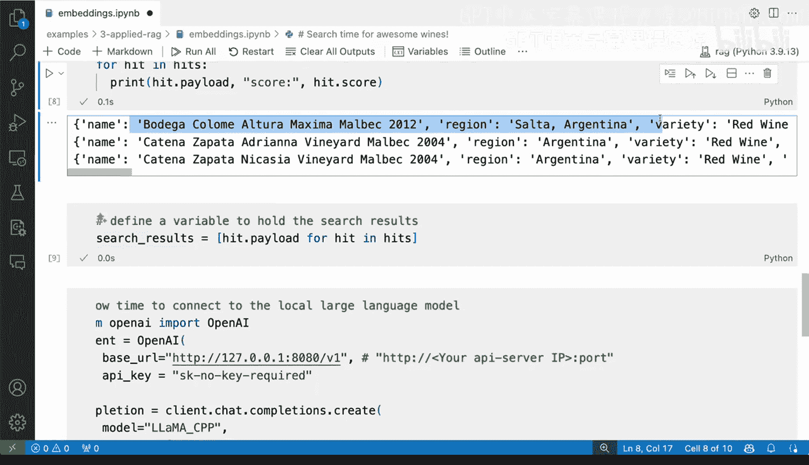

# 杜克大学《本地大语言模型的基础｜Foundations of Local Large Language models》中英字幕 p33 33_02_07_在LLM中使用RAG.zh_en -BV19M4m1m72W_p33-

Alright， so now it's time to get our wines comma separator value inside our database and we're going to again import pandas and we're going to use these in order to get these records into the database and then we're gonna make it work with our large language model All right so we're gonna drop these data only to 700 entries to make it faster。

 we're going click here so that it runs， we're in order the warning that we're get getting there and then we' to use the quadrant client。

 we're going to run this again， we're gonna import some of the things that we're going to be using。

 we're gonna run the encoder again， and then we are going to create the vector database client again。

 we're going create the collection to store the we're not gonna to store books we're going store some wines and we're going to say store wines。

 we' going to save that everything the same as before I'm gonna run that and then we're going to create the vector we're going upload everything into our collection the top wines collection。

Right there and then what we're gonna to be doing is when I wait until that completes。

 it's going to take a few seconds because we've reduced these to only 700 records and once that is complete。

 we are going to be using this with the open AI APIs and that is going to allow us to get meaningful meaningful results so let's just wait until these complete Allright that completed。

 it took 34 seconds and you know even though I reduced it to 700 entries。

 this is going to this is going to take you know quite a while in my in my machine so I'm going to scroll down all the way to the bottom and I'm going do this prompt suggest me an amazing Mbag wine from Argentina I'm going to define that as a variable and now I'm going to search。

So I'm going to search these and again， I'm going to get the some of the results here， perfect。😊。

And now I'm going to make it easier going to apply all of those results to this variable right there and I'm going to connect to OpenaiI so I'm running a local model I'm using Lama file behind the scenes those or that is not really relevant what is relevant is that you could actually connect these to ChaGT or an open AI API ash or perhaps or something that defines that API for you and you can see here I don't need any keys I can talk to that directly so here we have the prompts。

And I have the system prompt， you a Chabo， a wine specialist。

 your top priority is to help guide users into selecting amazing wide and guide them with their requests perfect。

 and then the content you suggest me an amazing M wine from Argentina and the role of system content is what we're going to get in from our results from the database。

Great， this is going to run。😊，And we are going to get the content here， the chat completion message。

 Let's see what the large language model responded with and it says I suggest you try the Bodega Colome Alta Maxima Albe from Argentina Oh this is amazing。

 It has rating 96 So it's using none of that context from before。

 remember if I scroll here all the way to the top。 you can see that this was the first result and it's coming from Salelta Argentina。

 which is a very beautiful region in Argentina for sure So there you go that is how you would make all of this work with a database enhancing with a large language model and getting results that are meaningful because of the extended context。

