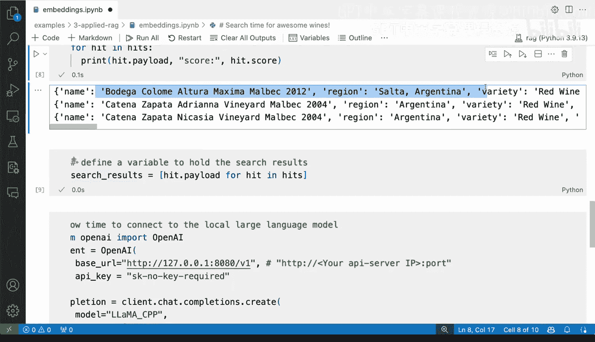

# 本地大语言模型的基础：33：在LLM中使用RAG


## 概述
在本节课中，我们将学习如何将外部数据（一个葡萄酒数据集）导入向量数据库，并利用检索增强生成技术，让大语言模型基于这些数据生成更准确、更有意义的回答。我们将通过一个具体的例子——查询阿根廷的优质马尔贝克葡萄酒——来演示整个工作流程。

## 准备工作
上一节我们介绍了向量数据库的基本概念。本节中，我们将实际操作，把CSV格式的葡萄酒数据加载到数据库中。

首先，我们需要导入必要的库并加载数据。为了提升演示速度，我们将数据条目限制在700条。

```python
import pandas as pd
# 假设 wines.csv 是我们的数据文件
data = pd.read_csv('wines.csv').head(700)
```

## 创建向量数据库与集合
接下来，我们需要初始化向量数据库客户端，并创建一个专门用于存储葡萄酒数据的集合。

以下是创建向量数据库客户端的核心步骤：

```python
# 导入必要的模块，例如Quadrant客户端
from quadrant_client import QuadrantClient
# 初始化客户端
client = QuadrantClient()
# 创建名为“top_wines”的集合
collection = client.create_collection(name="top_wines")
```

运行以上代码后，我们就有了一个可以存储和检索葡萄酒信息的向量数据库集合。

## 向数据库上传数据
数据库和集合准备就绪后，下一步是将处理好的葡萄酒数据上传到“top_wines”集合中。

这个过程涉及将每条葡萄酒记录转换为向量并存入数据库。虽然我们已将数据缩减到700条，但上传仍需一些时间，请耐心等待。

```python
# 假设 `data_vectors` 是已经编码好的数据向量列表
collection.upload(data_vectors)
```
上传完成后，我们的数据库就包含了用于检索的葡萄酒知识。

## 执行检索与生成
现在，数据库已准备就绪。我们将结合大语言模型来回答一个具体问题。

我们定义用户的问题是：“请为我推荐一款阿根廷产的优质马尔贝克葡萄酒。”

以下是执行检索并准备上下文的核心代码：

```python
user_query = "请为我推荐一款阿根廷产的优质马尔贝克葡萄酒。"
# 在集合中进行相似性搜索，获取最相关的几条记录
search_results = collection.search(query_vector=encode(user_query), limit=5)
# 将检索结果整合为给模型的上下文
context = "\n".join([result['text'] for result in search_results])
```

## 调用大语言模型获取答案
我们获得了相关的葡萄酒信息作为上下文。现在，我们将结合系统指令、用户问题和检索到的上下文，调用大语言模型来生成最终答案。

我们将使用一个预设了“葡萄酒专家”角色的系统指令，并将检索到的上下文作为补充信息提供给模型。

```python
system_prompt = "你是一名葡萄酒专家，首要任务是帮助用户挑选出色的葡萄酒，并根据他们的请求提供指导。"
full_prompt = f"{system_prompt}\n用户问题：{user_query}\n相关葡萄酒信息：{context}"

# 调用大语言模型API，例如OpenAI的ChatCompletion
response = openai.ChatCompletion.create(
    model="gpt-3.5-turbo",
    messages=[{"role": "user", "content": full_prompt}]
)
generated_answer = response.choices[0].message.content
```
模型运行后，会生成一个融合了数据库知识的回答。

## 结果分析
让我们看看大语言模型返回了什么结果。

模型回答道：“我建议您尝试阿根廷Bodega Colomé酒庄的Alta Máxima Albe葡萄酒。它的评分高达96分。”

这个推荐并非模型凭空想象，而是基于我们从数据库中检索到的第一条结果（来自阿根廷Salta产区）生成的。这证明了RAG技术的有效性：它通过引入外部知识，极大地增强了模型回答的准确性和相关性。

## 总结
本节课中，我们一起学习了检索增强生成技术的完整应用流程。



我们从导入数据开始，逐步完成了创建向量数据库、上传数据、执行语义检索，并最终利用大语言模型结合检索到的上下文生成高质量答案。这个过程展示了如何通过RAG让大语言模型突破其固有知识的限制，根据特定的、最新的外部数据源提供精准的信息服务。