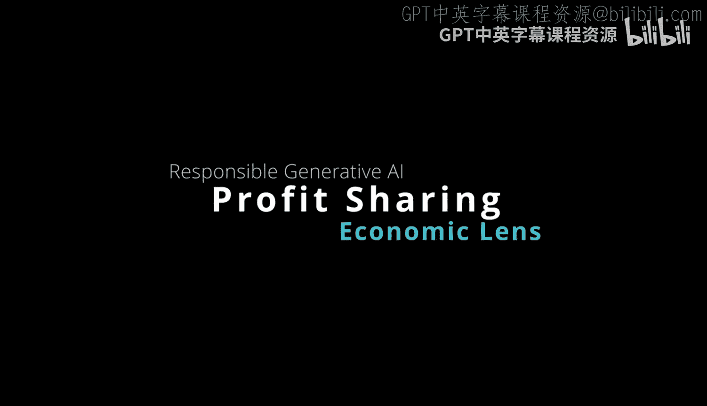
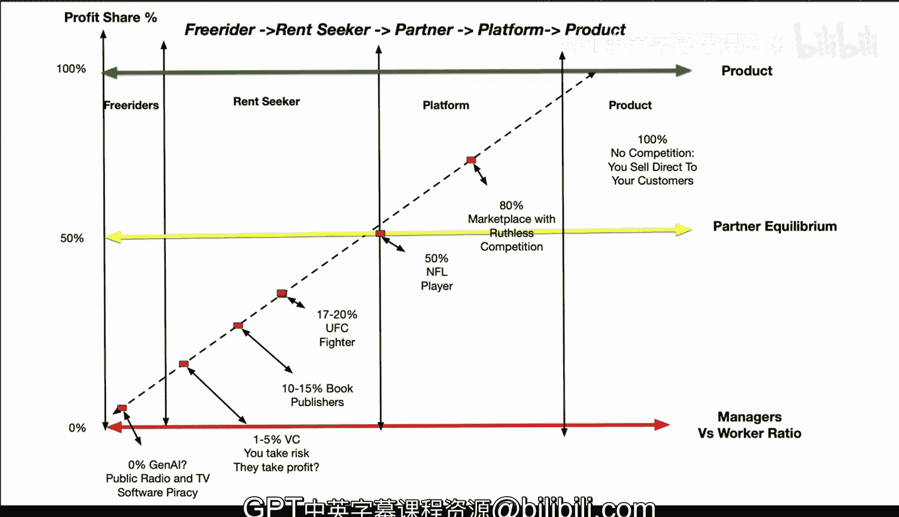

# 杜克大学《本地大语言模型的基础｜Foundations of Local Large Language models》中英字幕 p35 35_03_02_利润分享概念.zh_en -BV19M4m1m72W_p35-

It's important to think about profit share and percentage in the context of society and we can think about this from a microeconomics frame。

 And if we look at this free rid scenario here， this is one kind of profit share。

 we have rent seeker which is another kind of profit share， we have platform。

 which is another kind of profit share and we have product。

 there's no perfect scenario in any of these categories really there's pros and cons to this in terms of both the consumer and the company as well。

 but it's important understanding what these terms mean。 So first up， if we have free rids。

 a good example would be public radio and TV。 So there are many people that daily listen to public radio。

 but never pay for subscription， So they're free rids。

 they're getting a benefit without paying anything for it。

 If enough people didn't pay for public radio， there would be no public radio。

 likewise with software piracy if it's able。In terms of a software package it's able to be downloaded for free eventually if enough people became free writerss。

 there be no profit and then why would the software developer actually continue to develop that software so the free rids could cause an issue there and likewise this may be the case with generative AI as well if all of the content from newspapers to films to book writers to software engineers is all consumed and there's no profit sharing then eventually the motive to produce these things in the public domain or even in a copyrighted manner if they're not protected could induce all creative output to zero so these are some of the issues with with free writing now again。

 if there's only a few free writerss then maybe doesn't matter but it's something to be aware of now in terms of rent seeking the concept with rent seeking and it's not 100% rent seeking behavior there's a gradient here is that you want to do as little work as possible。

While getting some kind of a rent or some kind of a payment， so if we look at venture capital。

 that's a good example where in some scenarios， potentially a venture capital firm will invest in 100 companies。

 they know that 95 out of 100 potentially could go bankrupt so those 95 companies with their employees are taking gigantic risk。

 they could have even earned a much larger payout in terms of salary bonuses from an established company。

 but they're actually getting a lower expected value。

 which is the profit that you're going to get multipied by the probability of the event in this case it would be essentially 5% probability。

And so you're taking all the risks， but the venture capitalists are taking the profit because they've invested in a way of indexing against all the risk。

 likewise with book publishers in some scenarios， maybe a book publisher does a lot for an author and some scenarios maybe they do very little。

 but they're getting 10 to 15% in many scenarios for the book so you could call this a form of rent seeking now a lot of times as well in these kinds of scenarios。

You could see that there's really a high amount of management because they have the funds。

 right they're taking a majority of the profits， and then they potentially invest that back into the organization。

 Now whether that actually adds value to society or it adds value to the product is really on a case by case basis。

 we can see with professional sports， one of the lower profit sharing percentages is the UF where they're getting 17 to 20% payouts。

 But in the terms of more mature organizations like the NFL that're getting a partner level payout。

 So 50% of the revenue that goes in the NFL that goes back to the players and other organizations that are more mature like basketball and baseball also have similar profit sharing。

 So you can see there there's a partner equilibrium where。Really。

 the tradeoffs start to make sense for both the workers as well as the owners。

 and this could be a sweet spot to consider now in terms of a platform。

 there are also some benefits right， if you get 80% of the profit that's great for you。

 but if there's ruthless competition that's not great for you and there's an expression and economics in perfect competition。

 all profit at least is zero， meaning that if the platform has no way of limiting who can join the platform。

 there's no way to even differentiate between who's great and who's not great and this could really cause a problem with eliminating the profit。

 now the platform itself potentially could make lots of money because they have all these people competing and they get a transaction fee。

The final stage here is really kind of a perfect scenario for the owner is if you're， let's say。

 a farmer and you directly sell fruit on the side of the road， you get 100% of the profit， right。

 There's no transaction fees。 There's nothing involved with a middleman。

When you're selling a product directly to the customer。

 so it's important to consider this whenever you hear about a opportunity or a new kind of technology or some new thing that you're thinking about is that there's tradeoffs to each of these there's tradeoffs to free riders。

 there's tradeoffs to rent seekers， there's trades of the platform， there's tradeoffs to products。

 and it's important to really go into the scenario with your eyes open and also from an ethical standpoint。

 what is the impact on society when you're engaging with a company that's doing one of these behaviors。

