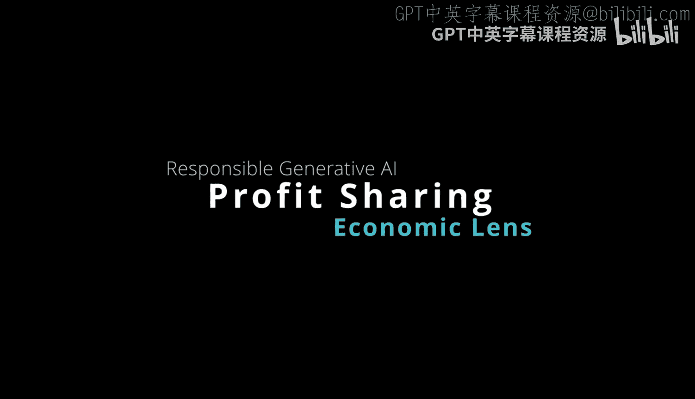
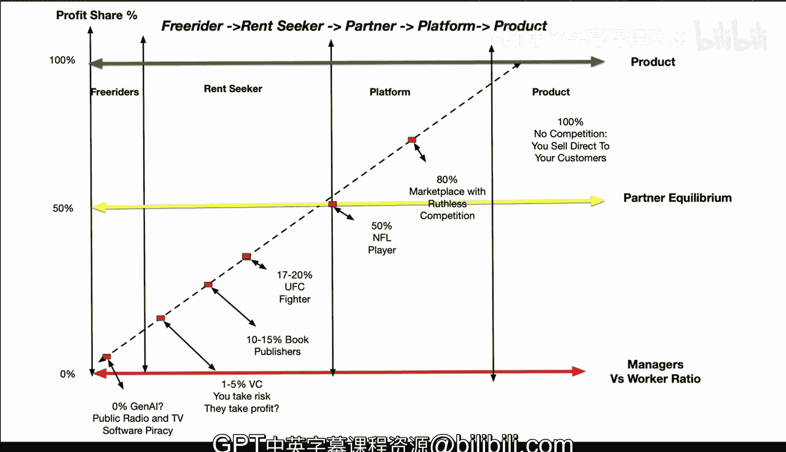

# 本地大语言模型的基础：35：利润分享概念 💰

在本节课中，我们将学习利润分享的不同模式及其对社会的影响。我们将从微观经济学的角度，分析四种主要的利润分享场景：搭便车者、寻租者、平台和产品。理解这些概念有助于我们评估新技术或商业机会的利弊。

## 从微观经济学角度思考利润分享

在社会的背景下思考利润分享和比例非常重要，我们可以从微观经济学的框架来理解这一点。

## 四种利润分享模式

以下是四种主要的利润分享模式，每种模式都有其优缺点，对消费者和公司的影响各不相同。

### 搭便车者

搭便车者是指享受利益却不支付任何成本的行为。如果搭便车者过多，可能导致产品或服务无法持续。

*   **公共广播电视**：许多人每天收听公共广播，但从不支付订阅费，他们就是搭便车者。
*   **软件盗版**：如果软件包可以免费下载，最终导致足够多的人成为搭便车者，开发者将无利可图，从而失去继续开发软件的动力。
*   **生成式AI的潜在问题**：如果从报纸、电影到书籍和软件的所有内容都被消费，却没有利润分享，那么最终生产这些内容的动机可能会消失，导致所有创造性产出降为零。

**核心概念**：搭便车者数量少或许影响不大，但这是一个需要警惕的问题。

### 寻租者

寻租行为（这里并非100%的寻租，而是一个渐变的概念）旨在以尽可能少的工作，获取某种租金或报酬。

*   **风险投资**：风投公司可能投资100家公司，知道其中95家可能会破产。那95家公司的员工承担了巨大风险，他们本可以在成熟公司获得更高的薪水和奖金，但实际获得的**期望值**更低。风投公司则通过投资组合来对冲所有风险，从而获取利润。
    *   **期望值公式**：`期望值 = 利润 × 事件发生概率`
*   **图书出版商**：在某些情况下，出版商为作者做了很多，有时则做得很少，但他们通常能获得图书收入的10%到15%，这也可以被视为一种寻租形式。

**核心概念**：在这些场景中，通常存在高度的管理，因为资金方拿走了大部分利润，并可能将其再投资回组织。这是否为社会或产品增加了价值，需视具体情况而定。

### 平台

平台模式也有其好处。如果你能获得80%的利润，这对你非常有利。

*   **完全竞争**：经济学中有一个说法，在完全竞争下，所有利润至少为零。这意味着如果平台无法限制加入者，甚至无法区分优劣，这可能导致利润被消除。
*   **平台的盈利**：平台本身可能赚很多钱，因为它让所有人在上面竞争，并收取交易费。

**核心概念**：平台面临无情的竞争，这可能对参与者不利。

### 产品

对于所有者来说，最理想的情况是直接向客户销售产品。

*   **直接销售示例**：假设你是一个农民，在路边直接销售水果，你获得100%的利润。这里没有交易费，也没有中间商参与。

**核心概念**：这是所有者获取全部利润的完美场景。

## 权衡与伦理考量

在考虑任何机会、新技术或新事物时，必须权衡每种模式的利弊。

*   **权衡无处不在**：搭便车者、寻租者、平台和产品模式各有其权衡。
*   **保持清醒**：重要的是要睁大眼睛进入任何场景。
*   **伦理影响**：从伦理角度看，当你与采取上述某种行为的公司互动时，需要考虑它对社会的影响。

---

本节课中，我们一起学习了四种利润分享模式：**搭便车者**、**寻租者**、**平台**和**产品**。我们了解了每种模式的定义、典型例子及其潜在的社会经济影响。关键在于认识到没有完美的模式，每种选择都伴随着对消费者、生产者和整个社会的不同权衡。在评估商业或技术机会时，保持清醒的认识并思考其广泛的伦理影响至关重要。