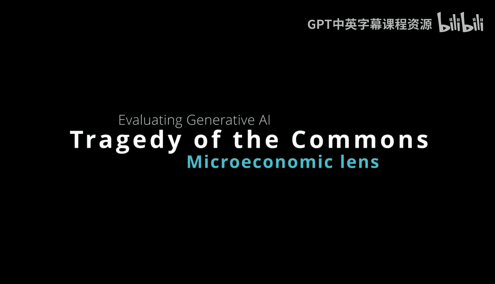
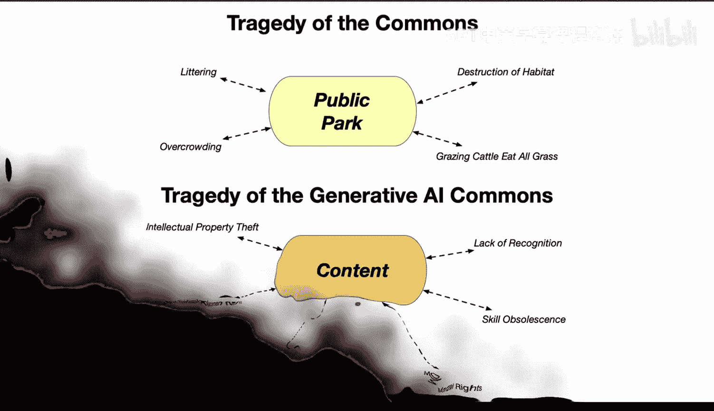

# 杜克大学《本地大语言模型的基础｜Foundations of Local Large Language models》中英字幕 p36 36_03_03_生成式AI的公共资源悲剧.zh_en -BV19M4m1m72W_p36-

Tragedy of the Commons is a great example of some of the things that can happen when you have a free resource that is shared by really an unlimited number of people。

  different things can happen。 There's no regulation and let's say it's a public park。

 you could litter everywhere and destroy the public park just from littering alone。

 you also could overcrowd the park。 let's say there's again。

 no regulation and there's really like a horde of people constantly coming in and eventually the park is so crowded。

 you can't even visit the park。 Another one would be destruction of habitat if you went to。

 let's say a national park and started destroying maybe some of the features of the national park or parts of the mountain etc ce。

 then it no longer could be as beautiful as it was before or the classic example is you have different companies that own cattle。

 some ranchers will then go in and kind of compete to see who can。

the most amount of grass because they're afraid the other one will consume grass quicker than they will。

 So it's kind of a race to the bottom。 And then before you know it there's no grass left and it's all been destroyed。

 So this is the classic case of tragedy， the commons。 In fact。

 you can see this in certain public parks depending on the regulations， all over the world。

 including in the United States。 the tragedy of the generative AI commons has some of those similar characteristics。

 So let's think first here about intellectual property theft。

 So a generative AI model could be trained on copyrighted works and then the author or maybe the company involved doesn't have consent。

 and then that could devalue the original work and even undermine the incentive to create new content。

 if your property is going to be stolen。 why would you create more We also have job displacement。

 So in the case of generative AI there's a risk that human creators would be no longer as desired and this could lead to job displacement and there's a negative externality。

That's associated with it。 So if those people can get can't get work anymore。

 then society has to bear the burden of that job displacement， also quality control。

 So it's possible that。In the case of the outputs， the work is going to even devalue the artist because it looks really poor quality but it' actually the generative AI that's mimicking the artist and it could lead to just overall quality control problems we also have the lack of recognition or attribution so a creator could really have their work stolen without compensation and then they're not even recognized for actually creating the original work and this can be demotivating and it could be unfair and it could also have a significant contribution to whether that artist in the future gets work we also have the ethical concerns themselves or the moral rights where an author may not want。

 let's say their image associated with smoking or alcohol or some other vice and you're not asking their permission so it isn't a kind of a slam dunk with geneative。

I where the traditional tragedy of the common scenario is just magically not there for generative VI。

 they actually exist as well for this problem and so we need to look at both the benefits and there's some strong benefits of generative VI like summarization or outlining or cogeneration but then also look at the negative externalities。

 what is the impact on society where society isn't actually getting benefited。

From some of these things like if if it's a commercial model， society isn't getting that paycheck。

 but they have to pay the cost and this is similar again to littering in the park or overcrowding the park or destroying the public park is you have to pay the penalty for other people abusing it so iss it important to consider the tragedy the Commons when thinking about the ethics of generative AI。

