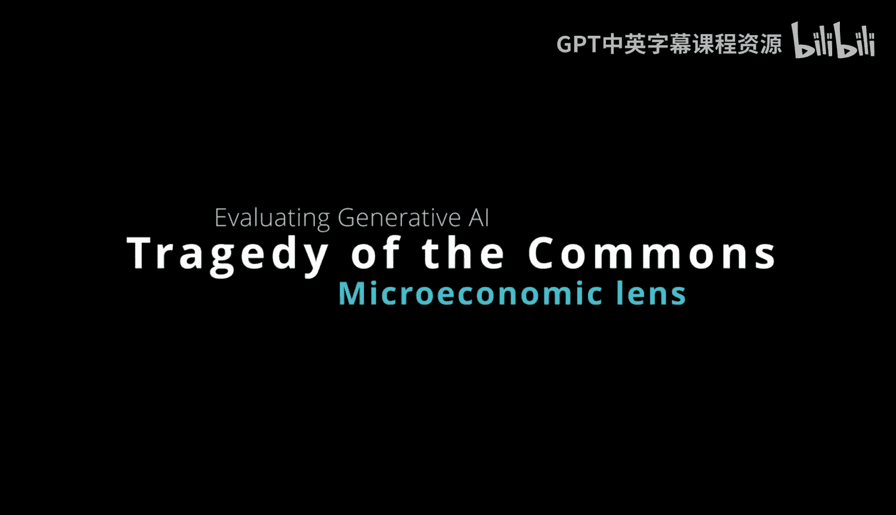
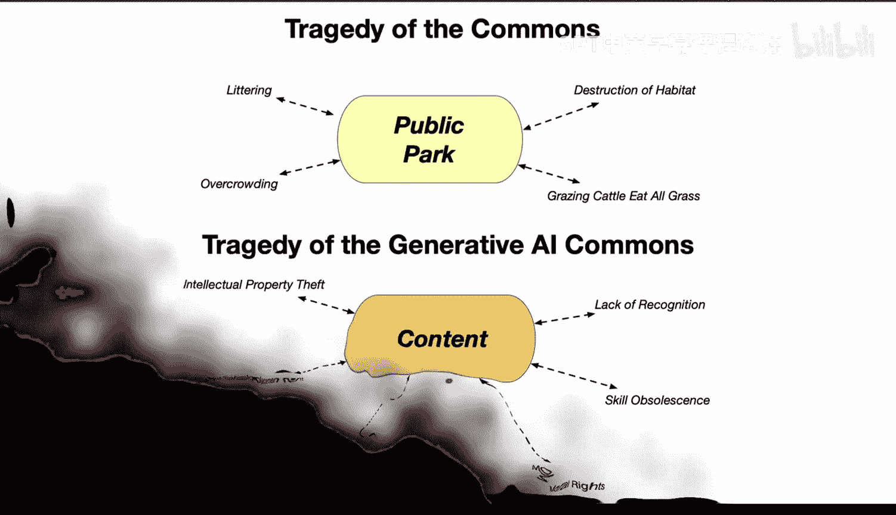

# 本地大语言模型的基础：第36讲：生成式AI的公共资源悲剧 🎭

在本节课中，我们将探讨一个经典的经济学概念——“公共资源悲剧”，并分析其在生成式人工智能（AI）领域的体现。我们将理解当一项资源被无限制地共享时可能出现的问题，并审视生成式AI技术带来的伦理挑战。

---

公共资源悲剧是一个经典案例，它描述了当一项免费资源被几乎无限数量的人共享时可能发生的状况。由于缺乏监管，多种负面情况可能出现。

以下是公共资源悲剧的几个典型例子：

*   **乱扔垃圾**：以公共公园为例，人们可能到处乱扔垃圾，仅此一项就足以破坏公园环境。
*   **过度拥挤**：如果没有管理，大量人群持续涌入，最终公园会拥挤到无法游览。
*   **栖息地破坏**：例如在国家公园，如果游客破坏自然景观或山体等特征，公园将不再像以前那样美丽。
*   **过度放牧**：经典的例子是多个牧场主在同一片公共草地上放牧。他们会竞相让自家牲畜吃最多的草，因为他们担心别人会更快地消耗掉草资源。这演变成一场“竞次”比赛，最终导致草地被完全破坏，寸草不生。

这就是公共资源悲剧的经典情形。事实上，根据各地的监管情况不同，你可以在世界范围内（包括美国）的某些公共公园看到这种现象。

上一节我们了解了公共资源悲剧的一般概念，本节中我们来看看生成式AI领域的“公共资源悲剧”。生成式AI的公共资源悲剧具有一些相似的特征。

以下是生成式AI可能引发的几类具体问题：

*   **知识产权盗窃**：生成式AI模型可能在未经同意的情况下，使用受版权保护的作品进行训练。这会贬低原作品的价值，甚至削弱创作者创作新内容的动力。如果作品会被盗用，为何还要创作更多？
*   **工作替代**：生成式AI存在风险，可能导致人类创作者的需求下降，进而引发工作被替代。这会带来负外部性。如果这些人无法再获得工作，社会将不得不承担这种工作替代带来的负担。
*   **质量控制**：生成式AI输出的作品质量可能不佳，但却在模仿某位艺术家，这可能导致艺术家本人被贬低，并引发整体的质量控制问题。
*   **缺乏认可或归属**：创作者的作品可能在被盗用且未获补偿的同时，其原创者的身份也得不到认可。这会打击创作积极性，有失公平，并可能严重影响艺术家未来获得工作的机会。
*   **伦理或道德权利问题**：作者可能不希望自己的形象与吸烟、饮酒或其他不良嗜好相关联。如果未经其许可就用于生成式AI创作，便侵犯了其道德权利。

因此，对于生成式AI而言，传统的公共资源悲剧场景并非神奇地不存在，这些问题同样切实存在。我们需要同时审视其益处与负面影响。

生成式AI有显著的益处，例如**文本摘要**、**大纲生成**或**内容协同创作**。但我们也必须关注其负外部性——那些社会并未从中受益却需承担成本的影响。

这类似于公园里的乱扔垃圾、过度拥挤或破坏行为：你需要为他人滥用公共资源的行为付出代价。如果是一个商业模型获利，社会并未拿到那份报酬，却必须支付成本。

---

本节课中，我们一起学习了“公共资源悲剧”的概念及其在生成式AI伦理中的体现。我们认识到，在思考生成式AI的伦理时，考虑其可能引发的公共资源悲剧至关重要。这要求我们在享受技术红利的同时，也必须审视并设法缓解其对社会和个体创作者带来的潜在风险与不公。