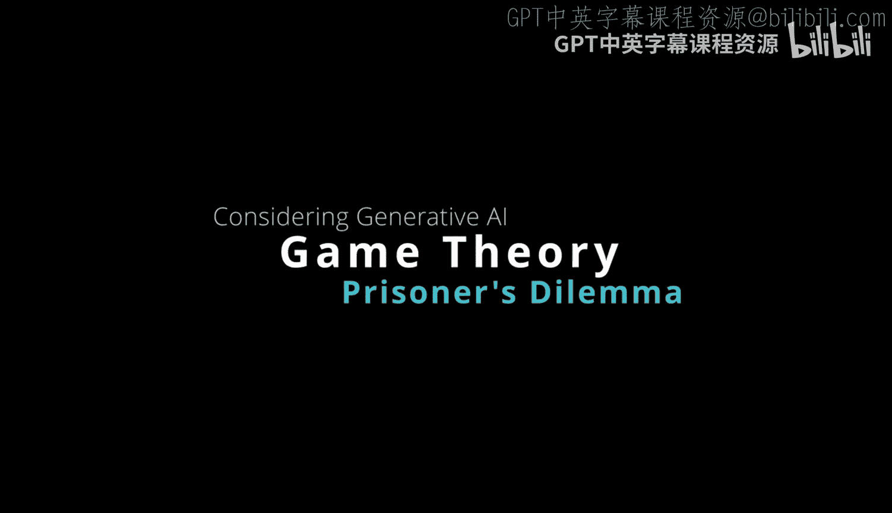
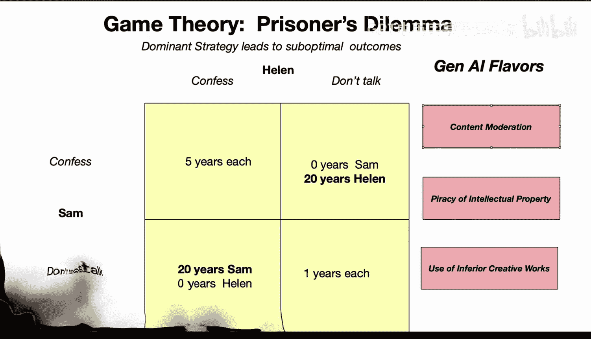

# 本地大语言模型的基础：第37讲：生成式AI的博弈论视角 🎲

在本节课中，我们将学习博弈论这一数学框架，并探讨它如何帮助我们理解生成式人工智能（AI）发展中的潜在风险与策略选择。我们将通过经典的“囚徒困境”模型，来分析在缺乏合作与长远规划的情况下，个体理性决策如何可能导致整体利益受损的“逐底竞争”。

## 博弈论简介

上一节我们介绍了生成式AI的宏观影响，本节中我们来看看一个分析互动决策的强大工具——博弈论。

博弈论是一个数学框架，用于研究多方互动。它将互动视为一场“游戏”，其中包含**参与者**、**策略**和**收益**，旨在找出最优策略，或分析在特定情境下（如囚徒困境）导致次优结果的**占优策略**。

## 经典案例：囚徒困境

为了理解博弈论的核心思想，我们先来看一个经典问题。

囚徒困境是博弈论中的一个经典问题。在这个情境中，自私的占优策略将导致对所有人而言的次优结果。假设你是一名检察官，你逮捕了涉嫌犯罪的Sam和Helen，但缺乏给两人定罪的证据。

从他们身上获取所需信息的唯一方法，是设法让他们互相背叛。我们来看这个收益矩阵：如果两人都保持沉默（不招供），每人只会被判1年监禁。但如果你分别提审他们并说：“如果你招供，你将获得自由，无需坐牢。”

“但如果我们带来的另一个人不招供，那个人将入狱20年。”

你这是在激励每个人都选择招供。而当你们都招供时，你们每人将获得5年刑期。如果一人沉默而另一人招供，沉默者的惩罚将非常严重，以至于保持沉默变得毫无意义。因此，即使他们能够沟通时的最优策略是每人只坐1年牢。

但这两个人互不信任。结果，你成功地让他们采取了这种次优的占优策略，即两人都招供，并且坐牢的时间比合作情况下长了五倍。

## 生成式AI中的博弈论应用

理解了囚徒困境，我们可以将这种博弈论视角同样应用于生成式AI领域。

这是一个很好的例子：假设我们进入了一个所有内容审核都由某个AI系统完成的世界。我们会发现，确保你的内容具有吸引力的激励非常强烈。

如果你的内容缺乏足够的参与度，你的公司就会亏损。因此，尽管平台上出现了大量低质量的生成式AI内容，你实际上会减少审核力度，因为这会影响你公司的利润底线。一旦你的竞争对手意识到他们也开始亏损。

你们双方都会继续调整各自的内容审核策略。

导致审核标准越来越宽松，最终你们的平台可能变成一个完全由生成式AI内容充斥的平台，这些内容质量可能非常低劣，甚至包含有害信息。我们可以称此为“逐底竞争”。同样，在生成式AI领域，你可能会陷入这样一种假设：假设某个竞争对手、其他国家或政府会窃取知识产权。

因此，你觉得你也必须窃取相同的知识产权。结果就是，大家都不再尊重知识产权，所有人都开始盗用，最终导致知识产权概念不复存在。这同样可能是一种“逐底竞争”，因为你预判了对方会做坏事。

另一个与囚徒困境对应的情况是使用劣质创意作品。

如果你觉得你的竞争对手可能会开始使用通过某些提示词生成的劣质AI作品，那么你也会做同样的事情。最终，你们双方开始生产越来越差的艺术品，直到最后。

你们生产的所有艺术品质量都很差。于是所有人都输了。顾客输了。当然，创作艺术的人也不再被雇佣。

那么，我们就再也看不到真正优秀的艺术品了。由此可见。

如果你只从试图采取占优策略的角度思考问题，并且不进行迭代思考。

只考虑单次博弈，你可能会选择一种导致游戏中所有参与者都获得次优结果的占优策略。

## 总结与启示

本节课中，我们一起学习了博弈论的基本概念及其在生成式AI领域的应用。通过囚徒困境模型，我们看到了个体理性决策如何可能引发损害整体利益的“逐底竞争”，例如在内容审核放松、知识产权侵犯和艺术品质量下降等场景中。

因此，在考虑像生成式AI这样的新技术时，这是一个非常重要的问题：我们需要思考其潜在影响，以及如何创建一种迭代的合作策略，以避免陷入“逐底竞争”的困境？