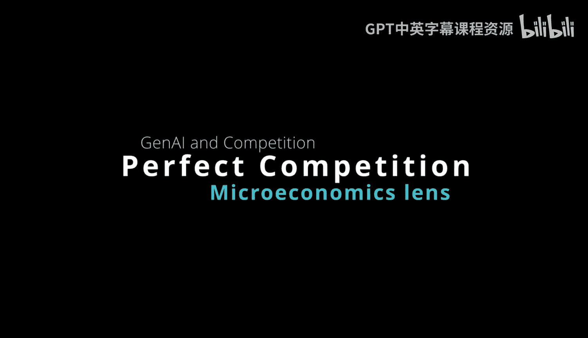
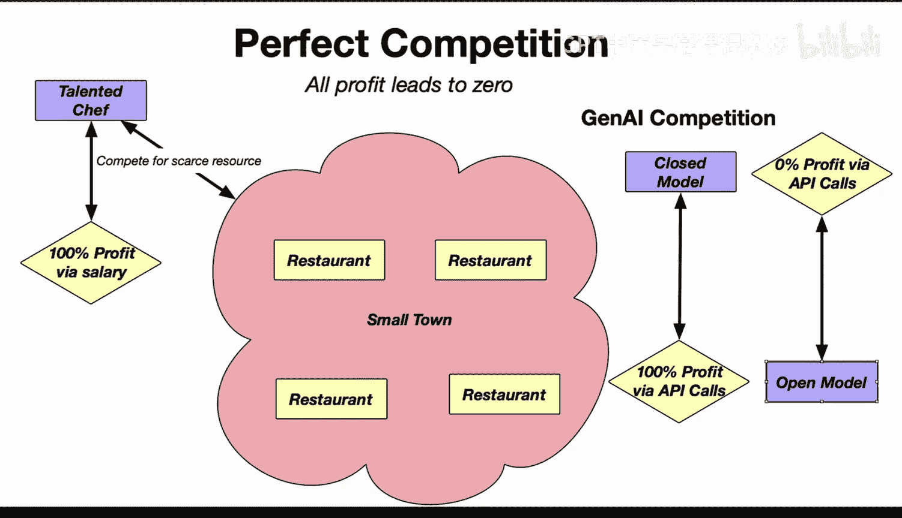
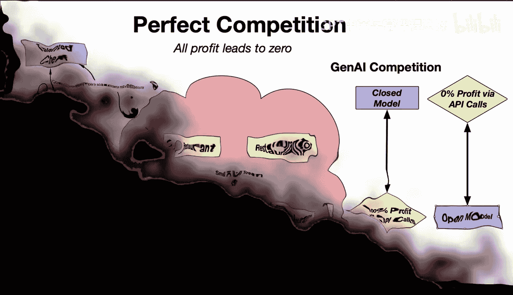

# 本地大语言模型的基础：38：完全竞争

## 概述
在本节课中，我们将要学习经济学中的“完全竞争”概念，并探讨其在人工智能领域，特别是大语言模型市场中的潜在应用与启示。我们将通过一个餐馆竞争厨师的例子来理解核心原理，并分析在封闭模型和开放模型两种不同情境下，AI公司可能面临的商业挑战。

## 完全竞争的核心含义
在完全竞争的市场中，所有经济利润最终会趋向于零。这意味着，任何超出正常水平的利润都会被竞争所消除。

为了理解这一点，我们可以观察一个小镇餐馆的例子。

## 案例分析：小镇餐馆与天才厨师
假设一个小镇上有四家餐馆。起初，它们之间没有显著的竞争差异，直到一位天才厨师来到镇上。

由于这位厨师才华横溢，能为餐馆吸引所有顾客，因此他成为了一种稀缺资源。以下是接下来发生的情况：

1.  所有餐馆都开始竞相争夺这位厨师的服务。
2.  它们通过不断提高薪资报价来相互竞争。
3.  最终，厨师通过谈判获得了极高的薪水，从而攫取了餐馆的全部经济利润。

在这个例子中，厨师因其稀有且备受需求的技能，捕获了所有的经济剩余。

## 关键概念解析
我们需要明确几个利润相关的概念：

*   **经济利润**：指总收入减去总经济成本后的剩余。
*   **正常利润**：指吸引投资所需的最低回报，可被视为成本的一部分。
*   **超额利润**：即经济利润，是高于正常利润的部分。

用公式表示即：
**经济利润 = 总收入 - (显性成本 + 隐性成本(含正常利润))**

在完全竞争下，这种超额利润无法长期维持。

## 对商业模式的启示
上一节我们通过餐馆例子看到了稀缺资源如何捕获全部利润。本节中我们来看看，这可能导致一个严峻的商业后果：完全竞争最终可能导致企业破产。

因为实际雇佣厨师的餐馆，必须将全部利润支付给厨师，自身无法通过其他方式构建竞争壁垒。同理，我们可以在生成式人工智能领域发现类似的情况。

以下是两种可能的情景分析：

**情景一：依赖单一封闭模型**
假设存在一个性能卓越的封闭模型，所有人都必须使用它。这就如同那位天才厨师。

*   所有公司都使用同一个封闭模型，无法借此获得竞争优势。
*   这些公司的大部分利润，将通过API调用费的形式，流向模型提供方，正如利润流向厨师一样。

**情景二：模型完全开源**
如果所有模型都是开源的，情况则会走向另一个极端。

*   由于可以平等地使用任何模型，模型本身无法产生差异化。
*   训练模型的公司将难以盈利，最终可能退出市场，因为无法通过模型本身赚钱。

## 战略思考
这是一种假设性情境，但当你评估自身AI战略时，从经济学角度思考这个问题至关重要。

你需要权衡：全力投入封闭模型是否会带来持久的竞争优势？还是说，在未来模型数量近乎无限的情况下，模型本身会像Linux一样，成为一种免费的通用商品？如果答案是后者，那么竞争将不得不转向其他技术形式或商业模式。

## 总结
本节课中我们一起学习了完全竞争的经济学原理。我们看到，当关键资源（如天才厨师或顶级AI模型）稀缺且成为竞争焦点时，它可能吸走产业链中的大部分利润。这对AI公司的启示是：必须认真思考其战略是建立在拥有稀缺资源上，还是准备在资源商品化后，在其他维度构建自己的核心竞争力。