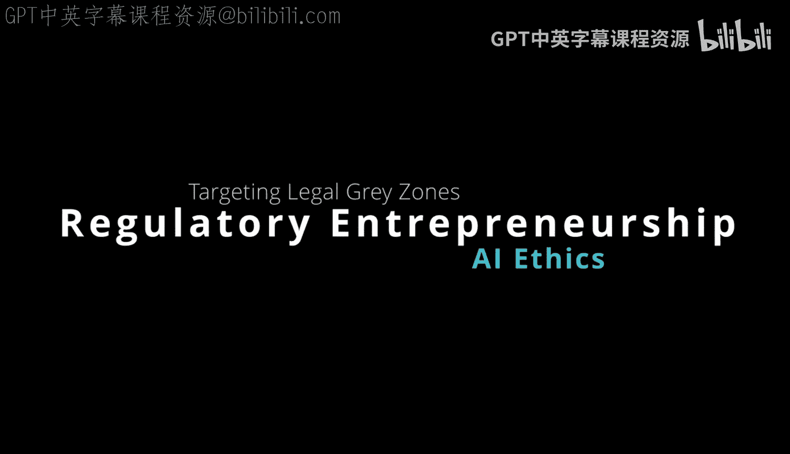
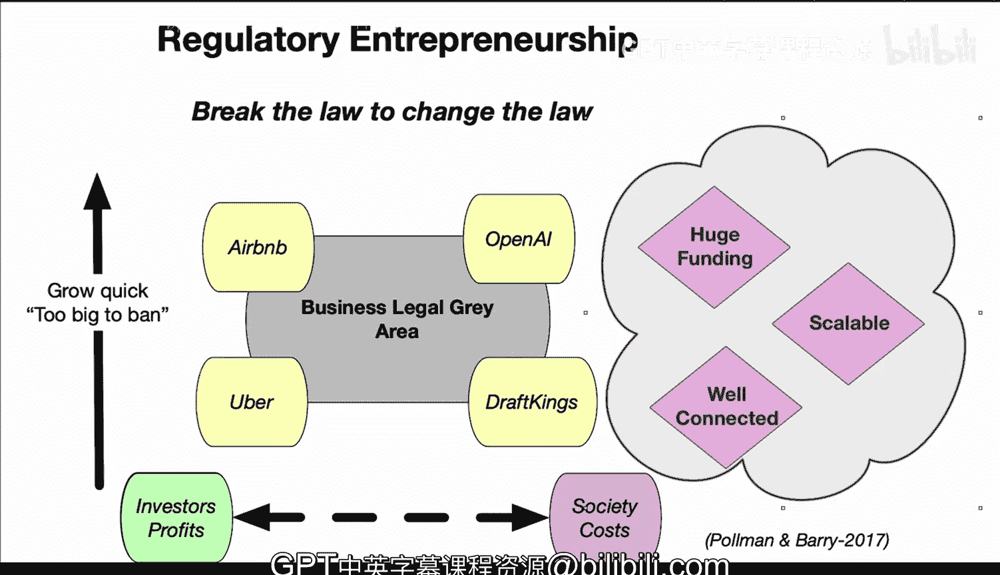

# 本地大语言模型的基础：40：监管创业

## 概述
在本节课中，我们将要学习“监管创业”这一概念。我们将了解其定义、核心策略、促成因素、社会影响，并通过具体案例来分析这一现象在现实世界中的表现。

## 什么是监管创业？
监管创业是由Paulllman和Barry在2017年提出的一个术语。其核心含义是：通过**在法律灰色地带创立公司，甚至不惜违反现有法律**，来推动后续法律的改变。

上一节我们介绍了监管创业的基本定义，本节中我们来看看涉及这一模式的一些知名公司。

## 典型案例
以下是几个典型的监管创业公司案例：
*   **Airbnb**：模糊了酒店与个人短租的界限。
*   **Uber**：改变了出租车与私人交通服务的法规。
*   **Tesla**：在汽车直销等领域挑战传统法规。
*   **DraftKings**：推动了在线体育博彩的合法化。

这些公司的共同点是，它们都游走于商业创新与改变法律法规的边界。

## 核心策略与促成因素
那么，这些公司是如何运作的呢？以下是它们常用的一些关键策略：
*   **识别法律灰色地带**：寻找法规尚未明确或存在漏洞的领域进入。
*   **快速扩张**：迅速扩大规模，使得政府难以简单禁止，即形成“**太大而不能禁**”的局面。
*   **动员用户获取政治支持**：利用社交媒体等渠道，让公众支持其产品，形成舆论压力。

这些策略的成功，依赖于一些特定的促成因素：
*   **资金充足**：获得大量风险投资支持。
*   **模式可扩展**：业务能够快速复制和增长。
*   **公众吸引力**：提供的服务深受大众欢迎。
*   **瞄准地方法规**：相较于国家法律，挑战州或地方性法规的难度更低。
*   **诉讼政治化**：将法律争议转化为公众政治议题。

## 社会影响与外部性
监管创业模式带来了深远的社会影响。其直接结果是降低了这些公司进入市场的合规成本，并可能促使政策快速变更。然而，这些变更有时可能偏离公共利益，产生需要由社会承担的“负外部性”。

接下来，让我们通过具体案例来剖析这些负外部性。

以下是Airbnb、Uber、DraftKings和OpenAI四家公司带来的社会收益与成本分析：

*   **Airbnb**
    *   **收益**：公司获得巨额利润和估值，为创始人和投资者带来回报。
    *   **社会成本**：全球范围内可负担的租赁住房单元减少，社会需承担此损失。

*   **Uber**
    *   **收益**：公司获得高估值，风险投资者得以退出获利。
    *   **社会成本**：以旧金山为例，交通拥堵和尾气排放增加。这不仅加剧全球变暖，当地居民也需承受污染和拥堵的代价，且无人为此获得补偿。

*   **DraftKings**
    *   **收益**：创造了一个价值数十亿美元的梦幻体育产业。
    *   **社会成本**：导致更多人赌博成瘾、个人破产增加。例如，若有人将钱用于赌博而无力支付房贷，其家庭可能流离失所，这个代价最终由社会承担。

*   **OpenAI / 生成式AI**
    *   **收益**：推动了生成式AI的技术进步，并创造了商业利润。
    *   **社会成本**：AI可能被用于破坏性用途；艺术家们的版权作品在未经明确许可下被用于模型训练，其权益受到侵害。使用受版权保护的数据进行训练的成本，也是一种社会需要承担的损失。

## 总结
本节课中，我们一起学习了“监管创业”的概念。我们看到，这并非全新现象，而是风险投资中一个长期存在的模式。其典型路径是：快速成长至规模巨大、需求庞大、资金雄厚，并由能游说国会的人士推动。关于未来监管会更多还是更少，目前尚无定论，但这种“先突破，后改变规则”的模式值得我们持续关注和思考。