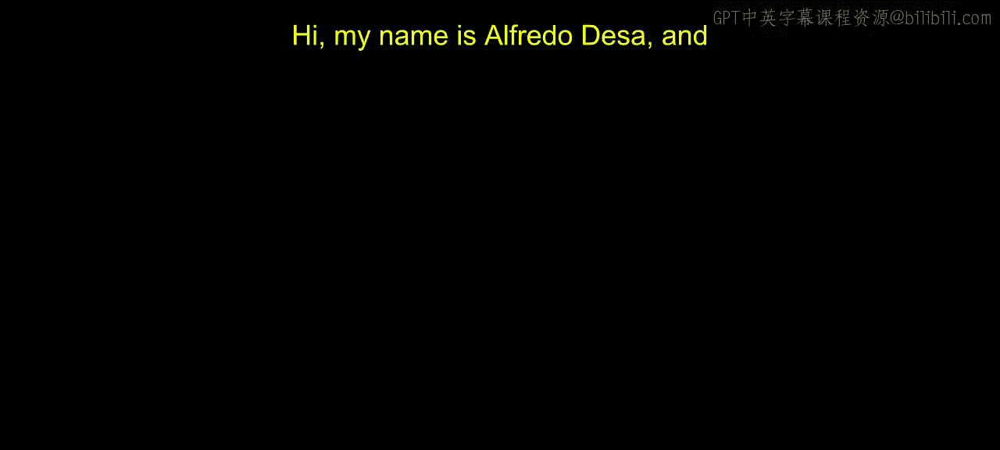

# 1：0_与您的导师 Alfredo Deza 会面

## 概述

在本节课中，我们将初步了解开源大型语言模型，并认识本课程的导师。我们将概述课程的核心内容，包括如何与模型交互、如何寻找模型，以及通过不同技术栈进行实践。

大家好，我是 Alfredo Deza。在本课程中，我们将深入探讨开源模型。

我们将学习如何与它们交互，以及如何寻找它们。

我们会介绍您可能希望与之交互的各种开源模型类型。我们将探讨多种使用场景，例如在浏览器中使用模型。

我们将使用 JavaScript，我认为这非常不可思议。同时，我们也会使用 Python 库。

Python 库的使用也非常普遍。此外，我们还会涉及 Rust。我们将看到 Python 和 Rust 之间的一些差异，以及您为何会选择其中之一。但课程的重点是让一切变得易于访问、简单明了。在某些情况下，我们会使用开箱即用、可直接运行的本地模型。

我们将构建有趣的项目。您将能够通过动手实验和非常实用的示例来应用这些概念。

这样，您就可以实际动手尝试我们在整个课程中将探讨的概念。我拥有多年教授机器学习和 Python 的经验。过去，我曾是一名软件工程师和系统管理员。我认为，我在演示这些示例、介绍代码仓库以及所有课程内容时采用的方法，能让您在整个学习过程中，通过非常实用、直接的例子，获得一些类似的经验。

希望您能很好地理解如何与开源模型协作，并将其应用到您自己的项目和想法中。

## 总结

本节课中，我们一起认识了课程导师 Alfredo Deza，并了解了本课程将涵盖的核心主题：探索开源大型语言模型、学习通过不同工具（如浏览器、Python 和 Rust）与模型交互，并通过实践项目巩固所学知识。课程旨在提供简单易懂、动手实践的体验。