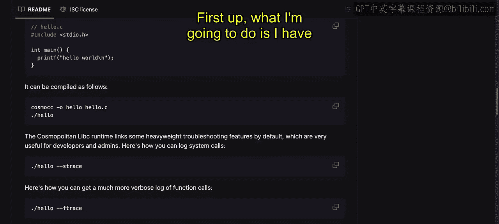
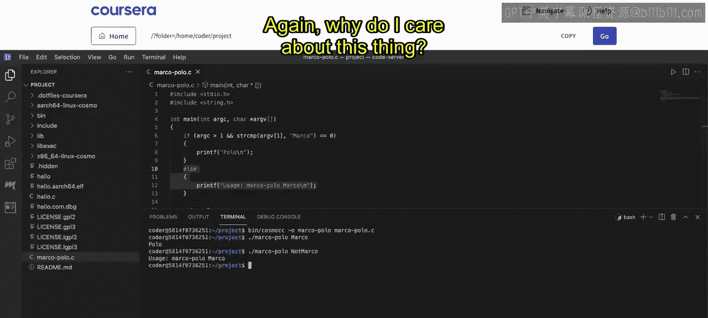
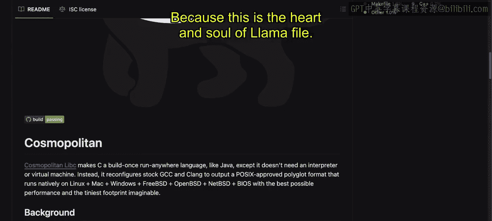
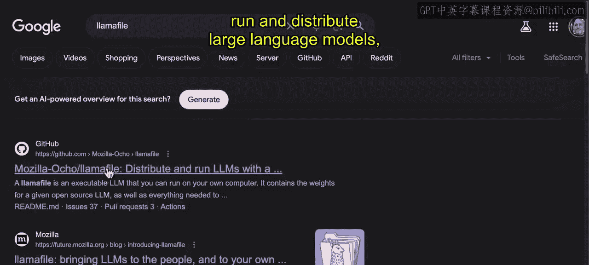
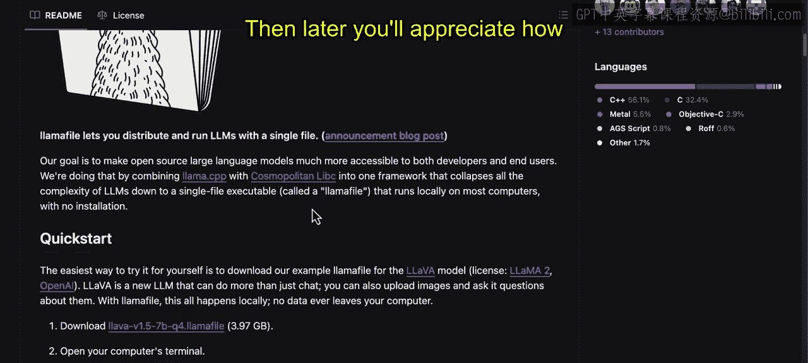

# 5：使用Cosmopolitan构建便携式二进制文件


## 概述
在本节课中，我们将要学习Cosmopolitan库的核心概念。这个库是Llamafile项目的基础，它使得大型语言模型能够被打包成单一、可移植的二进制文件，实现“一次构建，随处运行”。我们将通过编写和编译简单的C语言程序来理解其工作原理。

## Cosmopolitan库简介
Cosmopolitan是一个C语言库，它使得用C编写的程序能够像Java一样，实现“一次构建，随处运行”。这是Llamafile能够成为便携式大型语言模型的核心技术。

## 准备工作
要开始使用Cosmopolitan，首先需要下载并解压其发布版本。解压后，你会找到一个名为`cosmocc`的编译器，我们将使用它来编译我们的程序。



## 第一个示例：Hello World
让我们从一个简单的“Hello World”程序开始，了解基本的编译和运行流程。

以下是创建一个“Hello World”程序的步骤：

1.  创建一个名为`hello.c`的C语言源文件。
2.  在文件中写入以下代码：
    ```c
    #include <stdio.h>

    int main() {
        printf("Hello World\n");
        return 0;
    }
    ```
3.  使用Cosmopolitan编译器进行编译。命令格式为：
    ```bash
    ./bin/cosmocc -o hello hello.c
    ```
    这条命令会生成一个名为`hello`的便携式二进制文件。
4.  运行生成的二进制文件：
    ```bash
    ./hello
    ```
    你将在终端看到输出：“Hello World”。

通过这个简单的例子，我们看到了使用Cosmopolitan构建和运行一个基础程序是多么直接。

## 进阶示例：Marco Polo程序
上一节我们介绍了如何编译一个基础程序，本节中我们来看看一个稍微复杂一点的例子，它包含一些简单的逻辑判断。

我们将创建一个名为`marco_polo.c`的程序，它根据输入参数做出不同响应。

以下是创建“Marco Polo”程序的步骤：

1.  创建一个名为`marco_polo.c`的C语言源文件。
2.  在文件中写入以下代码：
    ```c
    #include <stdio.h>
    #include <string.h>

    int main(int argc, char *argv[]) {
        if (argc == 2 && strcmp(argv[1], "Marco") == 0) {
            printf("Polo\n");
        } else {
            printf("Usage: %s Marco\n", argv[0]);
        }
        return 0;
    }
    ```
    这段代码检查用户是否输入了参数“Marco”。如果是，则回复“Polo”；否则，显示用法说明。
3.  使用Cosmopolitan编译器编译该程序：
    ```bash
    ./bin/cosmocc -o marco_polo marco_polo.c
    ```
4.  运行程序并测试不同情况：
    *   输入正确参数：
        ```bash
        ./marco_polo Marco
        ```
        输出应为：“Polo”。
    *   输入错误或没有参数：
        ```bash
        ./marco_polo
        ```
        输出应为用法提示，例如：“Usage: ./marco_polo Marco”。

这个例子展示了如何构建一个包含条件逻辑的便携式程序。



## Cosmopolitan与Llamafile的关系
我们之所以要深入了解Cosmopolitan，是因为它是Llamafile项目的核心与灵魂。



Llamafile是一个让你能够运行和分发大型语言模型的工具。Cosmopolitan库是其实现跨平台便携性的关键组件。有时，深入底层原理，亲自体验其核心库的工作方式，并围绕它构建一些东西，能让你在未来更深刻地体会到Llamafile设计的优雅之处。





## 总结
本节课中我们一起学习了Cosmopolitan库的基本用法。我们通过创建“Hello World”和“Marco Polo”两个C语言程序，实践了如何使用`cosmocc`编译器将它们构建成可在不同系统上运行的单一二进制文件。理解这个基础库是掌握Llamafile如何实现大型语言模型便携化的第一步。