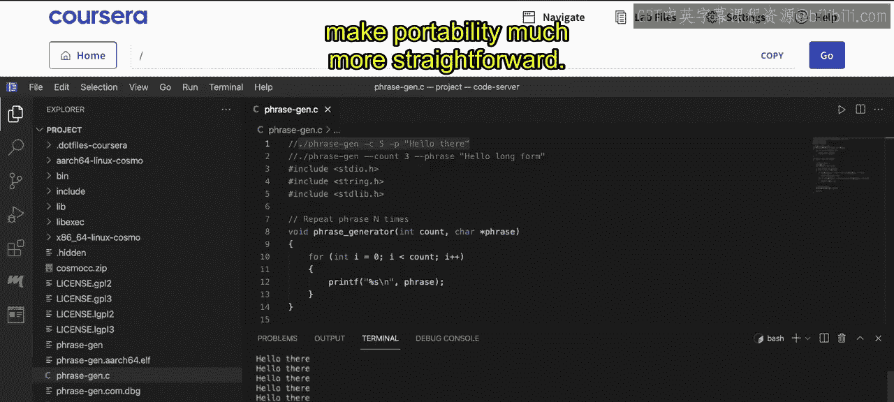

# 6：使用 Cosmopolitan 构建短语生成器 🛠️


在本节课中，我们将学习如何使用 Cosmopolitan 可移植二进制框架来构建一个简单的、跨平台的短语生成器命令行工具。我们将了解其基本结构、编译过程以及跨平台部署的优势。

---

## 概述

Cosmopolitan 框架能帮助开发者构建可在多种操作系统（如 Windows、Linux、macOS）上运行的单一可执行文件，无需修改代码或重新编译。本节我们将利用它创建一个简单的短语生成器工具，作为理解其工作原理的入门示例。

上一节我们介绍了 Cosmopolitan 框架的基本概念，本节中我们来看看如何用它构建一个具体的工具。

## 代码结构与解析

首先，我们来看一下构建这个工具所需的 C 语言源代码。代码主要包含标准库头文件的引入、一个重复生成短语的函数以及解析命令行参数的主逻辑。

```c
#include <stdio.h>
#include <string.h>
#include <stdlib.h>
```

以下是核心函数，它负责将指定短语重复输出指定的次数。

```c
void repeat_phrase(int count, const char* phrase) {
    for (int i = 0; i < count; i++) {
        printf("%s\n", phrase);
    }
}
```

程序的主函数 `main` 负责处理命令行参数。它检查用户是否通过 `-c` 或 `--count` 参数指定了重复次数，以及通过 `-p` 或 `--phrase` 参数指定了要重复的短语。

```c
int main(int argc, char* argv[]) {
    int count = 1; // 默认重复次数
    char* phrase = "Hello, World!"; // 默认短语

    // 解析命令行参数
    for (int i = 1; i < argc; i++) {
        if (strcmp(argv[i], "-c") == 0 || strcmp(argv[i], "--count") == 0) {
            if (i + 1 < argc) {
                count = atoi(argv[i + 1]); // 将字符串转换为整数
                i++; // 跳过下一个参数（数值部分）
            }
        } else if (strcmp(argv[i], "-p") == 0 || strcmp(argv[i], "--phrase") == 0) {
            if (i + 1 < argc) {
                phrase = argv[i + 1];
                i++; // 跳过下一个参数（短语部分）
            }
        }
    }

    // 调用函数生成短语
    repeat_phrase(count, phrase);
    return 0;
}
```

## 编译与构建

由于 Cosmopolitan 框架自带编译器，我们使用其提供的 `cosmocc` 命令进行编译。这个命令会生成一个单一的可移植二进制文件。

编译命令如下：
```bash
bin/cosmocc -o phrase_generator phrase_gen.c
```
执行此命令后，会生成名为 `phrase_generator` 的可执行文件。这个文件包含了程序运行所需的所有依赖，因此可以直接分发到不同平台运行。

## 运行示例

生成可执行文件后，我们可以通过命令行来使用它。以下是几个运行示例：

以下是该工具支持的命令行参数示例：
*   `./phrase_generator`：使用默认参数（重复1次“Hello, World!”）运行。
*   `./phrase_generator -c 5`：将默认短语重复输出5次。
*   `./phrase_generator -p "Cosmopolitan is cool!"`：将指定短语重复输出默认的1次。
*   `./phrase_generator --count 3 --phrase "Test Phrase"`：使用长参数名，将“Test Phrase”重复输出3次。

## 跨平台优势与应用场景

短语生成器虽然简单，但它清晰地展示了 Cosmopolitan 框架的核心价值：**一次构建，处处运行**。你只需要在一种系统上编译一次，生成的可执行文件就能在 Windows、Linux、macOS 等多种系统上直接运行，无需为每个平台单独编译。

这种特性对于需要广泛部署的工具尤其有用，例如：
*   静态网站生成器
*   系统管理脚本或工具
*   **大型语言模型（LLM）推理工具**：这也正是 Llamafile 项目选择 Cosmopolitan 框架的原因，它极大地简化了在不同操作系统上分发和运行 LLM 应用的复杂性。

---

## 总结



本节课中我们一起学习了如何使用 Cosmopolitan 可移植二进制框架构建一个跨平台的短语生成器命令行工具。我们分析了其代码结构，演示了如何使用 `cosmocc` 编译器进行构建，并展示了其强大的跨平台运行能力。理解这个简单示例是掌握如何利用 Cosmopolitan 框架为更复杂的应用（如本地大型语言模型工具）构建可移植分发包的重要第一步。