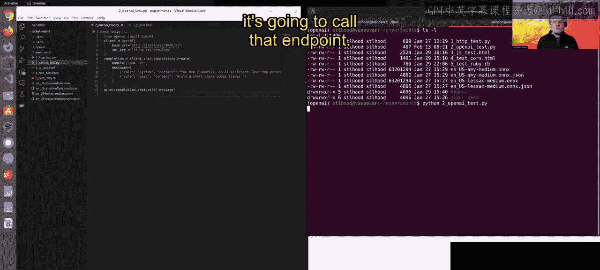
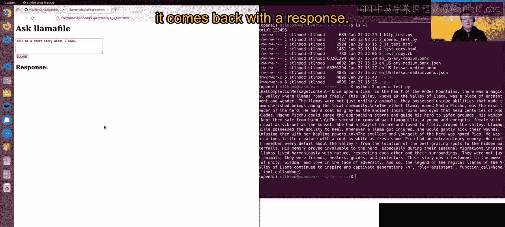

# Llamafile教程：P3：使用Llamafile API 🚀


在本节课中，我们将学习Llamafile的服务器模式及其提供的OpenAI兼容API。你将了解如何利用此功能，将原本为OpenAI编写的代码无缝切换到本地运行的Llamafile模型上。

## 服务器模式概述

当你启动任何一个Llamafile时，默认情况下它也会在后台启动一个服务器。这个服务器提供了一个与OpenAI兼容的API端点。这意味着，它模仿了OpenAI API的签名，用于文本补全和其他功能，但背后调用的并非OpenAI的服务，而是运行在你本地机器上的Llamafile模型。

## API兼容性的意义

这种设计的核心意义在于，你可以直接使用那些为OpenAI编写的代码，只需稍作修改，就能让它与Llamafile协同工作。这使你能够从一个商业化的集中式服务（如OpenAI）轻松切换到一个由你掌控的开源、免费可用的系统。

你可以选择在本地机器上运行，也可以将Llamafile容器化并在服务器上部署。这两种方式都很常见。

## 实践示例：Python调用

上一节我们介绍了Llamafile API的基本概念，本节中我们来看看具体的代码实现。

以下是一个非常简单的Python代码示例，它使用了`openai`这个Python库。

```python
import openai

# 关键步骤：将API的基础URL指向本地运行的Llamafile服务器
openai.api_base = "http://localhost:8080/v1"
openai.api_key = "not-needed"  # 本地运行通常不需要API密钥

# 构建请求
completion = openai.ChatCompletion.create(
    model="local-model",  # 模型名称可任意指定，Llamafile会忽略
    messages=[
        {"role": "system", "content": "你是一个有帮助的助手。"},
        {"role": "user", "content": "请给我讲一个关于大语言模型（LLM）的短故事。"}
    ]
)

# 输出结果
print(completion.choices[0].message.content)
```

在这段代码中，我们仅仅修改了`openai.api_base`，将其指向本地主机（`localhost`）上运行的Llamafile服务器实例（例如运行着Mistral 7B模型）。当执行这段代码时，它会调用本地的API端点，并返回模型生成的关于大语言模型的短故事。

## 实践示例：JavaScript调用

除了Python，你也可以使用JavaScript通过HTTP请求直接与这个API交互。



以下是一个简单的HTML/JavaScript示例，它不依赖任何外部库，直接使用`fetch` API。

```html
<!DOCTYPE html>
<html>
<body>
    <script>
        async function askLlamafile() {
            const response = await fetch('http://localhost:8080/v1/chat/completions', {
                method: 'POST',
                headers: {
                    'Content-Type': 'application/json',
                },
                body: JSON.stringify({
                    model: 'local-model',
                    messages: [
                        {role: 'user', content: '请给我讲一个关于大语言模型（LLM）的短故事。'}
                    ]
                })
            });

            const data = await response.json();
            // 将原始响应内容输出到控制台
            console.log(data.choices[0].message.content);
        }
        // 调用函数
        askLlamafile();
    </script>
</body>
</html>
```



这段代码会在浏览器中运行，通过JavaScript向本地的Llamafile服务器发送请求，并将返回的原始故事内容打印到浏览器的开发者控制台中。

## 纯服务器模式

目前，Llamafile已经支持此功能。当你创建自己的Llamafile时，可以将其配置为**仅运行在服务器模式**。这意味着它不会启动任何Web用户界面，纯粹作为一个API服务器运行。如果你的使用场景只需要API接口，这可以进一步优化资源占用。

我们非常希望开发者能享受使用这个过程。我们的目标是让人们能更容易地从集中式的商业服务转向开源方案，因为我们相信这将加速开源领域所有我们希望看到的进步。

## 总结

本节课中我们一起学习了Llamafile的OpenAI兼容API功能。我们了解了其服务器模式的工作原理，并通过Python和JavaScript的实例，掌握了如何修改现有代码或编写新代码来调用本地运行的Llamafile模型。利用此功能，你可以灵活、安全地在本地部署和控制大语言模型的应用。