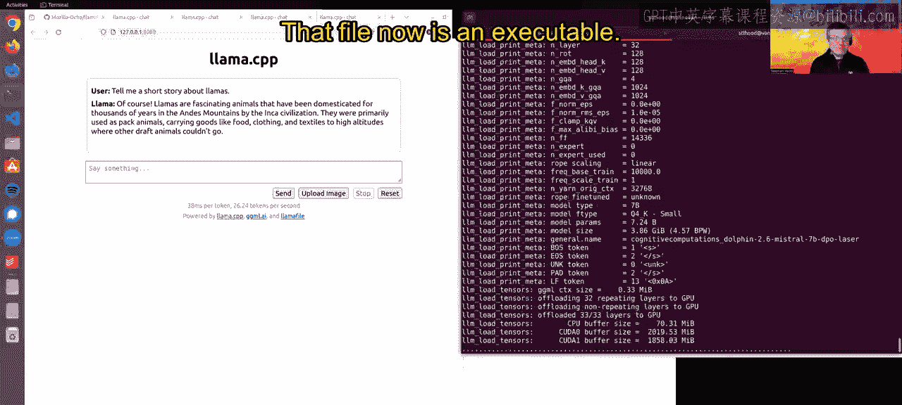

# Llamafile入门：P4：3_创建Llamafile


在本节课中，我们将学习如何获取、运行以及创建自己的Llamafile，体验在本地计算机上运行大型语言模型的过程。我们将从下载预构建的Llamafile开始，演示其运行效果，并最终学习如何将模型权重文件转换为可执行的Llamafile。

## 获取与运行预构建的Llamafile 🚀

要开始使用Llamafile，最简单的方法是获取我们预先创建好的示例文件。

访问Llamafile的官方网站或在搜索引擎中查找“Llamafile”，即可找到其GitHub仓库。该仓库的README文件中提供了许多我们已创建好的Llamafile示例链接。这些文件托管在Hugging Face平台上，您也可以在那里找到更多其他模型。

以下是获取和运行Llamafile的基本步骤：

1.  **下载文件**：从提供的链接下载所需的Llamafile可执行文件。
2.  **直接运行**：在终端或命令行中，像运行普通程序一样执行该文件。

例如，我们下载了一个名为`Mistral-7B`的模型文件。这是一个近期发布的小型模型，性能出色且采用开源许可。在命令行中直接输入文件名并执行，即可启动。

```bash
./mistral-7b-model.llamafile
```

程序启动后，会自动将模型加载到内存中，并弹出一个聊天交互界面。此时，您可以与这个完全在本地运行的AI模型进行对话。它不会连接任何互联网服务，保证了100%的开源性、隐私性和用户控制权。

## 体验CPU与GPU加速模式 ⚡

上一节我们成功运行了模型，本节我们来对比一下不同硬件下的运行速度。

初始运行时，模型仅使用计算机的CPU进行计算。虽然速度可能不及云端服务，但完全可用。例如，在演示中，CPU模式下的生成速度约为**11.34 tokens/秒**。

然而，Llamafile的强大之处在于它能轻松利用GPU进行加速。通过在启动命令后添加特定的命令行参数，可以指示程序尽可能多地将模型层加载到GPU的显存中，从而利用GPU进行加速计算。

```bash
./mistral-7b-model.llamafile --n-gpu-layers 999
```

再次运行并询问相同问题后，推理性能会有显著提升。在演示中，GPU加速后的速度达到了近**120 tokens/秒**。这充分展示了GPU加速的威力。

值得一提的是，Llamafile开箱即用地支持NVIDIA和AMD显卡。在AI领域，AMD显卡通常更难配置，但Llamafile使其能够轻松工作。

## 探索多模态与轻量级模型 🌟

除了标准的文本模型，Llamafile还能运行功能更丰富的模型。

例如，`LlaVA`是一个多模态模型。这意味着它不仅能接受文本输入，还能理解图像内容。运行相应的Llamafile后，您可以上传一张图片并向模型提问，例如“这张图片里有什么？”。模型会分析图像并给出描述，展示了开源社区在多功能AI模型上的进展。

此外，对于资源受限的环境，Llamafile也能胜任。`Phi-3B`这类非常小的模型就是为此设计的。虽然它的能力不如大型模型强大，但其运行速度极快，且答案质量尚可。

最令人惊叹的是，借助Llamafile，您甚至可以在树莓派（一款约35美元的信用卡大小的计算机）上运行此类模型。这充分说明了开源AI在普及性和可及性方面取得的巨大进步。

## 创建自定义的Llamafile 🛠️

前面我们使用了现成的Llamafile，本节我们将学习如何创建自己的Llamafile。

Llamafile可以与任何`GGUF`格式的模型权重文件配合使用，这是当前开源模型权重的一种流行格式。您可以在Hugging Face上找到成千上万个不同量化级别的GGUF文件。

创建自定义Llamafile的过程非常简单，只需一条命令。假设您已经下载了一个GGUF文件（例如一个经过微调并以4位量化的Mistral模型变体），您可以通过以下命令将其转换为可执行的Llamafile：

```bash
llamafile-convert your-model-file.gguf
```

几秒钟后，它会生成一个后缀为`.llamafile`的新文件。现在，这个新文件就变成了一个可执行程序，您可以像运行之前演示的其他Llamafile一样运行它。

```bash
./your-model-file.llamafile
```

执行后，它会加载模型并打开交互界面，功能与之前使用的所有模型完全一致。这使得根据个人需求定制和运行模型变得非常容易。

## 总结 📚

本节课我们一起学习了Llamafile的完整使用流程。

我们首先介绍了如何获取和运行预构建的Llamafile，体验了在本地隐私环境下运行AI模型。接着，我们对比了CPU与GPU加速模式下的性能差异，看到了GPU带来的巨大提升。然后，我们探索了多模态模型和轻量级模型，了解了Llamafile应用场景的多样性。最后，我们掌握了将通用的GGUF模型权重文件转换为专属可执行Llamafile的方法。

总而言之，Llamafile以其简单易用、兼容性强和功能全面的特点，极大地降低了在本地设备上运行大型语言模型的门槛，是探索和实践本地AI的强大工具。



