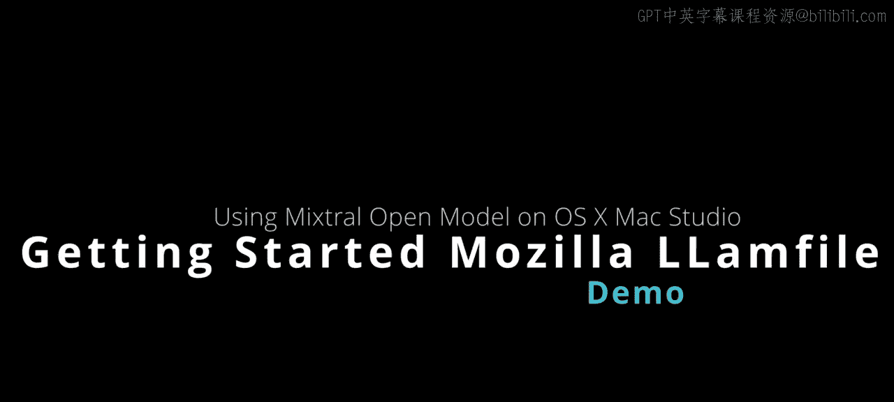
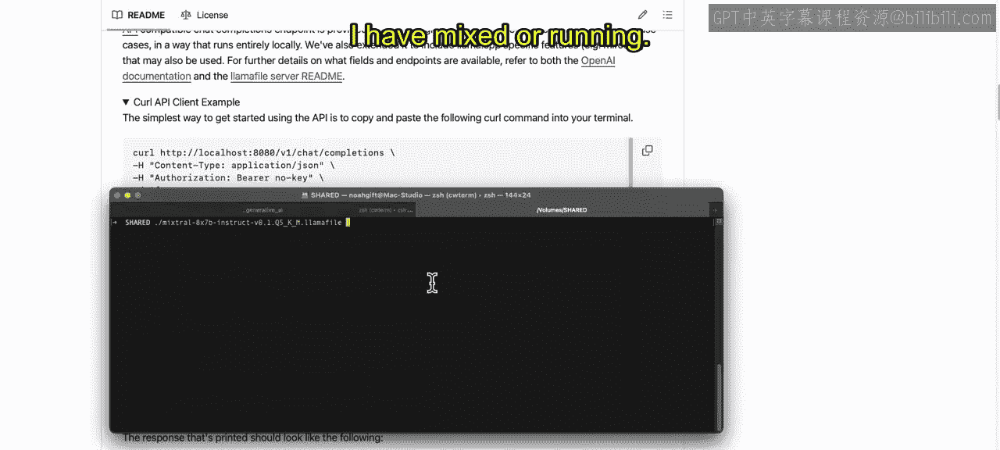
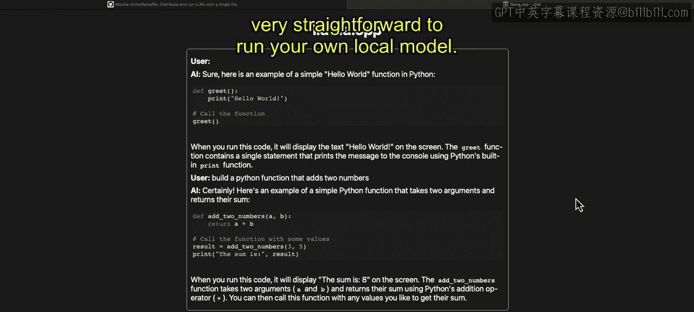
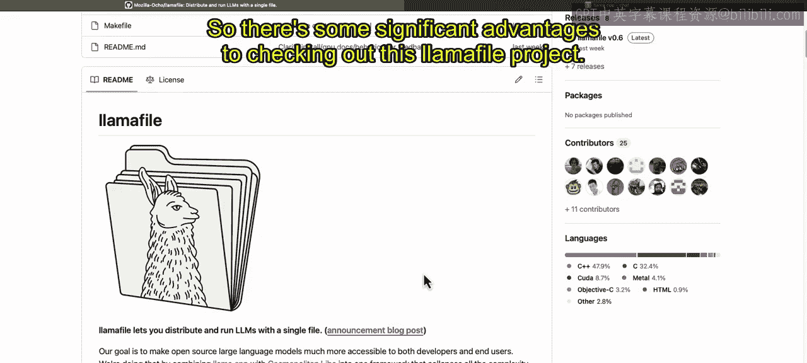

# 本地大型语言模型入门：P7：开始使用 Llamafile 🚀



在本节课中，我们将学习如何使用 Llamafile 项目在本地运行大型语言模型。Llamafile 由 Mozilla 开发，它可能是运行本地 LLM 最简单的方式。我们将了解其结构、优势，并通过一个实际例子来演示如何操作。

---

## 项目概述

Llamafile 项目允许你通过单个文件分发和运行大型语言模型。其核心在于使用了 **Cosmopolitan Libc** 库，该库能将所有依赖打包成一个名为 `llamafile` 的可执行文件。

有趣的是，尽管名字叫 Llamafile，但它并不局限于特定的 LLM。例如，你可以下载支持图像识别的 LLaVA 模型，或者性能出色的 Mixtral 模型。

---

## 核心优势

上一节我们介绍了 Llamafile 的基本概念，本节中我们来看看使用它的主要好处。

以下是使用 Llamafile 的三大核心优势：

1.  **隐私保护**：你的数据不会发送给任何第三方公司，完全在本地处理。
2.  **性能出色**：由于无需网络请求，延迟极低，响应速度通常比调用外部 API 更快。
3.  **完全免费**：利用你自己的硬件资源，无需支付 API 调用费用。

---

## 如何开始使用

了解了优势后，我们来看看具体如何操作。整个过程非常简单。

以下是开始使用 Llamafile 的步骤：

1.  **下载模型文件**：从 Llamafile 官网选择你需要的模型。例如，Mixtral 模型是一个约 30GB、采用 Apache 2 许可证的文件。
2.  **运行模型**：下载完成后，在终端中进入文件所在目录，执行命令 `./llamafile` 即可启动。
3.  **进行交互**：模型启动后，会提供一个本地交互界面（通常是一个 Web UI 或命令行），你可以直接输入问题进行对话。

此外，Llamafile 还提供了一个 **Python API**，其接口设计与 OpenAI 的 API 兼容。这意味着你可以轻松地将代码从使用商业闭源模型（如 GPT）迁移到使用这个本地开源模型上。

代码示例：使用兼容 OpenAI 的 API
```python
# 假设 Llamafile 服务运行在本地 8080 端口
import openai
openai.api_base = "http://localhost:8080/v1"
openai.api_key = "not-needed"

response = openai.ChatCompletion.create(
    model="local-model",
    messages=[{"role": "user", "content": "Hello!"}]
)
print(response.choices[0].message.content)
```

---



## 实际操作演示

让我们通过一个终端实例来看看它的实际效果。我已经提前下载好了 Mixtral 模型的 Llamafile。

启动命令非常简单：
```bash
./mixtral-8x7b-instruct-v0.1.Q5_K_M.llamafile
```

启动后，会运行一个本地的 Llama.cpp 服务。在交互界面中，我可以将对话机器人命名为 “AI”，然后向它提问。

例如，我输入：“写一个 Python 的 ‘Hello, World‘ 函数。”

模型会利用我 Mac 的 GPU 进行快速推理，并立即返回正确的代码：
```python
def hello_world():
    print("Hello, World!")

hello_world()
```

我还可以继续让它编写更多函数，比如“写一个将两个数字相加的 Python 函数”。整个过程非常流畅。



---



## 总结


本节课中，我们一起学习了 Llamafile 这个强大的工具。我们了解到，运行自己的本地大语言模型其实非常直接简单。通过 Llamafile，你不仅能保障数据隐私、获得更快的响应速度，还能节省成本。如果你对本地 AI 感兴趣，强烈建议你访问 Llamafile 项目官网，亲自尝试一下。